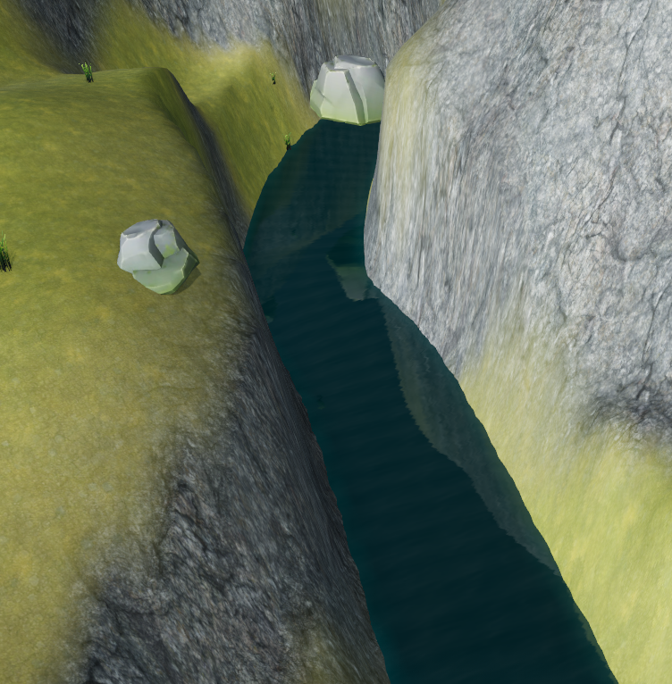
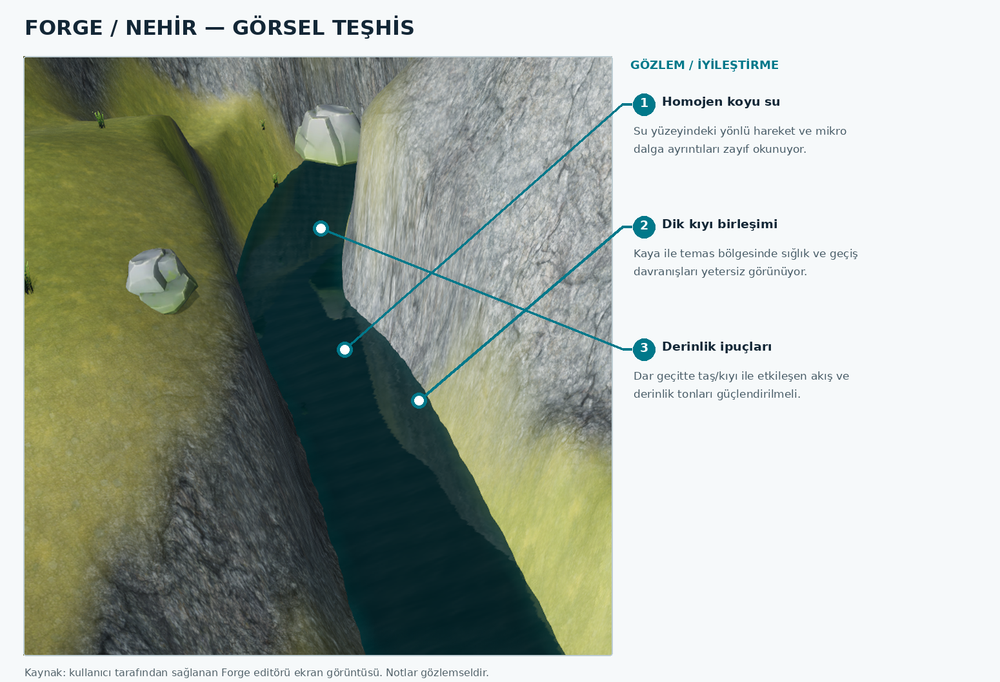
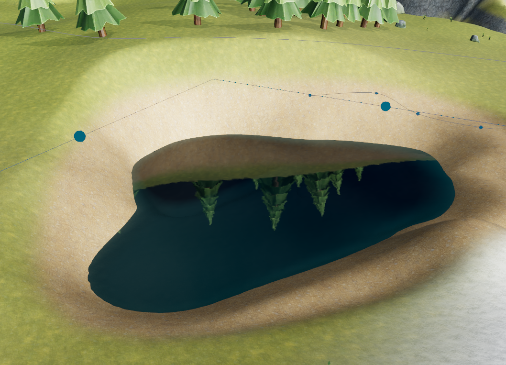
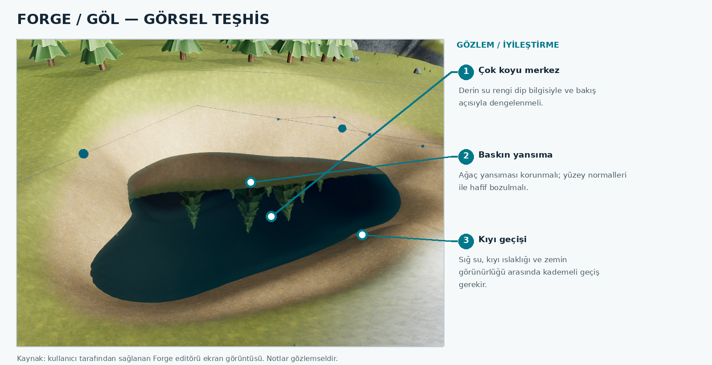
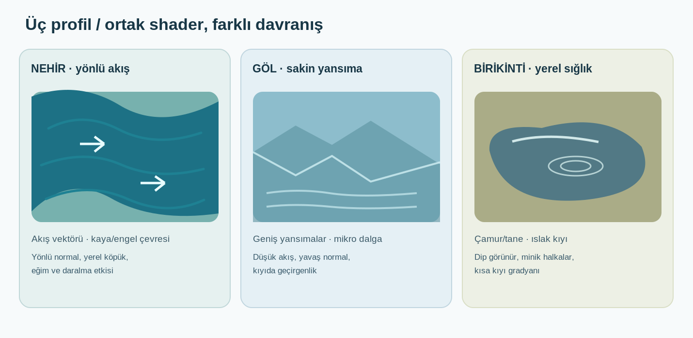
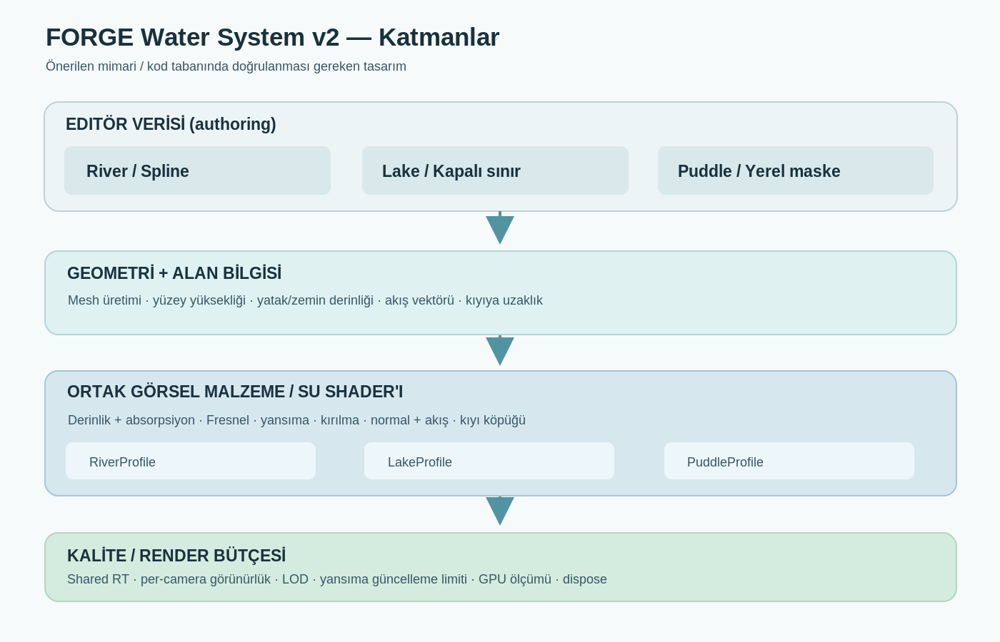
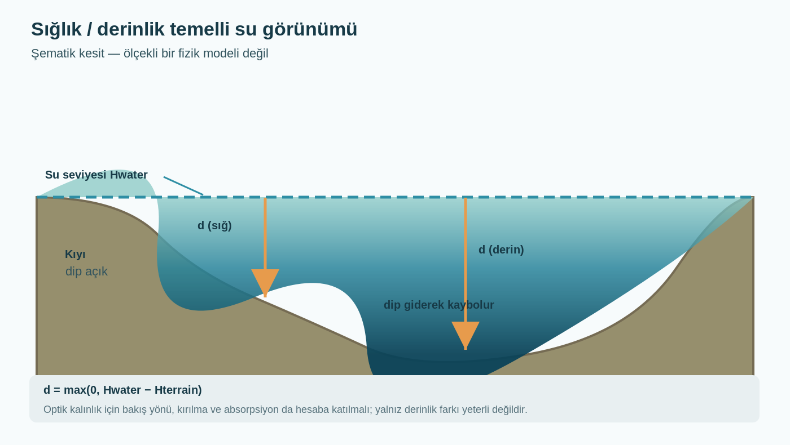
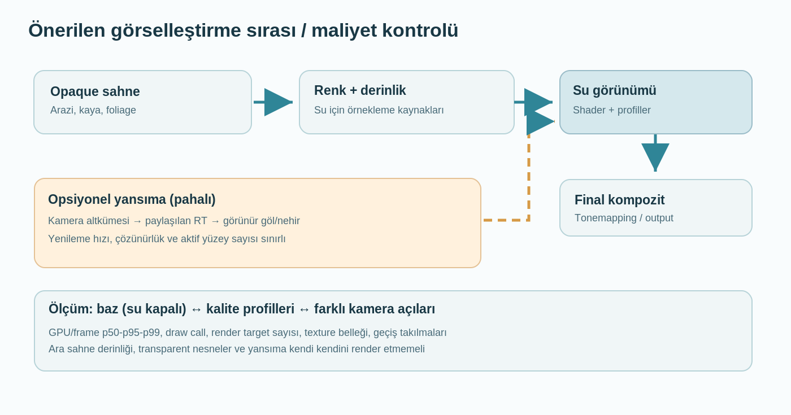

# FORGE WATER SYSTEM v2
## Su yüzeyleri için görsel araştırma, mimari öneri ve Codex/Claude uygulama brifi

**Belge:** `FORGE_WATER_SYSTEM_V2_ARASTIRMA_VE_TDD_v1.0.md`  
**Sürüm / tarih:** 1.0 / 26 Ekim 2026  
**Hedef:** Forge editörü ve oyun çalışma zamanı; Three.js / WebGL2  
**Bağlam:** Forge Offroad (izole dağ yerleşimleri, arazi lojistiği), ancak tasarımın Forge motoruna genel amaçlı eklenmesi hedeflenir.  
**Durum:** **Araştırma + teknik tasarım önerisi.** Kod henüz bu doküman kapsamında değiştirilmedi veya yeniden test edilmedi.  
**Önemli sınır:** Aşağıdaki “mevcut” teknik bilgiler, 23 Ekim 2026 tarihli teknik envanterden alınmıştır; ajan önce kendi repo dalında doğrulamalıdır. Şema, parametre ve yol önerilerinin hiçbiri otomatik olarak “uygulandı” sayılmamalıdır.

---

## 0. Codex/Claude için görev özeti

**Ana hedef:** Mevcut nehir sistemini bozmadan **nehir / göl / su birikintisi** arasında inandırıcı görsel farklılık yaratan; derinlik, sığlık, kıyı geçişi, yansıma, normal/akış animasyonu ve maliyet kontrolü içeren genişletilebilir **Water System v2** tasarlamak, kontrollü testlerle hayata geçirmek.

**Tasarım hükmü değil, değerlendirmeye açık öneri:** **Bir ortak malzeme/render/kalite katmanı + üç ayrı su gövdesi tipi ve geometri üretimi.** Mevcut kodla karşılaştırın; daha düşük maliyetli ve daha güvenli alternatif varsa gerekçeli önerin.

**Önce yapılacak:**

1. `engine/scene/riverWater.ts`, `engine/render-three/riverWater.ts` ile bunları kullanan editör, runtime, renderer, shader, kaydetme ve test akışlarını **gerçek kaynak koddan** inceleyin.
2. Belgenin “mevcut / gözlem / öneri / test gerekiyor” ayrımını muhafaza edin; repo bulgularıyla çelişki varsa kod ve test kaydını önceliklendirin.
3. Önce yalnız **mevcut nehir üzerinde en küçük görsel prototipi** geliştirin: sığlık/derinlik, Fresnel, tutarlı kıyı davranışı. Göl ve birikintiyi ilk adımda zorla aynı ribbon mesh'e çevirmeyin.
4. Her aşamada editör görünümü, Play/runtime, save/reload, performans ve ekran görüntüsüyle karşılaştırmalı kanıt toplayın.
5. Kullanıcı onayı olmadan oyun vizyonunu, başka renderer sistemlerini veya terrain kayıt biçimini toptan yeniden tasarlamayın.

**Teslim şekli:** Her fazda değişen dosyalar, uygulanmış/uygulanmamış özellik listesi, test sonuçları, önce/sonra görselleri, ölçülmüş GPU/CPU maliyeti ve kalan riskler.

---

## 1. Görsellerin nasıl kullanılacağı

Tüm **yerel görseller** Markdown dosyasına göre `./images/` klasöründe. Ana paket bu klasör yapısını korur. Diyagramların `.svg` sürümleri düzenlenebilir kaynak, `.png` sürümleri hızlı görüntüleme içindir.

| Kod | Dosya | Kaynak | Teknik amaç |
|---|---|---|---|
| IMG-01 | `images/01_forge_nehir_mevcut.png` | Kullanıcının Forge ekran görüntüsü | Mevcut dar/derin nehir sahnesi — başlangıç kanıtı |
| IMG-02 | `images/02_forge_gol_mevcut.png` | Kullanıcının Forge ekran görüntüsü | Mevcut durgun su/göl sahnesi — başlangıç kanıtı |
| IMG-03 | `images/03_nehir_gorsel_teshis.png` | IMG-01 üzerine gözlemsel işaretleme | Nehir görünümündeki iyileştirme alanları |
| IMG-04 | `images/04_gol_gorsel_teshis.png` | IMG-02 üzerine gözlemsel işaretleme | Göl görünümündeki iyileştirme alanları |
| IMG-05 | `images/05_water_architecture.png` / `.svg` | Bu araştırma için hazırlanmış şema | Önerilen v2 modüler mimarisi |
| IMG-06 | `images/06_depth_shore_section.png` / `.svg` | Şematik çizim | Zemin–su derinliği, kıyı ve optik görünüm |
| IMG-07 | `images/07_three_water_profiles.png` / `.svg` | Şematik çizim | Üç su tipinin davranış farkı |
| IMG-08 | `images/08_render_pipeline.png` / `.svg` | Şematik çizim | Opaque/depth/su/yansıma render pass ilişkisi |

> **Görsel dürüstlüğü:** IMG-03/04 mevcut sahnenin teşhisidir; teşhislerden herhangi biri tek başına shader kodunda hata kanıtı değildir. IMG-05/06/07/08 ise şematiktir, motorun mevcut görüntüsü veya bir “after” ekran görüntüsü değildir. Göl görselindeki ters ağaçlar normal yansıma olabilir; sorun yalnız ters görünmeleri değildir.









---

## 2. Problem tanımı: Bugünkü su neden “su gibi” okunmuyor?

### 2.1 Mevcut görüntülerden çıkan gözlemler

**Nehir görüntüsü (IMG-01/03):** Koyu/türdeş su alanı; kıyı kaya birleşiminde sınırlı doğal geçiş; akış yönünün, yüzeyin farklı hız ve pürüzlülüğünün zor okunması. Dar vadide güçlü gölge gerçekten koyuluk yaratabilir. Ama suyun karanlığı tek başına “teknik hata” kanıtı değildir; hedef, düşük aydınlatmada dahi okunabilir fiziksel ipuçları üretmektir.

**Göl görüntüsü (IMG-02/04):** Geniş koyu yüzey, belirgin ağaç yansımaları, fakat yüzey dalga karakteri ve sığ kıyıdaki dip görünürlüğünün düşük okunması. Yansımalar tam ters konumda görünebilir; bu beklenir. Önemli olan yansımanın **Fresnel, yüzey normali, bakış açısı ve kırılmayla** dengelenmesidir.

**Ortak sorun:** Doğru etki, tek “su rengi” ya da sadece daha kuvvetli normal map ile değil; **geometri + optik kalınlık + çevre yansıması + kıyı + hareket + aydınlatma** birlikte düşünülerek elde edilir.

### 2.2 Uzak durulacak görsel hatalar

- Gölü dev bir nehir gibi sürekli aynı yöne kaydırmak.
- Nehir köpüğünü kanalın her noktasına aynı yoğunlukta yaymak.
- Sığ alana koyu opak bir yüzey kaplayıp dipteki zemin dokusunu tümüyle kapatmak.
- Bütün kıyılara kalın beyaz parlak “köpük konturu” koymak.
- Birikintileri okyanus ölçeğinde dalgalandırmak ya da çok kalın, zifiri siyah yapmak.
- Her nesne için ayrı yüksek çözünürlüklü planar reflection ile ek render maliyetini katlamak.
- Fiziksel su seviyesini yalnız shader UV animasyonundan çıkarmaya çalışmak.
- Gereksiz fotogerçekçi/parlak bir görünümü düşük poligonlu bitki ve stilize çevrenin üzerine uygulamak.

### 2.3 Projeye uygun sanat yönü [ÖNERİ]

**Stilize doğal gerçekçilik.** Nehirler görsel olarak canlı, göller sakin ve derinlikli, birikintiler araziyle bütünleşik; aydınlatma, yerel gökyüzü ve hava durumuyla uyumlu olmalı. “Her sahnede turkuaz” veya “her derinde gece laciverdi” gibi sabit paletler kullanmayın. Dağ dere suyu berrak/çamurlu ve göller yeşil/mavi/kahverengi olabilir: **gövde tipi**, **bulanıklık/absorpsiyon** ve **renk paleti** ayrı kontrol edilir.

---

## 3. Doğrulanmış motor envanteri ve sınırlar

**Kaynak:** `FORGE_OFFROAD_FORGE_TEKNIK_DURUM_RAPORU_2026-10-23.md` (bu oturumun ekli kaynaklarından; özellikle 1, 2.1, 2.4, 5 ve 6.2 bölümleri).

| Başlık | Raporun söylediği | Bu belgedeki sonuç |
|---|---|---|
| Renderer | Three.js **0.184.0**, `WebGLRenderer`, WebGL2; ana renderer'da WebGPU yok | Çözüm WebGL2/GLSL yoluyla uyumlu tasarlanmalı |
| Mevcut su | Landscape spline referanslı **river ribbon**, flow/normal/foam, depth/renk, opsiyonel planar reflection | Bunu koruyup geliştirmek, sıfırdan başlamaktan daha makul |
| Mevcut nehir yolları | `engine/scene/riverWater.ts::resolveRiverWater`, `engine/render-three/riverWater.ts::{buildRiverWaterRibbon,RiverWaterObject}` | İlk denetim noktaları |
| Kaydetme | `River Water Body resolves defaults and only saves presentation fields` test adı; legacy migration içinde nehir referansları | Şema değişikliği geriye uyumlu tasarlanmalı; test adı veri alanlarının tam dökümü değildir |
| Terrain | Mevcut editör/render işleyişi tek tile adaptörü; multi-tile renderer tümüyle bağlanmamış | Su sorguları mevcut tek-tile yolunda doğrulanmalı, ileride tile'e taşınabilir tasarlanmalı |
| Terrain yükseklikleri | Mevcut `ForgeLandscapeData` yükseklikleri; yeni `WorldTerrainDef` ayrı temeller içeriyor | Geometri/yükseklik otoritesi tek noktadan sorgulanmalı |
| Kayıt/test | 1.291 motor kontrolü ve sınırlı Playwright akışları geçti | Görsel kalite veya performans kabulünün geçtiği anlamına gelmez |
| Water physics | Bu raporda buoyancy, akıntı kuvveti, motor boğulması yok | Görselleştirme ve oyun fiziği ayrı fazlar olmalı |
| Profiling | Frame bölgeleri, GPU timer/capture, render sayaçları, kalite profili araçları mevcut | Yeni sayaç aracı yazmadan önce mevcut debug yolunu kullanın |

**Kod incelemesi yapılmadan aşağıdaki sorulara kesin cevap vermeyin:** Mevcut `depth` alanı gerçekten fiziksel yatak derinliği mi yoksa bir renk katsayısı mı? Yansıma güncelleme sırası nasıl? Transparent malzemelerin sıralaması nasıl? Su nesnesi editor ve runtime'da ayrı mı örnekleniyor? Render target/renderer renk uzayı nasıl yönetiliyor? Kıyı maskesi var mı? Bunların hepsi **açık inceleme maddesi**.

**Öncelikli kod/ilişki haritası (başlangıç noktası):**

```text
engine/scene/riverWater.ts
engine/render-three/riverWater.ts
engine/render-three/renderer.ts
engine/render-three/landscape.ts
engine/scene/landscape.ts
engine/terrain/terrainLandscapeBridge.ts
src/scene/SceneApp.ts
src/scene/RuntimeSceneApp.ts
tests/engine/*   (river water, terrain, serialize, shaders varsa tespit et)
tests/smoke/terrain-migration.spec.ts
engine/perf/*
```

Yukarıdaki yollar teknik rapordan derlenmiş **aday denetim yerleridir**; eksiksiz etki analizi değildir. Repo aramasında su renderer'ına erişen bütün import/reference noktalarını çıkarın. Kod değişikliğinden önce `git status`, branch/commit, ilgili test adları ve ekran görüntüsü bazını kaydedin.

---

## 4. Hedef kullanıcı deneyimi ve tür farkları



| Görsel parametre | River | Lake | Puddle |
|---|---|---|---|
| Geometri | Spline takip eden kıvrımlı şerit, farklı kotlar | Kapalı, tercihen yatay gövde | Küçük düzensiz gövde, sığ çukur |
| Su yüksekliği | Akış boyuna değişebilir | Göl boyunca yaklaşık sabit | Çukur içi yerel seviye |
| Akış | Yönlü vektör, yerel hız | İhmal edilebilir ortalama akış | Yok (yağmur mikro efektleri ayrı) |
| Dalga | Uzunlamasına/türbülanslı | Uzun dalga + hafif mikro normal | Çok küçük mikro dalga/ripple |
| Yansıma | Çoğunlukla bozulan | Sakin suda daha güçlü | Sakinse güçlü ama kısa menzilli |
| Geçirgenlik | Derinlik/tortuya bağlı | Kıyıda daha yüksek | Dip çoğu zaman gözlemlenir |
| Köpük | Engel, şelale, hızlı akış, kıvrım | Çok düşük; rüzgâra bağlı lokal olabilir | Normalde sıfır |
| Kıyı | Nemli kaya/toprak, nehir yatağı | Kıyı geçişi, taş/sığlık | Islak çamur + puddle sınırı |
| Performans | Spline mesh ve seçilmiş foam | Büyük alan için LOD/yansıma bütçesi | Çok sayıda küçük obje için batching/atlas |

**Geçerlik testi:** Sabit ışık, kamera ve karşılaştırılabilir renk tonu ile gösterilen üç suyu kullanıcılar “nehir”, “göl”, “birikinti” diye ayırt edebilmeli. Aynı shader kodu kullanılabilir ama profil parametreleri, geometri ve davranış ayrı kalır.

---

## 5. Önerilen mimari



### 5.1 Veri ve modül sınırı

**WaterBody** ortak kavramdır; `kind: river | lake | puddle` farklı geometri/yüzey davranışını belirtir. Mevcut river kayıt biçimini tek hamlede kaldırmak yerine, önce uyarlayıcı (adapter) oluşturmak tercih edilebilir.

**Önerilen sorumluluklar:**

- **WaterBodyDefinition:** Kimlik, tip, görünüm, geometri referansı, opsiyonel su seviyesi/yatak derinliği ve veri sürümü.
- **WaterGeometryBuilder:** Nehir spline/ribbon, göl polygon/mesh, birikinti maske/yerel mesh üretimi.
- **WaterSurfaceSampler:** Dünya konumundan su yüksekliği, su var/yok, varsa yatak derinliği, 2D akış yönü/hızı.
- **WaterVisualMaterial:** Ortak su shader parçaları; profil bazlı parametre ve feature bayrakları.
- **WaterRenderCoordinator:** Depth/opaque source, refleksiyon RTT bütçesi, draw ordering, render pass koordinasyonu.
- **ShorelineProvider:** Kıyı uzaklığı/ıslaklık/engel veya terrain maskesinden alınan veriler.
- **WaterQualityController:** Low/Medium/High ve yakınlık/ekran kapsama göre efekt seviyesi.
- **Editor Water Inspector:** Su tipi preset + az sayıda anlaşılır artist kontrolü + gelişmiş/debug ayarları.

Bu modül isimleri öneridir; mevcut projenin capability/data naming standardına göre yeniden adlandırılabilir.

### 5.2 Taslak tipler (sözleşme tartışması için; doğrudan kod değildir)

```ts
type WaterKind = 'river' | 'lake' | 'puddle';
type WaterQuality = 'low' | 'medium' | 'high';

interface WaterAppearance {
  clarity: number;             // 0..1, editör dostu görünüm parametresi
  absorptionRgb: [number, number, number]; // linear uzay / 1/metre, öneri
  scatteringRgb: [number, number, number]; // uygulama modeline bağlı, opsiyonel
  normalStrength: number;
  smallWaveScaleMeters: number;
  waveSpeed: number;
  foamIntensity: number;
  shoreWetnessWidthMeters: number;
  reflectionMode: 'environment' | 'planar-auto' | 'planar-off';
}

interface WaterBodyV2 {
  schemaVersion: 2; // örnek; mevcut save formatına göre revize edilecek
  id: string;
  kind: WaterKind;
  geometryRef: string; // spline ID, polygon ID veya mask ID; gerçek yapıya uyarlayın
  appearance: WaterAppearance;
  // surfaceLevel/flow vb tip-özgü alanları discriminated union ile tutmak daha güvenli.
}

interface WaterSurfaceSample {
  isInside: boolean;
  surfaceY: number;
  bedY?: number;        // bilinmiyorsa undefined; 0 veya sahte değer kullanma
  depthMeters?: number;
  flowXZ?: [number, number];
  flowSpeedMps?: number;
}
```

**Önemli:** `waterDepthAt(x,z)` yalnız `waterHeightAt - terrainHeightAt` ile hesaplanabilir sanılmamalı; su altında yerel kaya/nesneler, spline yatağı ve farklı meshler olabilir. Terrain verilmediğinde `depthMeters` belirsiz kalmalı veya ekran-alanı alternatifine düşülmeli. `waterHeightAt` fiziksel yüzeyin kaba/ortalama seviyesidir; vertex/normal dalgalanması ile su kuvveti/su seviyesi API'si yanlış eşleştirilmemeli.

### 5.3 Su fiziğinden ayrım

Sıralama:

```text
Editör geometrisi + authored su seviyesi  →  Görsel su sistemi
                                 └────────→  WaterSurfaceSampler (gelecek fizik API'si)
Gelecekte araç su etkileşimi            →  mevcut fizik sistemine ayrı adapter
```

Bu dokümanda **boyancy / akıntı kuvveti / motor boğulması / çamur suyu fizik modeli yok**. Water System v2'nin görsel işi tamamlandı diye bunlar uygulanmış sayılmayacak.

---

## 6. Optik görünümün teknik araştırması

### 6.1 Yatak derinliği, optik kalınlık ve geçirgenlik



Önce su yüzeyindeki dünya koordinatını `(x,z)` ve suyun yerel yüksekliğini `Hs(x,z)` belirleyin. Yerel zemin yüksekliği `Hb(x,z)` güvenilir biçimde biliniyorsa:

```text
d_vertical = max(0, Hs(x,z) - Hb(x,z))
```

**Bu geometrik düşey derinliktir, tek başına ışığın su içinde katettiği yol değildir.** Işığın su içindeki yaklaşık yol uzunluğu `L`, bakış açısı ve refraksiyonla değişebilir. İlk kontrollü kalibrasyonda `L ≈ d_vertical / max(cosThetaWater, ε)` kullanılabilir; görüntü/derinlik verisiyle daha doğru su altı kesişimi varsa onunla karşılaştırılmalıdır.

**Beer–Lambert tipi absorpsiyon [ÖNERİ]:**

```glsl
vec3 transmittance = exp(-absorptionRgb * opticalPathMeters);
vec3 transmitted = opaqueUnderwaterColor * transmittance;
vec3 inScattered = waterBodyColor * (vec3(1.0) - transmittance);
vec3 refractedWater = transmitted + inScattered;
```

Bu, tam fiziksel hacim saçılması değildir; uygun renk ve optik kalınlıkla kontrol edilebilir bir görünüm modelidir. `absorptionRgb` lineer renk uzayında, dalga boyu etkisini yaklaşık temsil eden katsayı olarak anlaşılmalı; palet rengine körü körüne eşitlenmemeli.

**Sınır durumları:** Sıfır derinlik, suyun terrain'i kestiği yerler, görünmeyen zemin, boş tile, su üstünde su olmayan kamera pixel'i, transparan objeler, clip plane, çok dik nehir duvarı ve açılı kamera. Her biri testlenmeli.

### 6.2 Fresnel yansıma dengesi

Su–hava arayüzü için yaklaşık **IOR 1.33**, normal bakıştaki yansıtırlık **F0 ≈ 0.02** alınabilir; görsel sanat hedefi için profilce kısıtlı sapmalar olabilir. Google Filament'in PBR dokümanı bu büyüklükleri destekler: https://github.com/google/filament/blob/main/docs/Filament.md.html

Schlick yaklaşımı:

```glsl
float F0 = 0.020; // yaklaşık, fiziksel ön-kabul
float NoV = clamp(dot(normalize(N), normalize(V)), 0.0, 1.0);
float fresnel = F0 + (1.0 - F0) * pow(1.0 - NoV, 5.0);
vec3 result = mix(refractedWater, reflectedWater, fresnel);
```

**Uygulama uyarıları:** `N` ve `V` aynı koordinat uzayında olmalı; shader'ın yüzey yönü tersse NoV bozulur. İki-taraflı su, kamera su altında, normal-map dalgası ve sahne pozlaması ayrıca sınanmalı. `fresnel` sanatçı slider'ı ile abartılırsa sığ su dahi opak aynaya dönebilir.

### 6.3 Kırılma / alttaki sahne rengini okuma

İdeal görünüm için su altındaki **opaque color** kaynağından örnek alınır; surface normal ve gözlem açısıyla UV hafif kaydırılır. Ekran dışı ve kıyı kesişimi bölgelerinde distortion maskelenir. Gerekirse `DepthTexture`, zemin ve başka opaque objelerin su öncesi derinlik bilgisini sağlar. Three.js: https://threejs.org/docs/pages/DepthTexture.html ve https://threejs.org/manual/pages/rendertargets.html

**Olası uygulama stratejileri:**

1. İlk prototipte mevcut su yüzeyi + shader derinlik tonunu iyileştir; full-scene opaque color RT eklemeden farkı değerlendir.
2. Gerekliyse tek **paylaşılan** opaque color/depth yakalaması ekle; sahneye göre gerekli olmayan frame'lerde fazladan pass oluşturma.
3. RT çözünürlüğünü viewport/pixel ratio ve kalite profiline göre seç; viewport resize ve dispose testlerini ekle.
4. Transparan obje, su–su üst üste binmesi, depth write/sort, z-fighting ve MSAA çözümleme yolunu ayrıca test et.

**Önemli teknik tuzak:** Screen-space depth doğrusal değildir; `gl_FragCoord.z` gibi değerleri doğrudan metre sanma. Perspective/orthographic ve varsa reversed/logarithmic depth ayarına uygun view-space/world-space yeniden kurma uygulanmalı. Render edilen su pixel'inin önündeki opaque nesneye ait depth yanlışlıkla “su altı” olarak kullanılmamalı.

### 6.4 Yansıma stratejisi: progressive enhancement

Kalite sırası, maliyet artışıyla:

- **Seviye R0:** Ambient/sky/environment renk, Fresnel ve normal tabanlı basit yansıma.
- **Seviye R1:** Uygun ortam haritası/probe/scene sky reflection; mevcut motor yeteneği doğrulanmalı.
- **Seviye R2:** Yakın ve görünür, yeterince yatay su yüzeylerine isteğe bağlı **planar reflection**. RT paylaştırma, kare atlama ve kamera/ekran kapsama önceliği.

Mevcut `RiverWaterObject` raporda planar reflection destekli görünüyor; **refleksiyonun neyi/kimi render ettiğini**, recursion korumasını, tüm nehre tek plane uygulanmasının optik uyumunu denetleyin. Akış boyunca kotu değişen su yüzeyi tek bir planar ayna değildir. Göller bu yöntem için genellikle daha uygundur.

Three.js'teki `Water` ve `Reflector` yalnız **referans** olmalı; Forge data modelini bunların constructor'ına zorla uydurmayın. Resmî kaynaklar:

- https://threejs.org/docs/pages/Water.html
- https://threejs.org/docs/pages/Reflector.html
- https://threejs.org/docs/pages/WaterMesh.html (**WaterMesh WebGPU renderer içindir, Forge'un mevcut WebGL renderer'ı için doğrudan doğru seçenek değildir**.)

**Reflection kabulü:** Kamera hareketlerinde yansıma stabil; su kendisini render etmiyor; ağaç/sky yansıması doğal; su altı–yansıma karışımı Fresnel ile tutarlı; iki ayrı su yüzeyi reflection RT sayısını kontrolsüz artırmıyor.

### 6.5 Normaller, kıvrımlı akış, dalga ölçekleri

**Nehir:** Spline teğetini dünya düzlemine projeksiyonla 2D akış vektörüne dönüştür; akış yönü ve hız alanına göre UV kaydır. Bank/spline genişliğine göre kenarda yavaşlık, daralmada hızlanma gibi değişimler yalnız **art direction** hedefiyle eklenebilir; hesaplanmış fiziksel hidrodinamik varsayılmamalı. UV/akış seams, kısa splineler, keskin virajlar ve yanlış tangent yönleri kontrol edilmeli.

**Göl:** Aynı yönde büyük UV sürüklenmesi yerine farklı ölçeklerde yavaş normal blend, uzun/sığ dalga tepkisi, istenirse rüzgâr parametresi. Sert okyanus dalgaları ve bütün gölde aynı periyot tekrarından kaçınılmalı.

**Birikinti:** Mikro normal + düşük genlik; yağmur halkaları/araç teması gibi olaylar ayrı overlay olabilir. Kamera uzakken shader varyantı en aza indirilmeli.

**Normal map teknik not:** Normaller renk verisi değildir (`NoColorSpace` varsayımı). Mipmap/normal yeniden normalizasyonu, doğru tangent/world-space ve `normalStrength` üst sınırı kontrol edilmeli. Birbirini simetrik tekrar eden iki normal scroll'ü “damalı yüzey” gibi okunabilir; eşitsiz ölçek/frekans kullanın.

### 6.6 Kıyı yaklaşımı: derinlik tek başına yetmez

Kıyı sisteminin üç ayrı girdisi olabilir:

1. **Coast distance / shallow factor** — world-space distance-to-boundary veya terrain/su sınırı türetimi. Görsel blend genişliği.
2. **Obstacle / flow interaction** — kaya/engel yakınlığı, akıntı şiddeti; lokal foam kaynağı.
3. **Wet ground mask** — arazi materyali üzerinde ıslaklık, koyulaşma ve gerekirse roughness düşmesi. Su shader'ının içine değil, mümkün olduğunca arazi materyaliyle uyumlu bir maske olarak düşünün.

**Sürekli köpük hatası:** `foam = 1 - smoothstep(0, threshold, depth)` yazıp her yerde bembeyaz kıyı çıkarmayın. Başlangıçta göl/puddle köpüğü `0`, nehirde ise yalnız hızlı/kayalı bölgede maskeli az miktar kullanılabilir.

**Kıyı tipi:** Dar kayalık nehir geçidinde sığ kumlu kıyı yoksa “her kıyı yeşilimsi açık renk” zorlaması gerçek dışı olabilir; su dik kayaya temas ederken geçirgenlik ve yansıma doğal kalsın.

### 6.7 Renk uzayı / aydınlatma uyumu

Three.js working space Linear-sRGB; RGB renk texture'ları genellikle sRGB, normal/depth/flow haritaları **data texture**. Custom ShaderMaterial/RawShaderMaterial output dönüşümü ve tonemapping pipeline'a uygun olmalı; başka sahne katmanlarıyla iki kez dönüştürme yapılmamalı. Resmî kılavuz: https://threejs.org/manual/pages/color-management.html

Testler: gün ışığı, bulutlu, gölgeli dar vadi, gece/akşam, farklı exposure ve tonemapping değerleri. Göl aşırı siyah görünüyorsa tek çözüme “rengi aç” diyerek gitmeyin; ışık, yansıma ve transparan yolunu gözlemleyin.

---

## 7. Geometri ve editör araçları

### 7.1 Nehir — mevcut ribbon yolunu genişlet

**Koru:** Spline referanslı ribbon, kontrol noktaları, mevcut kaydetme ve editor gesture davranışı.  
**İyileştir:** genişlik sürekliliği, yüzeyin y/kot kontrolü, kenar/kıyı maskesi, UV mesafe ölçüsü, tangent flow direction; segment normal dikişi ve yansıma uyumsuzluğu.

Önce mevcut `buildRiverWaterRibbon` geometrisinin hangi attribute'ları oluşturduğunu çıkarın. Gerekirse yalnız su için `uAlong`, `vAcross`, `flowDirectionXZ`, `edgeDistance` gibi attribute ekleme ihtiyacını tartışın. Shader ve mesh maliyetini ölçmeden her vertex'e ağır parametreler eklemeyin.

### 7.2 Göl — kapalı polygon + yüzey kotu

Öneri: Editör kapalı bir sınır tanımlar, sınırın içinde düz veya neredeyse düz mesh triangulate edilir; yüzey tek su kotu taşır. Three.js `ShapeGeometry` veya `Earcut` teknik referansı: https://threejs.org/docs/pages/ShapeGeometry.html ve https://threejs.org/docs/pages/Earcut.html

**Zorunlu sağlamlık:** self-intersection, duplicate vertex, çok küçük üçgen, ters winding, delikler, kıyı clip'i, triangulation geçerliliği, editör undo/redo, save/reload. Fiziksel göl kenarını “mesh poligon sınırı = gerçek ıslak kıyı” gibi göstermek yerine terrain–su kesişimini kontrol edin; poligon büyük bir kapsama alanı olarak kullanılabilir.

### 7.3 Birikinti — iki olası MVP

**Basit ve güvenli MVP:** Küçük kapalı polygon/mesh; hafif terrain offset, sabit yerel su seviyesi, wet ground mask. Kullanıcı fırçasından polygon çıkarma daha sonra yapılabilir.

**İleri seçenek:** Terrain height sample'ıyla basit “depression fill” alanı tespit eden maske üretici. Kapalı havza/taşma hesapları, yol ve çamur deformation ile etkileşimli olduğu için ilk aşamada zorunlu değil. Tek fırçayla dinamik havza flood-fill geliştirmenin maliyetini küçümsemeyin.

### 7.4 Su gövdelerinin çakışması ve çamurlu yollar

- Nehir ile göl birleşimi: iki üst üste opaque water mesh yerine tutarlı overlap mask / mesh birleşimi / öncelik sistemi gerekli.
- Birikintinin yol veya çamur izini kaplaması: ıslaklığı terrain materyaline taşı, geometrik z-fighting'i önle.
- Çok yakın kesişen yüzeyler, kamera aşağıdayken double reflection veya foam duplication yapmamalı.
- Açık dünyanın gelecek multi-tile yaklaşımı için sampler/world-space koordinatları tile sınırından bağımsız tanımlanmalı; ancak bugün tam streaming varmış gibi kodlanmamalı.

---

## 8. Kalite profilleri ve performans mimarisi



**Önemli:** Bu profil içeriği **öneridir**; ölçülmüş FPS vaadi değildir.

| Özellik | Low | Medium | High |
|---|---|---|---|
| Derinliğe bağlı renk | Evet, basitleştirilmiş | Evet | Evet |
| Fresnel | Evet | Evet | Evet |
| Normal katmanı | 1 | 2 | 2 (+ yerel detay ops.) |
| Refraction | Kapalı/çok düşük | Paylaşılan opaque RT varsa hafif | Paylaşılan opaque RT, kontrollü distortion |
| Planar reflection | Kapalı | En kritik görünen yüzeyde düşük maliyetli | En kritik yüzeylerde dinamik bütçeli |
| Köpük | Basit maske | Nehir için lokal | Detaylı ama maskeli |
| Kıyı ıslaklığı | Basit | Evet | Evet |
| Uzak mesafe | Normali ve köpüğü azalt | Dinamik efekt azalt | Görüntü önemine göre |

### 8.1 Render hedefleri

- Tek su yüzeyi için bağımsız reflection RT açmak yerine **visible-body scheduling** düşünün.
- Planar reflections için RT boyutu örneğin viewport'un **0.25–0.5 doğrusal ölçeği** ile başlayıp testle seçilebilir; bunlar doğrulanmış optimum değerler değildir.
- Re-render sıklığı kamera/sahne hareketine, görünürlük ve kaliteye bağlanabilir. Statik görünümde her frame yeniden yansıtma zorunlu değil; bunun da hareket artefaktı testi gerekir.
- Render target allocate/dispose, resize, browser tab hidden, scene unload ve editör→Play dönüşlerini test edin.
- Gözle görülmeyen/küçük su birikintilerinin per-object draw cost'u yüksek olursa batching/atlas düşünün.
- Opaque scene copy / depth capture tek bir paylaşılan geçiş olmalı; zaten mevcut pass varsa tekrar yaratılmamalı.

### 8.2 Ölçümün nasıl yapılacağı

Sabit hardware/Chrome/viewport/DPR/scene/quality profili kaydedin. Mevcut motor debug/GPU timer araçlarından ölçün. **Karşılaştırma A/B:** su kapalı, eski su açık, Water v2 Low, Medium, High. Aynı kamera konumları, zaman aralığı, foliage yoğunluğu.

Kayıt alanları:

```text
build / commit / GPU / driver / browser / viewport / DPR
scene / camera / water body count / visible water pixels approx
profile / reflection RT size / reflection updates per second
FPS p50/p95/p99 veya frametime p50/p95/p99 (birimini belirt)
GPU toplam frame ms / suya ait tahmini ek GPU ms / CPU renderer ms
draw call ana pass + reflection pass ayrımı
texture/render target sayısı, VRAM tahmini, JS heap
warm-up süresi / shader compile hitch / resize hitch
```

**Yanlış kıyasları reddedin:** `renderer.info` sayaçları render pass/reset sırasına duyarlı olabilir; teknik raporun uyarısıyla örtüşür. Sadece 1 FPS ekran görüntüsüyle maliyet kararı alınamaz. “60 FPS garanti” denmemeli. **İlk performans kapısı**, eski sürüme göre profil başına delta'nın raporlanmasıdır; sayısal FPS/MS eşikleri hedef platform kararı ve gerçek testten sonra onaylanmalıdır.

### 8.3 Render-pass kritik testleri

- Water reflection sırasında scene içinde water/reflector recursive çizilmiyor mu?
- Shadow pass / postprocessing / sky/fog / exposure / transparent order sabit mi?
- Aynı anda lake + river + puddle görünce render pass sayısı kontrol altında mı?
- Kamera suyun altına girince depth, culling ve Fresnel undefined değer üretmiyor mu?
- Farklı DPR ve viewport size ile refraction UV bozuluyor mu?
- Normal map mipmaps ve minification titremesi kabul edilebilir mi?

---

## 9. Editör UX / Artist kontrolü

**İlk seviye UI:** `Water Type` (River/Lake/Puddle), `Preset`, `Clarity`, `Water Tint`, `Surface Motion`, `Reflection Quality`, `Foam`, `Shore Wetness`. Teknik UV vektörleri gelişmiş panele taşınmalı.

**Advanced:** absorption coefficients (linear units), IOR/F0 (varsayılan koruma), normal map scale/strength, flow multiplier, shoreline depth ranges, RT resolution scale, update policy, polygon/mesh debugging.

**Debug görünümleri:**

1. `Depth (meters)` — ölçek sabit efsane/legend ile.
2. `Optical path / transmittance`.
3. `Flow direction + speed`.
4. `Shore distance / wetness`.
5. `Normal vectors`.
6. `Reflection source` (none/environment/planar) ve update counter.
7. `Water bounds/mesh/overlap`.

**Preset** bir görünüm başlangıcıdır; “River = hep mavi” gibi zorunlu renk değil. UI'da yapılan her düzenleme serialize→reload→Play sonrası aynı kalmalı; undo/redo ve reset/dafault yolları test edilmeli.

---

## 10. İnşa sırası: her faz için somut kabul kapısı

### Faz 0 — Repo denetimi ve görsel baz [zorunlu]

- [ ] Branch/commit, temiz/dirty status ve var olan su testleri listesi.
- [ ] Gerçek su veri modeli ve shader pass zinciri çizildi.
- [ ] Mevcut `depth`, `foam`, `flow` ve `planar reflection` davranışları koddan belgelendi.
- [ ] IMG-01, IMG-02 sahnelerinin tekrar üretilebilir kamera/sahne koşulları kaydedildi.
- [ ] Su açık/kapalı baseline GPU/frame ölçümleri alındı.
- [ ] Repo ekibinin kabul etmediği yeniden adlandırma/migrasyon yapılmadı.

**Çıkış:** kısa `WATER_AUDIT.md` + dosya/işlev haritası + mevcut render/debug ekranları.

### Faz 1 — Mevcut nehir: derinlik + Fresnel + kıyı prototipi [P0]

- [ ] Mevcut river data ve ribbon korundu.
- [ ] Doğru yüksekliğe dayalı shallow/deep görsel farkı elde edildi.
- [ ] Fresnel bakış açısına göre görünür ve stabil.
- [ ] Dip görünürlüğü yerde/kayada z-fighting yaratmıyor.
- [ ] Kıyı çizgisinde alpha/foam sert beyaz konturu yok.
- [ ] Low profili ile çalışıyor, ek RT bağımlılığı zorunlu değil.
- [ ] Önce/sonra aynı kamera ve ışık görüntüsü + GPU delta.

**Çıkış:** River v1 alanları ve save/reload bozulmadan görsel iyileşme kanıtı. Fayda zayıfsa full-engine refactor'a geçmeyin; shader varsayımını yeniden kontrol edin.

### Faz 2 — Ortak materyal, ilk Lake ve Puddle gövdeleri [P0/P1]

- [ ] River adapter ve shared optical shader ayrımı.
- [ ] Lake polygon boundary / triangulate / level / save/reload.
- [ ] Puddle küçük geometri + sığlık + basit wet ground.
- [ ] Tipler animasyon/yansıma bakımından ayırt edilebilir.
- [ ] 3 su bir arada render ve save/load sonrası tutarlı.
- [ ] Legacy nehir referansları ve migrasyon testleri geçti.

### Faz 3 — Hareket/akış ve yerel kıyı [P1]

- [ ] River boyunca yönlü akışta dönüşlerde seam yok.
- [ ] Lake yüzeyi rüzgâr olmadan aşırı hareket etmiyor.
- [ ] Puddle minik dalga/ripple ile sınırlı.
- [ ] Foam yalnız fiziksel olarak anlaşılır noktalarda üretiliyor.
- [ ] Wet ground su yüzeyini çevre terrain shader'ında tutarlı değiştiriyor.

### Faz 4 — Planar reflection bütçesi + kalite profilleri [P1]

- [ ] Reflections kapatılabilir; Low path temiz.
- [ ] Büyük yatay Lake'a kaliteli ama bütçeli reflection.
- [ ] River için yansıtma algoritmasının sınırları açık.
- [ ] RT kaynakları sızıntısız; `dispose`, resize, scene switch testli.
- [ ] Su nesnesi sayısı arttıkça render pass patlamıyor.
- [ ] GPU delta ölçümlendi; görsel fayda/maliyet karşılaştırması raporlandı.

### Faz 5 — Oyun fiziği bağlantısı [ayrı karar, kapsam dışı]

`WaterSurfaceSampler` veya benzeri bir API uygulanabilir. **Araç yüzerliği, akıntı kuvveti, motor hasarı, su sıçraması** burada otomatik gereksinim değildir; ayrı gameplay/physics tasarım kararıyla ele alınmalı.

---

## 11. Test sahneleri ve kabul matrisi

| ID | Sahne / durum | Kontrol | Çıktı |
|---|---|---|---|
| W-VIS-01 | Dar kayalık nehir (IMG-01) | Normal, akış, dark canyon, shore intersection | Aynı kamera önce/sonra görsel |
| W-VIS-02 | Orman gölü (IMG-02) | Fresnel, tree reflection, sığ kıyı | Aynı kamera önce/sonra görsel |
| W-VIS-03 | Çamur yolda küçük birikinti | Alttaki zemin, ıslaklık, sığlık, küçük yüzey | Yakın ve 10–30 m uzak kamera |
| W-VIS-04 | Yukarıdan / alçak açı | Fresnel ve dip görünürlüğünün yön değiştirmesi | İki kamera karşılaştırması |
| W-VIS-05 | Gece / bulut / sert güneş | Color/exposure/sky uyumu | Üç ışık durumu |
| W-GEO-01 | Lake konkav polygon, hole, self-intersection | Hata handling ve triangulation | Deterministik geometri testi |
| W-GEO-02 | River keskin dönüş, genişlik değişimi | UV seam, bounding, flow direction | Görsel + saf matematik testi |
| W-GEO-03 | Birbiriyle kesişen iki su | Overlap, sorting, reflection recursion | Debug screenshot |
| W-DATA-01 | Eski level river reference | Legacy yükleme/kayıt | Round-trip regresyon testi |
| W-DATA-02 | Yeni lake/puddle | Save/Play/reload/undo/redo | Editör smoke testi |
| W-PERF-01 | 1/5/20 görünür puddle | Draw call/RT count | GPU/CPU snapshot |
| W-PERF-02 | Büyük göl + nehir + foliage | Reflection açık/kapalı | GPU p50/p95/p99 delta |
| W-PERF-03 | Resize, scene switch, 15 dk oturum | Kaynak sızıntısı ve shader hitch | Bellek/RT kaynak zaman serisi |

**Her test kaydı:** `test ID | tarih | commit | sahne/seed | kamera | renderer ayarları | water preset | görsel | GPU/CPU | sonuç | karar`. Kabul kriterlerini görsel onay ve ölçümle netleştirin, sayı uydurmayın.

### 11.1 Testin kapsamı dışında kalan varsayımlar

- Etkileyici fotoğraf referansı = shader'ın çalıştığı kanıt değildir.
- Teknik rapordaki testler = yeni su shader'ının Playwright visual regression garantisi değildir.
- Planar reflection var = göl yansıması fiziksel olarak doğru hazır demek değildir.
- Terrain yüksekliği biliniyor = her su altı nesnesinin derinliği tam hesaplanıyor demek değildir.
- Büyük dünya prototipi var = su mesh'i multi-tile streaming testli demek değildir.

---

## 12. Önerilen ilk prototip parametreleri (hepsi KALİBRASYON TOHUMU; ölçülmüş ayar değil)

Aşağıdakiler artistin ilk denemesinde parametrelerle karşılaşması için örnektir; Shader input birimi ve normal-map frekansı kod denetiminden sonra seçilmeli. Bunları production default olarak doğrudan uygulamayın.

| Parametre | River | Lake | Puddle | Not |
|---|---:|---:|---:|---|
| clarity (0..1 UI) | 0.65 | 0.55 | 0.40 | Ortama göre preset; absorpsiyonla eşlenmeli |
| surface motion normalized | 0.70 | 0.15 | 0.04 | Fark görünsün diye başlangıç ölçeği |
| normal strength normalized | 0.42 | 0.19 | 0.10 | Shader ve normal map içerikleri bilinmeden kesin değil |
| foam intensity normalized | 0.30 | 0.00 | 0.00 | River mask yoksa daha da düşük |
| wet shoreline width (m) | 0.3 | 0.5 | 0.15 | Dünya ölçeklerine göre tuning gerekir |
| planar reflection | Opt-in, sınırlı | Auto/High seçilmiş gölde | Off default | RT maliyetini ölç |

**Sanatsal varyasyonlar:** `clear alpine`, `turbid mountain`, `windy lake`, `muddy roadside` gibi **opsiyonel** presetler oluşturulabilir. Üç tip x dört farklı fiziksel çevre koşulu bütün oyuna zorla eklenmemeli. Simülasyon fizik parametresi olmadan renk tonuyla “çamur fiziksel” anlamı yaratılmamalı.

---

## 13. Örnek algoritmalar / hızlı prototip (kopyala-yapıştır üretim kodu değildir)

### 13.1 Nehir akış koordinatı

```text
spline sample at arc-length s
T(s) = normalize( tangent projected to XZ )
N2(s) = perpendicular(T)
position(s,u) = splineXZ(s) + N2(s) * (u * halfWidth(s)),
                 surfaceHeight(s)
flowVectorXZ(s,u) ≈ T(s) * flowSpeed(s,u)
```

**Denetle:** spline parametresi `t` ark uzunluğu değilse eşit `t` örnekleri eşit mesafe değildir; shader UV için world-space arc length tercih edin. Reverse spline direction, U dönüş, keskin kırılma ve çok kısa segmentlerde tangent sıfırlanması test edilsin.

### 13.2 Sahne derinliğiyle kıyı teması

```text
if waterSurfaceVisiblePixel and opaqueDepthIsBehindWater:
  surfaceWorld = reconstructWorldPosition(waterDepth)
  opaqueWorld  = reconstructWorldPosition(opaqueDepth)
  pathLength   = estimateWaterPath(surfaceWorld, opaqueWorld, refractedRay)
  alpha/transmittance = absorption(pathLength)
else:
  use terrain sampler / valid fallback / suppress distortion
```

**Denetle:** yanlış depth karşılaştırması kıyıdaki kayaları suyun altında gösterir veya tersine suyu transparan duvara dönüştürür. Kamera altında/üstünde ve reversed/log depth varyantlarında çizimler test edilsin.

### 13.3 Reflection scheduler (taslak)

```text
visibleWaterBodies = queryVisibleWaterBodies(camera)
rank = projectedScreenArea * profilePriority * reflectionImportance
planarBudget = qualityDependentBudget()
for each body sorted by rank:
    if planarBudget exhausted: use environment fallback
    else if body planarEligible and screenVisible:
         update/reuse reflectionTarget only when needed
         planarBudget -= measuredOrEstimatedCost
```

**Not:** Bunlar API değil, düşünce modeli. Gerçek render pass sırası önce koddan çıkarılmalı. GPU ölçümü yapılmadan `projectedScreenArea` maliyetle bire bir orantılı kabul edilmemeli.

---

## 14. Risk kaydı

| Risk | Etki | Önlem |
|---|---|---|
| Shader output renk uzayı iki kez çevrilir | Çok koyu/yıkanmış su | Sahneden sahneye output pass testi; resmî Three.js renk uzayı kılavuzu |
| Depth verisi metre sanılır | Yanlış sığlık ve kıyı | View-Z/World reconstruct ve debug legend |
| Planar reflection rekürsiyonu | Render maliyeti patlar / siyah sonuç | Water layers exclude ve recursion guard |
| Nehir eğimi planar yansımaya zorlanır | Yansıma fiziksel bozuk | Flat eligible surface kontrolü / fallback |
| Transparency sorting | Kaya/su sırası ve ağaç yansımaları tutarsız | Depth write/test, pre-water opaque pass, senaryo testleri |
| Puddle sayısı yükselir | Draw call artar | Batching veya sistematik görünürlük |
| Birikinti ve yol çakışır | Z-fighting, mavi overlay | Wet ground materyal entegrasyonu, polygon clipping |
| Save schema kırılır | Eski level açılmaz | Migration + round trip + retained fields test |
| Terrain multi-tile sanılır | Büyük haritada yanlış koordinat | Mevcut single-tile doğrulama, çoklu tile adaptörünü ayrı ele al |
| Fiziksel derinlikle optik yol karışır | Baş eğimli kamera altında yanlış görünüm | Göl/nehir için kamera açısı testi |
| Geliştirme kapsamı büyür | İlk görsel iyileşme gecikir | Faz 1 görsel karşılaştırması üzerinden stop/go |

---

## 15. Araştırma kaynakları ve doğrulanabilir dış görsel referanslar

**Erişim/derleme tarihi:** 26 Ekim 2026. Web bağlantıları bilgi ve stil araştırması içindir. Referanslarda proje içi ekran görüntüsü ile dış fotoğrafı karıştırmayın. Dış fotoğrafların ikili dosyaları paket içinde bulunmayabilir; yerel görsellerin tamamı IMG-01…08 tablosundadır.

### 15.1 Three.js / teknik resmî kaynaklar

| ID | Kaynak | Karar için kullanımı |
|---|---|---|
| SRC-01 | [Three.js Water](https://threejs.org/docs/pages/Water.html) | WebGL tabanlı flat reflective water referansı; genel çözüm değil |
| SRC-02 | [Three.js Reflector](https://threejs.org/docs/pages/Reflector.html) | Planar reflection/RT/bütçe çözümlemesi |
| SRC-03 | [Three.js WaterMesh](https://threejs.org/docs/pages/WaterMesh.html) | WebGPU renderer farkını doğrulama; mevcut Forge yoluyla doğrudan eşleme yapma |
| SRC-04 | [Three.js DepthTexture](https://threejs.org/docs/pages/DepthTexture.html) | Opaque depth yakalama |
| SRC-05 | [Three.js Render Targets](https://threejs.org/manual/pages/rendertargets.html) | RT oluşturma, boyutlandırma, maliyet değerlendirme |
| SRC-06 | [Three.js Color Management](https://threejs.org/manual/pages/color-management.html) | Linear vs sRGB, ShaderMaterial çıktı rengi |
| SRC-07 | [Three.js ShapeGeometry](https://threejs.org/docs/pages/ShapeGeometry.html) | Lake polygon triangulation başlangıcı |
| SRC-08 | [Three.js Earcut](https://threejs.org/docs/pages/Earcut.html) | Concave polygon / hole triangulation |
| SRC-09 | [Three.js WebGLRenderer](https://threejs.org/docs/pages/WebGLRenderer) | WebGL2, render info ve output alanları |
| SRC-10 | [Google Filament PBR Reference](https://github.com/google/filament/blob/main/docs/Filament.md.html) | Air/water IOR ve F0 fiziksel referansı |
| SRC-11 | [Three.js EffectComposer](https://threejs.org/docs/pages/EffectComposer) | Su, postprocess ve output pass sıralaması kıyaslaması |

**Belgede kullanılan basitleştirmeler:** Fresnel/Beer–Lambert denklemleri yaygın yaklaşık shader modelleridir; özellikle bulanık, köpüklü, çok sığ, gölgeli veya dalgalı suyun tam spektral ışık taşınımını çözmez. Bunlar “yüksek kalite / yönetilebilir maliyet” dengeleme araçlarıdır.

### 15.2 Fotoğraf referansları — bağlantı, yerel paket değil

Görsel sanat yönü karşılaştırması için Wikimedia Commons sayfaları. **Bu görselleri indirmek/yeniden dağıtmak gerekirse her dosyanın özgün lisansını, yazarı ve lisans sürümünü dosya sayfasından yeniden kontrol edin.**

| ID | Başlık | Kaynak / belirtilen lisans | İncelenecek davranış |
|---|---|---|---|
| PHOTO-RIVER | [River landscape with rocks and trees](https://commons.wikimedia.org/wiki/File:River_landscape_with_rocks_and_trees.jpg) | Mshuang2 / CC0 1.0 | Suyun kayanın yanında ilerleyişi, açı/yansıma |
| PHOTO-LAKE | [View of lake in forest](https://commons.wikimedia.org/wiki/File:View_of_lake_in_forest.jpg) | mirobo / Pixabay üzerinden yayımlanmış CC0 kaydı | Orman ve göl yansımasının ölçeği |
| PHOTO-PUDDLE | [Puddle reflection](https://commons.wikimedia.org/wiki/File:Puddle_reflection.jpg) | Just2blabber / sayfada CC0 1.0 | Küçük durgun suda gökyüzü yansıması |
| PHOTO-MUD | [Water puddle on a road after rain](https://commons.wikimedia.org/wiki/File:Water_puddle_on_a_road_after_rain.jpg) | Akum20 / CC BY-SA 4.0 | Çamur/su sınırı, ıslak yol; atıf ve aynı lisans şartları dikkate alınmalı |

**Lisans notu:** Dış görseller pakete gömülmediği için yerel paket içinde üçüncü taraf fotoğraf telif yükü yoktur; bunlar tıklanabilir kaynak referanslarıdır. Orijinal iki Forge görüntüsü kullanıcı tarafından sağlandı. Şemalar bu dokümana özel özgün çizimdir.

---

## 16. Codex/Claude için önerilen rapor formatı

Ajan iş sonunda bunu doldurmalı:

```markdown
# WATER V2 — Implementation Review
- Tarih / commit / branch:
- Audit edilen dosyalar (net listesi):
- Tespit edilen mevcut shader/render sırası:
- Raporla tutarsız bulgular:
- Uygulanan faz ve değişiklikler:
- Kasıtlı olarak uygulanmayan özellikler:
- Geriye uyumluluk / migration:
- Test komutları ve sonuçları:
- GPU + CPU A/B performans tablosu:
- IMG-01/IMG-02 ile aynı kamera açıları üzerinden karşılaştırma:
- Kaynak tüketimi / resize / dispose:
- Karar: [KABUL] [REVİZYON] [ASKIDA]
- Sıradaki en küçük test:
```

**Başlangıç için mevcut rapordaki örnek komut** (`PowerShell` üzerinde, doğru port/sahne/branch ile):

```powershell
npx.cmd tsc --noEmit
npm.cmd run test:engine:slow
$env:FORGE_SMOKE_PORT = '5284' # 5284 sadece önceki raporda boş bulunan örnek port
npx.cmd playwright test terrain-migration.spec.ts landscape-spline-chain.spec.ts --reporter=list
```

Bu komutların **bu oturumda çalıştırıldığı iddia edilmiyor**. Su için yeni test dosyası/fixture eklemek gerekebilir. Önce repo scriptlerini ve test şablonlarını doğrulayın. Islak yüzey ölçüm testi ve performans kabulü smoke testleriyle eşit değildir.

---

## 17. Son karar önerisi

**Önerilen ilk kilometre taşı:** **Mevcut nehir sistemini v2 optik bileşenlerinin deneme platformu olarak kullanmak.** Derinlik/sığlık + Fresnel + doğal kıyı ilk prototipte aynı sahne/kamera üzerinden gerçekten iyileşirse ortak materyal soyutlaması ve yeni göl/birikinti geometrilerine geçmek. Bu yaklaşım kapsamı ve regresyonu azaltırken Forge editörü için genel su altyapısı kurar.

**Bu belgenin dışındaki açık tasarım kararları:** hedef minimum GPU/FPS, nihai sanat stili, Lake/Puddle editör UX akışının ayrıntısı, su fiziğinin ne zaman başlanacağı, büyük dünya streaming entegrasyonu.

**Son koşul:** Güzel tek görüntü yeterli değildir. Shader'ın hareketli kamera, farklı ışık, su türleri, eski seviye verisi, Play/runtime ve gerçek GPU bütçesinde tutarlı çalışması gerekir.
