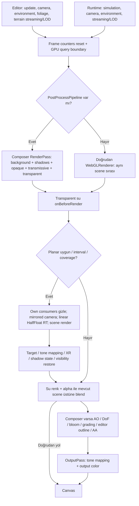

# Forge Water v2 — Faz 0 denetimi

Sonraki çalışma: Kullanıcının 26 Ekim 2026 tarihli uygulama talebiyle ilk kontrollü test ve nehir shader prototipi yapıldı; [Faz 1 prototip kaydı](WATER_PHASE1_PROTOTYPE.md). Aşağıdaki içerik Faz 0'ın tarihsel denetim kaydıdır.

Tarih: 26 Ekim 2026. Başlangıç branch: `main`. HEAD: `4d00aeaf5cf95f570cfb87adc18419f85377b963`.
Kapsam: mevcut kodun denetimi, görsel kaynakların değerlendirilmesi, izole tarayıcı ölçümü ve Faz 1 planı. **Faz 1 uygulanmadı.**

**Kullanıcı kapsam düzeltmesi:** Çalışma yalnız araştırmadır; kod yazılmayacak. Göl üzerinde başka bir oturum çalışıyor. Ölçüm için eklenen yardımcı JavaScript betiği kaldırıldı; bu çalışma için açılan sunucu kapatıldı. Yeni uygulama veya test değişikliği yapılmayacak. Aşağıdaki Faz 1 bölümü yalnız öneridir.

## 1. Çalışma ağacı ve kanıt sınırı

Çalışma ağacı başlangıçta dirty idi. [Tam başlangıç kaydı](evidence/git-status-before.txt) ve [mevcut değişikliklerin SHA-256 kaydı](evidence/preexisting-files.json) ekte. Özellikle `engine/scene/layout.ts`, `engine/scene/waterBody.ts`, `engine/terrain/terrainLakeWater.ts`, `src/scene/SceneApp.ts`, göl Details UI/testleri ve LandscapeTest level/terrain binary dosyaları zaten değişmişti. Bunlar Faz 0 tarafından yazılmadı. Silinmiş World Builder v0.1 belgesi de başlangıç durumudur.

Bu denetim yalnız HEAD'i değil, **dirty çalışma kopyasını** tanımlar. Commit'e ait eski içerik ile güncel göl/yatak çalışması birbirine karıştırılmamalı. Branch, commit veya push oluşturulmadı. Motor, editor ve authored level/terrain kaynakları bu çalışma kapsamında değiştirilmedi.

Ana araştırma/TDD belgesi tamamen, IMG-01–08 görselleri tek tek okundu. IMG-01/02 kullanıcı ekran görüntüsü; IMG-03/04 işaretli gözlem; IMG-05–08 hedef şemasıdır. Özellikle IMG-08 mevcut motorun pass grafiği değildir.

## 2. Dosya / işlev haritası

Satır numaraları denetlenen çalışma kopyasına aittir.

| Konum | Doğrulanan sorumluluk |
|---|---|
| `engine/scene/layout.ts:929` | `LayoutRiverWater`: spline/landscape referansları, görünüm, koordinat işareti; collision/navigation yok |
| `engine/scene/riverWater.ts:46` / `:90` | `RIVER_WATER_DEFAULTS`, `resolveRiverWater`; varsayılanlar ve point/segment kopyalama |
| `tools/saveValidator.ts:1147` / `:2197` / `:2294` | Nehir allowlist'i ve level'e geri yazılması |
| `engine/render-three/riverWater.ts:75` / `:136` | `riverChains`, `buildRiverWaterRibbon`; zincir, örnekleme, UV, derinlik ve indeksler |
| `engine/render-three/riverWater.ts:209` / `:245` / `:371` | Vertex/fragment shader ve `RiverWaterObject` |
| `engine/terrain/terrainRiverWater.ts:26` | `prepareTerrainRiverWaterSource`: çoklu tile'dan salt okunur yatak snapshot'ı |
| `src/scene/SceneApp.ts:7364` / `:7443` | Editor nehir üretimi ve normal/noise texture yükleme |
| `src/scene/SceneApp.ts:10220`–`:10475` | Nehir Details, düzenleme, oluştur/sil, undo/redo; kesin işlevleri kaynakta isimle bulun |
| `src/scene/RuntimeSceneApp.ts:5991` / `:6061` | Play/runtime aynı nehir renderer'ını kendi scene instance'ında üretir |
| `engine/render-three/planarReflectionSource.ts:150` / `:250` | Paylaşılan yatay reflection kaynağı, kalite, coverage gate ve nested render |
| `engine/render-three/waterReflectionRegistry.ts:4` | River/Lake rebuild ömürleri arasında ref-count lease |
| `engine/render-three/renderer.ts:23` / `:53` | WebGL2 renderer, frame başında açık sayaç reset'i |
| `engine/render-three/postProcess.ts:398` | Ortak `RenderPass` + efektler + `OutputPass` |
| `src/scene/SceneApp.ts:1925` / `RuntimeSceneApp.ts:1820` | Editor/runtime frame ve GPU timer sınırı |
| `engine/scene/layout.ts:1016`, `engine/scene/waterBody.ts:9` | Ayrı Lake şeması / runtime-save allowlist'i |
| `engine/terrain/terrainLakeWater.ts:56`, `src/scene/lakeWaterController.ts:22` | Terrain havzası snapshot/fill, exact shore clipping, yayınlama/iptal/dispose |
| `engine/render-three/lakeWater.ts:8` | Ayrı göl materyali; shader output chunk'ları mevcut |
| `engine/render-three/terrain/terrainWater.ts:115`, `terrainWaterState.ts` | Terrain içindeki yerel su filmi, tekerlek impulsları, kalite ve planar gruplar |
| `engine/render-three/terrain/terrainDeformation.ts:420` | Birikinti için Fresnel / analytic sky fallback; River/Lake ile aynı shader değil |
| `engine/perf/gpuTimer.ts:90`, `src/scene/gpuSweepSession.ts` | Asenkron/disjoint güvenli mevcut GPU ölçüm yolu |

Nehir renderer'ının uygulama tüketicileri `SceneApp` ve `RuntimeSceneApp`'tır. Test tüketicileri `terrainRiverWater.test.ts`, `terrainSplineData.test.ts` ve smoke probe'larıdır. Lake, River defaults'ını kullanır; bu ortak bir optik shader uygulandığı anlamına gelmez.

## 3. Gerçek veri ve geometri sözleşmesi

**Nehir kayıt biçimi:** `RoomLayout.schema=1`, `riverWaters[]`. Zorunlu alanlar `id`, `landscapeRef`, `splineRef`. İsteğe bağlı görünüm alanları: `surfaceLevel`, `widthScale`, `flowSpeed`, `normalScale`, `normalTexture`, `deepColor`, `shallowColor`, `opacity`, `bedVisibility`, `absorptionDistance`, `waveAmplitude`, `waveLength`, köpük/shoreWave alanları, `foamStamps`, `segmentProfiles`, reflection mode/group/quality/strength. Kimlik, isim, hidden/locked ve hiyerarşi alanları da allowlist'te.

`coordinateSpace:"world"` dünya kotunu/foam konumunu belirtir; alanın yokluğu legacy landscape-local davranışı korur. Nehirde genel bir `schemaVersion:2` yok. Validator bazı sayıları üç ondalığa yuvarlar. Yeni alan eklenirse resolver, layout tipi, validator ve UI/runtime birlikte ele alınmalı; Faz 1 için yeni kayıt alanı zorunlu değil.

**Ribbon:** directed segment zincirleri; `splineToPolyline(...,24)` ardından mesafeye göre alt örnekleme. UV U biriken yaklaşık 3B uzunluk / normal tile length (varsayılan 3); V şerit enidir. Exact analytic arc-length çözümü değil. Spline noktalarının Y'si mesafe/rapidness hesabını etkileyebilir, fakat bütün su vertex'lerinin temel Y'si **tek `surfaceLevel`** olur. Dolayısıyla mevcut nehir boyuna eğimli yüzey değildir. Merkezde iki sinüsle küçük vertex dalgası vardır; kıyıda sönümlenir.

Attribute'lar: `position`, `uv`, `flowDirection`, `shoreDistance`, `waterDepth`, `rapidness`, `foamMask`, `flowSpeedMultiplier`. `flowDirection` üretilir fakat shader'da şu an kullanılmaz; yönlü hareket U koordinatının kaydırılmasıyla sağlanır. `shoreDistance` metre değil: merkezde 0, ribbon kenarında 1. Gerçek terrain/kaya kıyısına uzaklık değildir. `foamMask` güncel ribbon'da sıfırdır; legacy strip kayıtları tutulur ama render edilmez. Point stamp'ler ayrı radial foam mesh'leridir.

World Terrain yolu terrain spacing'e uygun örnek yoğunluğu kullanır; koridor tile'larını en fazla dört eşzamanlı okumayla geçici snapshot'a alır. Terrain yükseklik sorgusu exact üçgen yüzeyini kullanır. Eksik tanımlı gerçek delikler null gelir ve üçgenler kesilir; tanımlı ama okunamayan tile bütün gövdeyi başarısız yapar. Residency, collider ve kayıt dirty durumu bu okumalarla değiştirilmez. Legacy `ForgeLandscapeData` yolu da korunur.

**Derinlik:** vertex başına `max(0,surfaceLevel-terrainHeight)`. Terrain yoksa legacy builder `surfaceLevel-1` ile **1 birim sentetik derinlik** kullanır; bu bilinmeyen derinliği temsil eden güvenilir fizik verisi değildir. Shader içindeki `depth=clamp(vWaterDepth/2.2,0,1)` yalnız normalize renk katsayısıdır. Veri terrain yatağına göre geometrik düşey derinliktir; su altı bağımsız kaya/mesh yüzeylerini veya optik bakış yolunu kapsamaz. Vertex dalgası bu baked depth'i her kare yeniden hesaplamaz.

## 4. Shader bulguları ve görüntüye etkileri

| Bulgu | Kod kanıtı / görüntüye etkisi |
|---|---|
| Nehirde Fresnel yok | Reflection ağırlığı `strength*(0.15+depth*0.2)*(1-foam*0.65)`, üst sınır 0.45; kamera açısı/N·V yok |
| Normal map fiziksel yüzey normali oluşturmuyor | İki farklı frekanslı kayan XY örneği renk ripple'ı ve reflection UV distortion üretir; scene light BRDF'si yok |
| Dip görünürlüğü varsayılanı çok düşük | `bedVisibility=.05`, `absorptionDistance=.5`; transmission `.05*exp(-d/.5)`. Sıfır derinlikte bile alpha en az .95; d=1'de en az .99323, d=2.2'de .99939 |
| Opacity tek başına üst sınır değil | `alpha=max(authored alpha with depth/shore factors,1-transmission)`; tipi açıklayan “maximum alpha” yorumu fiili hesabı tam anlatmıyor |
| Şerit kenarı sığlık gibi renklendiriliyor | `shallow=max(1-depth,shore*.78)`; gerçekten derin dik kaya teması da açık kenar tonuna zorlanabilir |
| Otomatik köpük ribbon enine göre | Bank→centre dalga bantları/noise + turn/slope rapidness; fiziksel engel algılama veya akış simülasyonu değil |
| Nehir shader'ında tone/output chunk'ları yok | Composer yolunda linear çıktı OutputPass'te dönüştürülür. Doğrudan canvas yolunda aynı shader gerekli dönüşümü yapmaz; yalnız screenshot'tan bütün koyuluğu buna bağlamak yanlış |
| Göl shader'ında output chunk'ları var | `tonemapping_fragment` ve `colorspace_fragment`. Nehirle doğrudan/composer tutarlılığı ayrı doğrulanmalı |
| Nehir shader'ı scene ışığı/fog almaz | Shader'da light/fog uniform/chunk zinciri yok; çevredeki aydınlık terrain suyu aynı biçimde aydınlatmaz |
| Paylaşılan opaque color/depth refraction yok | Su sampler'ları normal/noise/reflection; composer's depth texture'ı bulunması su shader'ına depth bağlantısı olduğu anlamına gelmez |

IMG-01/03'teki koyu ve türdeş nehir, düşük geçirgenlik ve açıdan bağımsız yansıma ile uyumludur; tek görüntü sebebi kesinleştirmez. IMG-02/04'te ters ağaç yansıması beklenen planar davranıştır; hata diye sınıflandırılmadı. Güncel dirty level'deki göllerin reflection'u ayrıca kontrol edilmeli; eski ekran görüntüsündeki görünüm otomatik olarak güncel ayarlara ait değildir.

Renk uzayı kararı Three.js 0.184.0'ın yerel renderer/program koduyla da karşılaştırıldı: normal/noise texture yükleme `NoColorSpace` varsayılanında; hex `Color` değerleri linear working space'e çevrilir. Render target içinde linear kalıp ekrana tek dönüşüm yapmak gerekir. [Three.js resmi renk yönetimi](https://threejs.org/manual/pages/color-management.html) bu ayrımı ve özel ShaderMaterial sorumluluğunu açıklar.

## 5. Gerçek render sırası

Şema su draw'ındaki nested capture'ı gösterir; composer kullanımı suyu ayrı bir opaque-depth pass'ine ayırmaz. AO/DoF gibi efektlerin kendi ek depth/normal çizimleri olabilir. Editor ve runtime aynı `RiverWaterObject` sınıfını kullanır ama ayrı scene/object ömürlerine sahiptir. Editor outline/gizmo/selection katmanları runtime ile aynı değildir.

**Transparent ordering:** Three.js önce opaque, sonra transmissive, sonra transparent listelerini işler. Transparent listede groupOrder → renderOrder → kamera derinliğinde arka→ön sıralama vardır (`node_modules/three/src/renderers/webgl/WebGLRenderLists.js`). River `renderOrder=1`, radial foam `=2`; Lake varsayılan `=0`. Hepsi transparent, `depthWrite=false`, varsayılan `depthTest=true`, `DoubleSide`. Opaque kaya depth ile suyu örter; su kendi depth'ini yazmaz. Lake/River örtüşmesi veya başka transparan nesneler için fiziksel per-pixel doğru sıralama garantisi yoktur.

**Reflection:** Low/off kaynak oluşturmaz; medium 256²/32 ms, high 512²/4 ms ve 2x samples. Bunlar sabit RT boyutlarıdır; viewport oranı veya global frame bütçesi değildir. %1 projected bounding-box coverage gate var, gerçek görünür su piksel sayısı değildir. Aynı exact plane/group/quality için lease paylaşılır. Nehir key'inde yuvarlanmış kot bulunsa da registry exact kotu da anahtarında tutar.

Kaynak kendi consumer'larını geçici gizler; `rendering` ve `isPlanarReflectionCamera` yeniden reflection başlatılmasını engeller. Diğer gruptaki su/reflector nesnelerinin tamamen gizlendiği varsayılmamalı. Layer 31 marker'ı tek başına `layers.enable(31)` ile layer 0 nesnesini dışlamaz. Bu çapraz su yansıması/sorting senaryosu için açık görsel kontrol maddesidir. Su altındaki kamera yeni capture üretmez; mevcut capture'ın kullanımına ilişkin sualtı kabulü yapılmış değil. `setQuality` ve `dispose` var; resize'da viewport'a oranlı bir reflection resize sistemi yok.

## 6. Araştırma belgesine düzeltmeler

| Eski kabul / öneri | Güncel durum |
|---|---|
| Terrain yalnız single-tile adapter | Güncel editor/runtime World Terrain çoklu tile yolu ve exact nehir snapshot'ı var; 16-tile LandscapeTest tarayıcıda yüklendi |
| Yeni Lake sistemi daha sonra eklenecek | Ayrı `waterBodies` Lake sistemi zaten var; dirty göl yatağı çalışması da mevcut. Tekrar yeni şema tasarlamamak gerekir |
| Lake için genel kapalı polygon ilk ihtiyaç | Mevcut `fillExisting` seed/bounds ve terrain bağlantılı havza üretir; polygon `bed` bir bake reçetesidir, su mesh'inin bağımsız genel sınırı değil |
| Puddle/tekerlek etkileri uygulanmamış | Terrain su filmi + wheel contact/slip impulsları + ripple + reflection mevcut. Bağımsız authored `kind:puddle` şeması yok |
| Flow/foam/depth/planar var | Doğru, fakat yukarıdaki normal/derinlik/legacy strip/sıralama sınırlarıyla |
| 1.291 eski motor kontrolü | Bu oturumda 1.970 mevcut kontrol geçti; eski sayının yeni kalite kabulü olmadığı ilkesi geçerli |
| Ortak optik shader ve global scheduler | Hâlâ öneri. River/Lake/terrain-film shader'ları ayrı; registry paylaşımı ortak optik materyal değildir |
| Boyuna kotu değişen river | Hedef olabilir; güncel mesh sabit surfaceLevel kullanıyor |
| WebGPU WaterMesh | Bu WebGL2 yoluna doğrudan alınamaz; [resmi WaterMesh belgesi](https://threejs.org/docs/pages/WaterMesh.html) WebGPURenderer gerektirir |

Araç buoyancy, akıntı kuvveti, motor boğulması veya nehir hidrodinamiği bu denetimde uygulanmış bulunmadı. Mevcut tekerlek→yerel su filmi etkisi bunlardan ayrı tutulmalı.

## 7. Görsel tekrar üretimi ve performans

### Kaynak görsellerin tekrar üretim sınırı

Paket IMG-01/02 için kamera position/quaternion/FOV, kayıt anının level hash'i, ışık ayar snapshot'ı, browser/DPR veya shader saati içermiyor. PNG'den bunları kesin geri çıkarmak mümkün değil. LandscapeTest içindeki tek river ve lake-1/2/3 adayları bulunarak yeni karşılaştırma kameraları kaydedildi; **bunlar IMG-01/02 ile birebir aynı kamera değildir**. Güncel göllerin reflection defaults'u off; kaynak IMG-02'de belirgin yansıma var. Bu farkı kapatmak için authored görünüm değiştirilmedi.

Ölçüm denemesi bağımsız smoke project üzerinde yapıldı. Gerçek `SceneApp` ve `createForgeRuntime` yüklendi; audit erişimi yalnız test sayfasının response'una eklendi. Kaydetme çağrısı yapılmadı. Kamera ve su mesh görünürlüğü yalnız bu tarayıcıda değiştirildi. Hareketli dünya güncellemesi donduruldu, su shader'ının gerçek saatli animasyonu devam etti. Yardımcı betik kullanıcı kapsam düzeltmesi üzerine kaldırıldı.

Kamera pozları, quaternion, FOV, near/far, viewport, DPR, renderer/pipeline, su ayarları, geometri ve derinlik aralıkları JSON kanıtına kaydedilir. Off koşulu River ve Lake görünür mesh'lerini gizler; terrain içindeki shader su filmi bu toggle'a dahil değildir. Reflection RT'leri off koşulunda dispose edilmez; bu kaynak tahsisinin değil görünür su çiziminin A/B kıyasıdır.

### Ölçüm sınırları

Tarayıcı **ANGLE / Vulkan SwiftShader (Subzero)** kullanıyor. `EXT_disjoint_timer_query_webgl2` yok: gerçek donanım GPU ms/delta **ölçülemedi**. Fiziksel GPU/driver WMI sorgusu mevcut izinle erişilemedi; WebGL cihaz dizesi kaydedildi. Hiçbir CPU süresi GPU süresi diye etiketlenmedi.

İlk authored yüksek efektli yakalama yazılım renderer'da çok pahalı kaldığı için tamamlanmadan durduruldu; sonuç gibi sunulmadı. İkinci pilotta 3 warm-up frame, en fazla 60 örnek veya 10 saniye; shadow/AO/DoF/bloom/SMAA kapalı tanısal profil kullanılır. Editor outline ve OutputPass varsa kalır. Küçük örneklemde p95/p99 yalnız pilot istatistiğidir. Bu profil IMG'lerin tam ışık/efekt kabulü veya hedef donanım performansı değildir.

CPU submit, rAF frame, toplam draw ve reflection draw sayaçları ayrı tutulur. Nested render sayaçları parent'tan çıkarılarak çift sayım önlenir. `renderer.info.autoReset=false`, frame başında bir reset vardır. JS heap ve texture/geometry/program sayıları VRAM ölçümü değildir. Tam VRAM, shader compile/resize hitch ve 15 dakika leak testi Faz 0 kapsamında tamamlanmadı.

**Bu pilot kabul edilmedi:** İncelenen editor ekranlarında siyah çevre, eksik aydınlatma/arka plan ve kaynak görüntülerle uyuşmayan kadraj görüldü. Dondurulmuş kamera sonrasında environment/streaming güncellemeleri kaynak sahneyle eşdeğer tutulamadı; ilk editor snapshot'ında göl üretimi de henüz tamamlanmamıştı. Bu nedenle eldeki CPU/rAF/draw sayıları güvenilir görsel baseline veya su maliyeti kabulü olarak kullanılmamalı. GPU verisi zaten yok. Ham JSON/görüntüler yalnız başarısız deney kaydıdır; aynı kamera/ışık kıyası ve performans kapısı açık kalır. Kullanıcının araştırma sınırı gereği yeni ölçüm kodu veya düzeltme denemesi yapılmadı.

## 8. Doğrulama

| Kontrol | Bu oturumdaki durum |
|---|---|
| `npx.cmd tsc --noEmit` | Geçti; [log](evidence/typescript.log) boş, exit 0 |
| `npm.cmd run test:engine` | Geçti: 1.970 kontrol; bundle 1.0 s, test 118.5 s; [log](evidence/engine-tests.log) |
| İlk sandbox esbuild denemeleri | Erişim engeli; gerekli erişimle tekrar çalıştırıldı, başarısız ilk deneme test geçişi sayılmadı |
| Seçili Playwright nehir/migration | 1 geçti / 2 başarısız; 8.3 dakika; [log](evidence/playwright-smoke.log) |
| `npm.cmd run build:verify` | Çalıştırılmadı. Faz 0 motor/TypeScript uygulaması içermiyor; tam release/build kabulü iddia edilmiyor |
| Yeni Water v2 / Fresnel | Uygulanmadı; yeni shader testi geçmiş gibi gösterilmedi |

Mevcut test haritası:

- `tools/engine-tests.ts:24763`: nehir defaults/presentation allowlist, legacy stamp alanları, reflection key ve Low davranışı.
- `tests/engine/terrainRiverWater.test.ts`: world/local frame, exact üçgen depth/foam/flow, bounded reads/failure/retry, gerçek delikler, seam bake undo/redo, coordinate marker save.
- `tests/engine/terrainSplineData.test.ts`: legacy/world migration, 1x1/multi-tile tekrar save/reload ve reference koruma.
- `tests/engine/terrainLakeWater.test.ts`: source-only schema, exact shore/island/connectivity, missing data, budget, cancel/dispose ve River/Lake lease.
- `tests/engine/terrainWater.test.ts`: standard/reversed depth clipping, wheel slip/frame-rate etkileri, settled wavefront, kalite ve render-state restore.
- `tests/engine/terrainLakeBed.test.ts`: dirty yatağın bake/undo/validation testleri; bunlar Faz 0'ın eklediği testler değildir.
- `tests/smoke/terrain-spline-editor.spec.ts:109`: nehir UI/foam/flow, sculpt depth, undo/redo, save/reload ve runtime eşliği; `:183`: unreadable streamed bed/retry.
- `tests/smoke/terrain-migration.spec.ts:41`: legacy Save migration, water ID koruma, reload/Play.
- `tests/smoke/terrain-lake-editor.spec.ts`, `terrain-water.spec.ts`, `terrain-water-runtime.spec.ts`: mevcut göl/su filmi kapsaması; tamamı bu oturumda yeniden çalıştırılmış sayılmıyor.

Smoke ayrıntısı: `multi-tile river UI, exact sculpt depth, foam and flow survive undo, Save/Reload and runtime` geçti. Legacy migration testi `page.goto(.../?editor&debug)` load beklerken 150 saniyeyi aştı; ilgili save/reload assertion'larına ulaşmadı. Streamed river testinde kontrollü HTTP 503 sonrasında tile erişimi açılıp yükseklik değiştirilince 30 saniye içinde beklenen 1 gövde yerine 0 görüldü (`terrain-spline-editor.spec.ts:199`). Bu ikinci sonuç açık retry bulgusudur; nedeni bu araştırmada kesinleştirilmedi. Trace ve error-context dosyaları `evidence/smoke-results/` altında saklandı; motor veya test kodu değiştirilmedi.

**Eşzamanlı oturum:** İlk hash kaydından sonra LandscapeTest level, terrain definition/global ve tile dosyaları ile göl probe/spec dosyaları değişti; ayrıca `3_1.tile.bin` dirty oldu. [Hash farkları](evidence/concurrent-changes.json) kaydedildi. Bunlar bu çalışma tarafından yazılmadı; kullanıcının bildirdiği ayrı göl oturumu nedeniyle geri alınmadı. Test geçişleri çalıştırıldıkları andaki kaynak durumuna aittir; sonradan değişmiş çalışma ağacı için otomatik tam geçiş anlamına gelmez.

## 9. Faz 1 için en küçük uygulanabilir TDD planı

**Amaç:** yalnız mevcut nehir üzerinde terrain-depth, kamera açısı ve kıyı geçirgenliğini doğru ilişkilendirmek. Lake/film shader'larını birleştirme, yeni water schema, terrain değişikliği veya yeni RT zorunluluğu yok.

| Sıra | İş / olası dosyalar | Önce başarısız olması gereken kabul |
|---|---|---|
| 1 | Deterministik nehir optik fixture'ı: `tests/smoke/pages/river-water-optics.*`, `tests/smoke/river-water-optics.spec.ts` | Aynı terrain altında top-down/grazing açılarda yansıma farkı; bugün açıdan bağımsız olduğu gösterilmeli |
| 2 | `engine/render-three/riverWater.ts` vertex/fragment değişikliği | Aynı uzayda world normal/view direction; sonlu ve sınırlı Schlick, üst/alt kamera için tanımlı fallback; normal/flow/foam animasyonu korunur |
| 3 | Aynı dosyada shoreline/depth/alpha | d=0, .1, 1, 2.2, 5 örnekleri; gerçek kuru terrain'de çizim yok; dip görünürlüğü monoton; dik kayada ribbon kenarı sahte sığ kıyı üretmez; köpük beyaz kontur yapmaz |
| 4 | Aynı dosyada output chunk'ları | Direct canvas ve composer'da nötr test renkleri tek dönüşümle tutarlı; `.2` exposure ışığı “düzeltme” gerekçesiyle değiştirilmez |
| 5 | `tests/engine/terrainRiverWater.test.ts` ek geometri/ömrü regresyonları | Sabit su kotu, seam/hole ve source data değişmez; existing attributes/point stamp'ler korunur; yeni save alanı yok |
| 6 | Mevcut smoke + aynı yeni kameralar | Editor/runtime, legacy ve world Save/Reload/undo aynı kalır; reflection off/Low path RT eklemeden çalışır |

**Dosya bütçesi:** 1 mevcut motor dosyası + 1 mevcut engine test dosyası + 3 yeni browser fixture/spec dosyası. Shader matematiği gerçekten tekrar kullanılacaksa ikinci adımda küçük bir ortak GLSL modülü çıkarılabilir; zorunlu değil. Testleri uygulamanın string kopyasıyla veya yalnız shader regex'iyle “yeşil” yapmamak gerekir; browser piksel/kontrast ve geometri davranışı asıl kanıttır. Genel WaterRenderCoordinator refactor'ı Faz 1 gereksinimi değildir.

Low için environment fallback gerekiyorsa önce mevcut sahne environment contract'ından girdi alma yolu belirlenmeli. Sahne cubemap/probe fiziksel örneklemesi yokken varmış gibi gösterilmemeli. Geçici analytic sky kullanılırsa açıkça yaklaşık fallback olarak kaydedilmeli; Lake/terrain shader'ın sanat ayarlarını otomatik değiştirmemeli. Yeni uniform'un scene'den beslenmesi gerekirse `SceneApp.ts` ve `RuntimeSceneApp.ts` ek dosya maliyetidir; bu ihtiyaç prototipin ikinci karar noktasıdır.

**Görev bölümü (bağımlılık sırası; ayrı ajan çalıştırılmadı):** A: fixture/kamera/ışık ve red görsel test; B: tek nehir shader prototipi; C: aynı fixture üzerinde renk/depth/angle kontrolleri; D: mevcut save/editor/runtime regresyonu; E: aynı donanımda off/eski/yeni CPU+GPU A/B ve görsel karar. Her adım ayrı geri alınabilir diff olacak kadar küçük tutulmalı. Commit ancak kullanıcı ayrıca isterse oluşturulmalı.

**Kabul kapısı:** TypeScript → tam engine gate → hedef smoke → aynı kamera/ışık before/after → donanım GPU delta. Sonra `build:verify`. Sayısal FPS eşiği ve nihai görsel kabul henüz belirlenmedi. Kaynak IMG'lerle birebir kıyas için özgün kamera/sahne snapshot'ı gerekir; mevcut audit kameralarıyla tekrar üretilebilir yeni baseline kurulabilir.

Faz 1 yalnız shader kapsamında kalırsa save/dev-server güvenlik sınırı değişmez. İleride yeni schema/validator, asset veya endpoint değişirse AGENTS.md gereği ilgili working-tree diff için **Codex Security diff scan önerilir**; bu oturumda scan başlatılmadı.

## 10. Karar ve açık kapılar

**Karar: REVİZYON.** Belgenin eski envanteri güncellendi; mevcut nehir en küçük prototip zemini olarak uygundur. Göl/birikinti için yeni paralel sistem kurmak yerine mevcut altyapı dikkate alınmalı.

Donanım GPU ölçümü ve özgün IMG kameralarının tam eşleşmesi sağlanmadığından Faz 0'ın bütün görsel/performance çıkış kutuları tamamlandı sayılmaz. Faz 1 izni bu denetimden türetilmez.

Sıradaki en küçük uygulama: izole düz/sığ/derin nehir fixture'ında iki açı ve direct/composer renk çıkışı için red test; ardından tek nehir shader'ında prototip.
