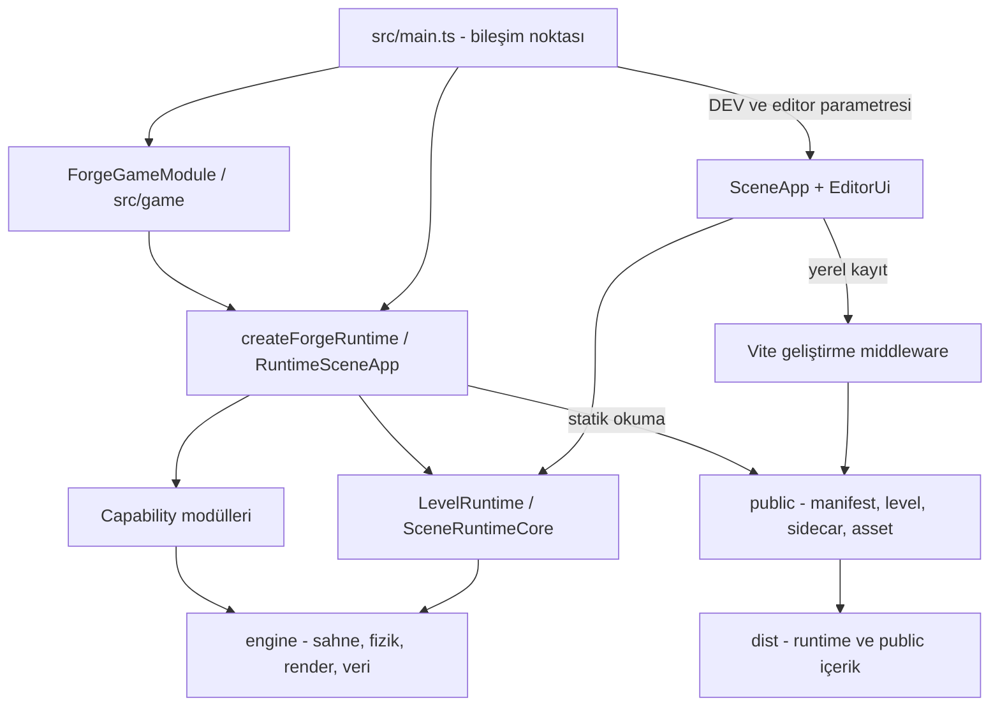

# Forge kapsamlı proje incelemesi

**Tarih:** 21 Ekim 2026 · **Referans commit:** `5aef6a0` · **Kapsam:** yerel çalışma ağacı, mimari, editör, runtime, veri, varlıklar, testler ve dağıtım.

Bu belge bir araştırma ve iyileştirme raporudur. Bulguların düzeltmeleri uygulanmadı. İnceleme sırasında üretim kodu değiştirilmedi; doğrulama araçlarının ürettiği çıktılar ve geçici smoke fixture'ları ayrıca değerlendirildi. Uzak CI geçmişi ve canlı bir dağıtım incelenmedi.

## 1. Genel değerlendirme

Forge, yerleşik editörü olan ve birden fazla oyuna temel sağlayabilecek ciddi bir platform altyapısına sahip. LevelRuntime ile ortak sahne kurulum hattı, capability modülleri, oyun modülü enjeksiyonu, engine testleri ve üretim paketinden editörün çıkarılması güçlü yönleri. Eksik olan temel konu yeni özellik sayısı değil; mevcut genişliğin güvenilir kayıt, güçlü doğrulama, anlaşılır sözleşmeler ve ölçülebilir yayın kalitesiyle korunması.

İlk yapılması gereken işler:

1. Arazi kaydındaki değişiklik kaybı yarışını gidermek.
2. Çok satırlı import'ları kaçıran mimari denetimini düzeltmek ve bu yolla gizlenen gerçek engine → src bağımlılığını kaldırmak.
3. Tarayıcı testlerini proje varsayılan sahnesinden ayırıp CI'a bağlamak.
4. Yayınlanacak varlıkların kaynak/lisans bilgisini ve paket kapsamını belirlemek.
5. Büyük editör dosyalarını mevcut ortak runtime mimarisini koruyarak küçük sorumluluklara ayırmak.

**Karar:** Yeni oyunların geliştirilmesi için kullanılabilir bir temel var. “Derleme yeşil, dolayısıyla bütün üretim akışları güvenilir” sonucu mevcut kanıtlarla desteklenmiyor. Yayın hazırlığı için aşağıdaki P1 maddeleri önce ele alınmalı.

## 2. Yöntem ve kanıt düzeyleri

- **Çalıştırılarak doğrulandı:** Komut veya izole deney bu incelemede çalıştırıldı.
- **Koddan doğrulandı:** Kaynakta doğrudan görüldü; ilgili uçtan uca hata senaryosu ayrıca çalıştırılmadı.
- **Geliştirme önerisi:** İhtiyaç/ölçümle önceliği belirlenecek bir iyileştirme; kanıtlanmış arıza anlamına gelmez.
- **Doğrulanmadı:** Donanım, tarayıcı veya ayrı yetkilendirme gerektiren kapsam.

İnceleme; giriş noktası, runtime bileşimi, sahne kurulum hattı, editör kayıt zinciri, asset loader'ları, validator, build araçları, CI, starter'lar ve mevcut planlardan örneklenerek yapıldı. Bu bir satır satır eksiksiz kod incelemesi veya güvenlik taraması değildir.

Yerel ortam: Windows / PowerShell, Node `v24.19.0`, npm `11.17.0`; build çıktısında Vite `7.3.5`. İlk sandbox denemesinde esbuild üst dizin erişim hatası verdi; aynı doğrulama daha geniş yerel çalıştırma izniyle geçti. İlk hata uygulama kusuru olarak sınıflandırılmadı.

### Çalıştırılan doğrulamalar

| Kontrol | Sonuç | Ne kanıtlıyor / sınırı |
| --- | --- | --- |
| `npm.cmd run build:verify` | **Geçti** | İçinde `verify:imports`, `tsc --noEmit`, Vite build, `test:engine:slow`, sıkı dist taraması var. |
| TypeScript | **Geçti** | Uygulamanın tsconfig kapsamı; bütün test ve araç dosyalarının ayrıca type-check edildiği anlamına gelmiyor. |
| Engine testleri | **1.222 kontrol geçti** | Filtresiz ve yavaş kontroller dahil; bundle yaklaşık 0,3 s, koşum 1,3 s. |
| Üretim paketi taraması | **Geçti** | 1.009 dosyanın 189 metin dosyası, 15 yasak token ile tarandı. Sezgisel tarama; tüm bağımlılıkları veya içerik gerekliliğini ispatlamaz. |
| `npm.cmd run smoke:browser` | **45 geçti / 4 başarısız** | 49 testin tamamı çalıştı, toplam 36,1 dakika. Ayrıntılar bölüm 5.3'te. Paket yeşil değil. |
| `npm.cmd run check:assets` | **Geçti; 0 hata / 876 uyarı** | Özgün manifestte 876 asset, 46 placeable. 874 thumbnail ve 2 kayıtsız dosya uyarısı; bölüm 5.9. |
| `npm.cmd run perf:assets` | **Geçti; 7 model bütçe üstünde** | Bilgilendirme aracı; bu uyarılar build'i başarısız kılmıyor. |
| Gerçek `saveLandscapeData` gövdesiyle geciktirilmiş yanıt deneyi | **Yarış doğrulandı** | Dosyaya yazmadan, yeni değişikliğin dirty işaretinin eski yanıtla silindiği gösterildi. |
| Gerçek import ayrıştırıcısıyla çok satırlı import deneyi | **Denetim boşluğu doğrulandı** | Tek satır import bulundu; aynı import çok satıra bölününce bulunamadı. |
| TypeScript AST ile aynı doğrudan katman kurallarının kontrolü | **1 ihlal bulundu** | 1.552 import/export/dinamik import ifadesi incelendi; 398 statik ifade çok satırlı. Transitif mimari analizi değil. |

Playwright Interactive becerisinin gerektirdiği `js_repl` bu oturumda yoktu. Tarayıcı doğrulaması projenin mevcut Playwright runner'ı ile yapıldı. Bu çalışma kullanıcıyla yapılan görsel kabul, gerçek 60/144 Hz ekran testi, ekran okuyucu testi veya mobil cihaz sertifikasyonu yerine geçmez.

## 3. Mevcut sistem haritası ve güçlü yönler



Şema amaçlanan ana akışı gösterir; F02'de bu sözleşmeye aykırı bir bağımlılık ayrıca belgelenmiştir.

| Alan | Korunması gereken kazanım | Kaynak |
| --- | --- | --- |
| Ürün sınırı | Masaüstü, tek oyunculu 3D oyun odağı; multiplayer, WebXR, 2D ve native mobilin bilinçli kapsam dışı olması | [README](../../README.md), [mimari sözleşme](../architecture/ARCHITECTURE.md) |
| Editör/runtime ayrımı | `?editor` ve DEV arkasında dinamik import; editör UI kodunun üretimden çıkarılması | [main.ts](../../src/main.ts), [verify-dist](../../builder/web/verify-dist.mjs) |
| Tek sahne hattı | Ortam, ışık, geometri ve içerik kurulumu için LevelRuntime; parity kontrolleri | [LevelRuntime](../../src/scene/LevelRuntime.ts), [parity testleri](../../tests/engine/buildManifestParity.test.ts) |
| Oyun bağımsızlığı | Oyun modülleri ve servis enjeksiyonu; capability'leri çıkararak farklı oyun türü oluşturma | [ForgeGameModule](../../src/scene/ForgeGameModule.ts), [defaultRuntimeModules](../../src/scene/capabilities/defaultRuntimeModules.ts) |
| Fizik/araç | Sabit fizik adımı, araç verisi, drivetrain, bin/in, kayıt ve spline AI için uygulanmış dilimler | [araç planı](../planned/VEHICLE_PHYSICS_PLAN.md), [araç testleri](../../tests/engine/vehicleRuntime.test.ts) |
| Kayıt verisi ayrımı | Layout ile save-game ayrımı; slot namespace, storage hatası toleransı ve opt-in persistent state | [saveGameStore](../../engine/persistence/saveGameStore.ts), [saveGameState](../../engine/persistence/saveGameState.ts) |
| Veri kaybı uyarısı | Save validator'ın düşürdüğü alanları bildirme ve bazı normalizer/save round-trip kontrolleri | [droppedFields](../../tools/droppedFields.ts), [serializationDrift](../../tests/engine/serializationDrift.test.ts) |
| Ölçüm altyapısı | Asset perf, frame bölgeleri, GPU sweep, kalite matrisi ve tarayıcı perf araçları mevcut | [engine/perf](../../engine/perf), [quality-matrix](../../tools/quality-matrix-report.mjs) |
| Oyun örnekleri | Sahne kurulumunu kopyalamadan game-starter ve karaktersiz RTS-starter | [game-starter](../../templates/game-starter/README.md), [rts-starter](../../templates/rts-starter/README.md) |

Bu kazanımları yeni bir engine, plugin pazaryeri veya tüm projeyi yeniden yazma girişimiyle riske atmak gerekmiyor.

## 4. Önceliklendirilmiş bulgu listesi

Öncelik tanımları: **P1** veri güvenilirliği, temel doğrulama veya yayın hazırlığı açısından ilk ele alınacak iş; **P2** bir sonraki sağlamlaştırma dilimi; **P3** gerçek kullanım/ölçek ihtiyacıyla açılacak iyileştirme. P1 bir güvenlik açığı derecelendirmesi değildir. Bu incelemede P0 düzeyinde bir iddia kurulmadı.

| ID | Öncelik | Bulgu | Kanıt düzeyi | Yaklaşık efor |
| --- | --- | --- | --- | --- |
| F01 | P1 | Arazi kayıt yanıtı daha yeni değişikliğin dirty işaretini silebiliyor | İzole deney | Orta |
| F02 | P1 | Import denetimi çok satırlı ifadeleri kaçırıyor; engine → src ihlali mevcut | İzole deney + AST | Küçük/orta |
| F03 | P1 | Browser fixture'ları varsayılan proje sahnesine bağlı; test tabanı güvenilir değil | Kod + browser koşumu | Orta |
| F04 | P1, yayın öncesi | 876 asset'in 810'unda lisans bilgisi `Unknown` | Manifest sayımı | Kaynak araştırmasına bağlı |
| F05 | P2 | Browser ve üretim HTTP akışları CI korumasının dışında | CI/config incelemesi | Orta |
| F06 | P2 | Kökten başlayan statik URL'ler alt dizin yayınına uygun değil | Kod + izole URL deneyi | Küçük/orta |
| F07 | P2 | Paket içerik seçimi ve performans bütçeleri yayın kapısı değil | Build + ölçüm | Orta |
| F08 | P2 | Büyük editör/runtime/test dosyaları bakım maliyetini artırıyor | Fiziksel satır sayımı | Aşamalı/orta-büyük |
| F09 | P2 | Runtime giriş verisi ve bozuk sidecar teşhisi tutarsız | Kod | Orta |
| F10 | P2 | Renderer oluşturulmadan önceki hata için kullanıcıya dönük boot fallback eksik | Kod | Küçük |
| F11 | P2 | Runtime spawn ile capability entity yaşam döngüsü tam birleşmiyor | Kod + açık plan sınırı | Orta |
| F12 | P2 | Outliner klavye/erişilebilirlik desteği ve büyük liste yaklaşımı sınırlı | Kod; ölçek etkisi ölçülmedi | Orta |
| F13 | P2 | Güncel kodla çelişen mimari/save belgeleri ve açık kalan analiz başlıkları var | Belge/kod karşılaştırması | Küçük/orta |
| F14 | P3 | Fork kurulumu, sürüm kabulü ve donanım matrisi daha tekrarlanabilir olabilir | Öneri + mevcut araçlar | Küçük/orta |
| F15 | P2 | Runtime debug paneli checkpoint menüsündeki Load tıklamasını engelliyor | Browser koşumu | Küçük |

Eforlar kişi/gün taahhüdü değildir. Düzeltme dilimi tasarlanırken daraltılmalıdır.

## 5. Bulguların ayrıntıları

### 5.1 F01 — Arazi kaydında değişiklik kaybı yarışı

**Kanıt:** [SceneApp.ts](../../src/scene/SceneApp.ts), `saveLayout` satır 3459 civarı, `saveLandscapeData` satır 10018, `scheduleAutoSave` satır 11332. `saveLandscapeData` isteği hazırladıktan sonra HTTP yanıtını bekliyor; yanıt başarılıysa güncel veri sürümünü kontrol etmeden `landscapeDataDirty.delete(landscapeId)` çağırıyor.

Gerçek metot gövdesi dosyadan okunarak, yalnızca HTTP beklemesi taklit edilen ve diske yazmayan bir deneyde şu sonuç alındı:

```text
Gönderilen yükseklik:             1
İstek sürerken yeni yükseklik:    2
Eski başarılı yanıttan sonra dirty: false
```

Dolayısıyla eski kayıt sürerken yapılan yeni düzenleme “kaydedilmedi” bilgisini kaybedebilir. Sonraki layout kaydı bu sidecar'ı dirty görmezse, bellekteki yeni yükseklik diske gitmez. Bu bir tarayıcıda gözlenmiş kullanıcı veri kaybı kaydı değil; gerçek metotla doğrulanan yarış koşuludur.

Aynı sürümsüz temizleme deseni `saveFoliageData` (satır 7750) ve `saveMeshPaintSidecar` (satır 8292) içinde de var: `await` sonrasında ilgili dirty boolean'ı koşulsuz `false` oluyor. Bu iki yüzeyin yarış deneyi ayrıca çalıştırılmadı; ortak kayıt çözümünün kapsamına alınmaları kod incelemesine dayalı öneridir.

İkinci sorun, kayıt zincirinin atomik olmaması: önce layout, ardından arazi/foliage/mesh-paint dosyaları yazılıyor. Sidecar hatasında bazı dosyalar yeni, bazıları eski kalabilir. Vite layout endpoint'i de layout ve manifest'i ayrı `writeFile` çağrılarıyla yazıyor. Burada disk kesintisi veya eşzamanlı yazma deneyi yapılmadı.

**Öneri:** Belge/sidecar başına artan düzenleme sürümü, kayıt kuyruğu ve kaydedilen sürümle eşleşen dirty temizleme ekleyin. Aynı dosyaya yazmaları sıralayın. Tek dosyada geçici dosya + kontrollü değiştirme; çok dosyalı kayıtta ise açık commit/geri kazanım stratejisi kullanın. Birkaç `rename` çağrısı tek başına çok dosyalı transaction değildir. Node da tamamlanmasını beklemeden aynı dosyaya birden fazla `writeFile` çağrısının güvenli olmadığını belirtir. [Node 24 dosya API'si](https://nodejs.org/docs/latest-v24.x/api/fs.html#fspromiseswritefilefile-data-options)

**Kabul:** Geciken A kaydı sırasında B düzenlemesi yapılınca B dirty kalır ve sonraki kayıtta diske gider; eşzamanlı Save/autosave sonucu en yeni sürüm korunur; sidecar hata senaryosu kullanıcıya hangi dosyaların kaydedildiğini bildirir ve tekrar kayıtta toparlanır.

### 5.2 F02 — Mimari denetimi mevcut bir ihlali kaçırıyor

**Kanıt:** [verify-imports.mjs](../../builder/web/verify-imports.mjs), satır 121'deki desenler `import ... from` bölümünü tek satırla sınırlıyor. Ayrıştırıcıdan doğrudan alınan fonksiyona aynı import tek satır ve çok satır verilince:

```text
import { X } from "@/editor/EditorUi";       -> bulundu
import {\n X,\n} from "@/editor/EditorUi";   -> bulunamadı
```

TypeScript AST ile aynı katman kuralları yeniden kontrol edildiğinde gerçek ihlal görüldü: [engine/movement/locomotionAnimation.ts](../../engine/movement/locomotionAnimation.ts), satır 15'te çok satırlı import ile `@/scene/assetSkeletonLoader` kullanılıyor. Bu yalnızca tip import'u değil; `resolveBlendSpaceWeights` çalışma zamanı fonksiyonu da alınıyor. Mimari sözleşmedeki “engine kendi içinde ve dış kütüphanelerle bağımsız kalır” kuralına aykırı.

Mevcut `verify:imports` 364 dosyayı tarayıp geçtiğini bildirirken AST karşılaştırması bu tek doğrudan ihlali buldu. Bu, editör UI'sinin üretim paketine sızdığı anlamına gelmiyor; üretim token taraması ayrıca geçti.

**Öneri:** Kuralları koruyup import/export/dinamik import ayrıştırmasını TypeScript AST'ye taşıyın. Blend-space tiplerini ve saf ağırlık hesabını engine'e çıkarın; HTTP sidecar yükleyicisi host katmanında kalsın. Denetçinin kendisi için tek/çok satır, type-only, re-export ve alias/relative import örnekleri ekleyin.

**Kabul:** Çok satırlı yasak örnekleri kapıyı düşürür; `engine` altından `src` import'u sıfırdır; mevcut 1.222 kontrol ve üretim ayrımı korunur. AST deneyi bugünkü doğrudan kurallarla sınırlıdır; tüm transitif sınırların temizliği iddia edilmemiştir.

### 5.3 F03 — Browser testleri düzenlenebilir demo içeriğine bağlı

**Kanıt:** [global-setup.mjs](../../tests/smoke/global-setup.mjs), `globalSetup` içinde test sahnesini manifest'in `editor.defaultScene` alanından okuyor. Oysa [ai-patrol.spec.ts](../../tests/smoke/ai-patrol.spec.ts) ve [ai-navigation-clearance.spec.ts](../../tests/smoke/ai-navigation-clearance.spec.ts) Playground'daki karakter AI controller'ını bekliyor. Referans commit'te varsayılan seviye Terrain; burada referans araba ve AI araba var, beklenen karakter AI düzeni yok. Araç AI debug'u ile karakter AI `controllers` sayacı aynı şey değil.

[landscape-spline-chain.spec.ts](../../tests/smoke/landscape-spline-chain.spec.ts), satır 42 civarı, paylaşılan `landscape-1` sidecar'ında tam **3** segment bekliyor. Bu dosya kullanıcı tarafından düzenlenen aktif demo arazisi; test fixture'ı olarak sabitlenmemiş. Testin hedefi yolun doğru kurulmasıyken ayarlanabilir demo segment sayısına bağlanmış.

Setup/teardown manifestleri ve ortak sidecar'ı yedekleyip geri yüklüyor; bu olumlu. Yine de testler çalışma ağacındaki gerçek authoring dosyalarını geçici değiştiriyor. Normal teardown ile koruma var; ayrı test çalışma dizini/fixture kökü bulunmuyor.

**Bu incelemedeki tam koşum:** **49 Chromium testi, 45 geçti / 4 başarısız**, tek worker ile **36,1 dakika**. Komut exit code `1`; bu paket başarılı olarak işaretlenemez.

| Başarısız test | Gözlenen hata | Değerlendirme |
| --- | --- | --- |
| `ai-navigation-clearance.spec.ts:41` | Beklenen `controllers: [1-9]`, gelen `controllers: 0`; ayrıca vehicle AI aktif | Karakter AI fixture'ı yerine Terrain içeriğinin korunmasıyla uyumlu |
| `ai-patrol.spec.ts:20` | Beklenen karakter AI controller'ı yok; `controllers: 0` | Aynı defaultScene bağımlılığı |
| `landscape-spline-chain.spec.ts:3` | Beklenen segment sayısı **3**, gelen **28** | Düzenlenebilir demo sidecar'ına sabit test beklentisi |
| `runtime-checkpoint.spec.ts:38` | Load düğmesinin tıklamasını debug readout kesiyor; 150 s test timeout | Ayrı UI hatası: F15; autosave oluştu, restore kısmına ulaşılamadı |

Geçen akışlar arasında editör authoring/undo/save/reload/Play, landscape paint/sculpt, game-starter, RTS-starter, runtime hareketi, parity, genel save/load/travel, portal gidiş-dönüşü ve **11 araç senaryosunun tamamı** var. Araç senaryoları sürüş, bin/in, hareket halinde save/load, kamera, motor sesi, spline AI, kayıt endpoint'i, override, drivetrain, model tekerlekleri ve yerleştir→kaydet→Play→sür akışını kapsıyor. İki araç asset/viewport editör testi de ayrıca geçti.

Bu koşumun [HTML raporu](../../playwright-report/index.html) ve `test-results` altındaki hata bağlamları/trace'leri yerelde üretildi. Bunlar Git'e eklenmeyen, sonraki test koşumuyla değişebilen yardımcı çıktılardır; kalıcı bulgu özeti bu belgededir.

**Öneri:** Kaynak kontrollü, yalnız teste ait küçük seviye/asset fixture'ları kullanın. Her senaryo kendi ön koşulunu kursun; kullanıcının defaultScene ve aktif arazi düzenlemesi sonucu etkilemesin. Yol testinde gereken segment sayısı test fixture'ında tanımlansın. Paylaşılan authoring dosyaları yerine izole geçici proje/public kökü tercih edin.

Projede bu yönde kullanılabilir örnek zaten var: [vehicle.spec.ts](../../tests/smoke/vehicle.spec.ts) sürüş senaryolarında level ve Game Mode'u route üzerinden açıkça seçiyor. Bütün testleri aynı ölçüde kırılgan saymak yerine bu yaklaşım diğer bağımlı senaryolara taşınabilir; authoring/kayıt testlerinin dosya izolasyonu ayrıca korunmalı.

**Kabul:** DefaultScene Terrain veya Playground seçilse de aynı test sonucu alınır; AI fixture'ı açıkça controller/rota içerir; sculpt/paint/spline test sırası sonucu değiştirmez; normal ve başarısız koşum sonunda Git ağacı önceki içerikle aynı kalır.

Koşum süresi de CI tasarımında dikkate alınmalı. Bugünkü ortak dosyalara yazan paketi yalnız `workers` artırarak paralelleştirmek izolasyon sorunlarını büyütebilir; önce fixture sahipliği düzeltilmeli, sonra ölçülerek kritik paket ayrılmalı.

### 5.4 F04 — Varlık kaynak/lisans kaydı yayın kararı için yetersiz

Build öncesi özgün manifest'in üretime kopyalanmış sürümünde 876 kayıt sayıldı:

| Manifest lisans alanı | Kayıt |
| --- | ---: |
| `Unknown` | **810** |
| `Project-local placeholder; replace before distribution if needed` | 62 |
| `Project-local placeholder` | 1 |
| `CC0` | 3 |

Örnekler: `t-cobblestone-pebble-d`, `t-cobblestone-pebble-m`, `t-cobblestone-pebble-n`. Kaynak: [asset manifest](../../public/assets/manifest.json). [validateAssetManifest](../../engine/assets/manifest.ts), satır 516, lisansın boş olmayan bir string olmasını denetliyor; `Unknown` bu koşulu sağlıyor.

Bu, varlıkların izinsiz olduğu veya dağıtılamayacağı hükmü değildir. **Manifest'ten dağıtım uygunluğu doğrulanamıyor.** Teknik asset health başarısı, kaynak ve lisansın tamamlandığı anlamına gelmez.

**Öneri:** Üretimde kullanılacak asset'ler için kaynak URL'si, paket/üretici, lisans metni/kimliği ve varsa attribution gereksinimini kaydedin. Placeholder ve Unknown durumunu yayın kontrolünde ayrı raporlayın. Her demo asset'ini araştırmak yerine önce gerçekten yayınlanacak içerik kümesini belirleyin.

**Kabul:** Yayın paketindeki her asset için doğrulanabilir provenance kaydı veya açıkça belgelenmiş proje üretimi açıklaması vardır; yayın kontrolü bilinmeyen durumu görünür kılar. Bu incelemede tek tek dış asset lisansları araştırılmadı.

### 5.5 F05 — CI kullanıcı akışlarını ve statik üretim sunumunu doğrulamıyor

**Kanıt:** [.github/workflows/ci.yml](../../.github/workflows/ci.yml), satır 45–49, `build:verify` ve `check:assets` çalıştırıyor; Playwright job'u yok. [Playwright config](../../playwright.config.ts) yalnız Desktop Chromium projesi ve geliştirme sunucusuyla çalışıyor. `verify:dist --strict` statik token kontrolü; derlenmiş oyunun HTTP üzerinden açıldığı bir kullanıcı akışı değil.

**Öneri:** Önce F03 ile fixture'ları sağlamlaştırın, ardından PR için küçük kritik Chromium paketi ekleyin: runtime boot, editör boot, kaydet→Play, save/load ve level travel. Ayrı bir test derlenmiş `dist` üzerinde çalışsın. Daha geniş paket ile Firefox/WebKit kontrollerini zamanlanmış veya sürüm öncesi kapı olarak değerlendirin. Playwright'ın resmi CI örneği browser kurulumu, test koşumu ve rapor artifact'i adımlarını içeriyor. [Playwright CI](https://playwright.dev/docs/ci-intro)

**Kabul:** UI etkileşimi bozulunca PR kapısı kırılır; başarısızlık trace/raporu saklanır; production HTTP açılışı da doğrulanır. Bütün browser testlerini körlemesine her PR'a eklemek yerine ölçülen süreye göre kapsam seçilir.

### 5.6 F06 — Alt dizine dağıtım için URL sözleşmesi eksik

**Kanıt:** [ProjectSystem.ts](../../src/project/ProjectSystem.ts), `loadActiveProject` doğrudan `/project.3dgame.json` istiyor; `projectFileUrl` de başına `/` koyuyor. [roomLayout.ts](../../src/scene/roomLayout.ts), satır 40, `.json` yolunda kökten URL üretiyor; yalnız bare-name kolunda `BASE_URL` kullanıyor. Runtime arazi yüklemesinde de `fetch('/' + dataRef)` deseni var.

Örnek: Oyun `/oyunlar/demo/` altında yayınlanırsa beklenen `/oyunlar/demo/project.3dgame.json` yerine `/project.3dgame.json` istenir. Sadece `vite build --base=/oyunlar/demo/` demek bu dinamik stringleri düzeltmez. Vite 7 bu tip dinamik URL birleştirmelerinde `import.meta.env.BASE_URL` kullanılmasını açıklar. [Vite 7 public base path](https://v7.vite.dev/guide/build#public-base-path)

Gerçek ProjectSystem modülü TypeScript ile bellekte JS'e çevrilip fetch yakalanarak, ağ isteği göndermeden kontrol edildi: `https://example.test/oyunlar/demo/` tabanında manifest URL'si `https://example.test/project.3dgame.json`, örnek asset URL'si `https://example.test/assets/test.glb` oldu. Böylece kök URL üretimi izole deneyle de doğrulandı; gerçek bir alt dizin deploy'u yapılmadı.

**Öneri:** Public URL üretimini tek yardımcıda birleştirin; manifest, layout, sidecar ve bağlı asset yolları aynı base sözleşmesini kullansın. İlk kapsam kök + bilinen alt dizin olabilir; gömülü göreli dağıtım ayrı bir ürün kararıdır.

**Kabul:** `/` ve `/oyunlar/demo/` altında boot, level travel, model, texture ve landscape istekleri doğru URL'lere gider. Bu incelemede alt dizinde gerçek deploy deneyi yapılmadı; bulgu kaynak kodundaki URL üretiminden çıkarılmıştır.

### 5.7 F07 — Paket boyutu ve içerik maliyeti ölçülüyor, sınırlandırılmıyor

Bu build'in `dist` toplamı **129.707.546 bayt**, yaklaşık **129,7 MB** veya **123,7 MiB**, **1.009 dosya**. Bunlar sıkıştırılmamış disk boyutlarıdır; ilk açılış transferi, runtime bellek kullanımı veya ölçülmüş FPS değildir.

| Üretim JS dosyası | Sıkıştırılmamış | Build'in bildirdiği gzip |
| --- | ---: | ---: |
| vendor-physics | 2.237,38 kB | 830,44 kB |
| vendor-three | 819,75 kB | 241,73 kB |
| ana giriş | 700,22 kB | 210,28 kB |
| vendor-meshoptimizer | 113,63 kB | 38,03 kB |
| debugPanel | 21,25 kB | 7,43 kB |

`debugPanel` ayrı ve URL parametresiyle yükleniyor; bu editör UI sızıntısı değildir. Ana kod yorumundaki “shipped game should not carry a byte” ifadesiyle gerçek “normal rotada yüklenmez ama build'de chunk bulunur” davranışı ayrılmalı.

Offline asset raporu: **46 model**, **752 texture**, toplam **53.158 model üçgeni**, **59,4 MB model**, **57,2 MB bağımsız texture**. Üçgen sayısı asset dosyalarının toplamıdır; sahnedeki instance/render üçgen sayısı değildir. Texture toplamı GLB içine gömülü texture'ların ayrıca toplamını ifade etmez.

En büyük örnekler:

| Model | Boyut | Gözlem |
| --- | ---: | --- |
| `SM_Pickup_Coin.glb` | 10.236.032 B | 2.416 üçgen; geometri azlığı tek başına küçük dosya sağlamıyor |
| `SM_Pickup_Health.glb` | 10.099.736 B | 3.164 üçgen |
| `SM_Road_Dirty.glb` | 9.187.116 B | Dosya boyutu bütçesi üstünde |
| `CommonTree.glb` | 8.890.620 B | 6.265 üçgen |
| `UAL1_Standard_RM.glb` | 7.620.504 B | 13.744 üçgen |

Kaynak: [perf:assets aracı](../../tools/asset-perf-report.ts). Yedi model araçtaki 5 MB eşiğini aşıyor. Ardından GLB JSON chunk'ı ve image bufferView uzunlukları salt okunur olarak ayrıştırıldı:

| Model | Gömülü image verisi | Dosyanın payı |
| --- | ---: | ---: |
| Coin | 10.100.682 B | **%98,7** |
| Health | 9.806.599 B | **%97,1** |
| Trigger Pad | 6.187.878 B | **%95,3** |
| CommonTree | 8.438.080 B | **%94,9** |

Bu dört modelde ilk optimizasyon hedefi üçgen sayısından önce gömülü texture verisi olmalı. Aynı yöntemle `UAL1_Standard_RM.glb` içinde gömülü image bulunmadı, 43 animasyon görüldü; aynı texture çözümünü tüm modellere uygulamak doğru olmaz. UAL dosyasının animasyon/geometri maliyeti ayrıca ölçülmeli. Bu ayrıştırma kaynak dosyaları dönüştürmedi.

Projede [strip-embedded-textures.mjs](../../tools/strip-embedded-textures.mjs) zaten var; yeni araç ihtiyacı varsayılmamalı. Bu araç yalnız bütün yüzeyleri material sidecar ile gerçekten karşılanan modeller için adaydır. Gömülü görüntü payının yüksek olması, texture'ları doğrudan silmenin doğru olduğu anlamına gelmez; gerektiğinde sıkıştırma, boyut düşürme veya paylaşım tercih edilir. Bu incelemede araç dönüştürme amacıyla çalıştırılmadı.

Vite `public` içeriğini olduğu gibi `dist`'e kopyalar. Burada runtime bağımlılıklarından oluşan seçili bir içerik paketi üretme adımı yok. [Vite 7 public directory](https://v7.vite.dev/guide/assets#the-public-directory)

**Öneri:** Yayına dahil level/asset köklerini belirleyen build profili; level→actor→mesh/material→texture/sidecar bağımlılık dökümü; kullanılmayan demo içerik listesi; ölçülen gerçek ihtiyaçlara göre GLB/texture optimizasyonu. Dinamik spawn edilen asset'ler için açık include listesi korunmalı. [vite.config.ts](../../vite.config.ts) içindeki 2.400 kB genel chunk uyarı sınırı yerine dosya sınıfına göre ayrı bütçeler daha görünür sonuç verir.

**Kabul:** Temiz starter paketi yalnız seçili içeriği ve açık dinamik bağımlılıkları taşır; kritik asset/bundle boyut artışı CI raporunda fark edilir; optimizasyon öncesi/sonrası aynı sahnede görünüm ve yükleme ölçümü karşılaştırılır.

### 5.8 F08 — Bakım yükü birkaç büyük dosyada toplanıyor

Fiziksel satır sayımı; boş satırlar dahil. `engine`, `editor`, `src`, `tools`, `tests`, `builder` köklerinde `.ts/.mjs/.css` uzantılı **455 dosya, 184.223 satır** sayıldı. Bu sayı saf üretim TypeScript'i değildir.

| Dosya | Satır |
| --- | ---: |
| [tools/engine-tests.ts](../../tools/engine-tests.ts) | **31.141** |
| [src/scene/SceneApp.ts](../../src/scene/SceneApp.ts) | **13.825** |
| [src/editor/editorUi.css](../../src/editor/editorUi.css) | 6.598 |
| [src/scene/RuntimeSceneApp.ts](../../src/scene/RuntimeSceneApp.ts) | **5.320** |
| [src/editor/EditorUi.ts](../../src/editor/EditorUi.ts) | **5.004** |
| [tools/saveValidator.ts](../../tools/saveValidator.ts) | **4.552** |
| [src/editor/SkeletalMeshEditor.ts](../../src/editor/SkeletalMeshEditor.ts) | 3.502 |

Satır sayısı tek başına hata değildir. Ancak `SceneApp` içinde landscape paint/sculpt/spline, sidecar kayıtları, seçim/render ve editör lifecycle sorumluluklarının bir arada bulunması, dar bir değişiklikte inceleme ve regresyon alanını büyütüyor. Engine suite'in 1,3 saniyede çalışması nedeniyle test bölmenin ana gerekçesi hız değil bakım ve fixture izolasyonudur; mevcut [bölme planı](../planned/ENGINE_TESTS_SPLIT_PLAN.md) da bunu söylüyor.

Ek kapsam boşluğu: [tsconfig.json](../../tsconfig.json) `tools` ve `tests` köklerini doğrudan include etmiyor. Test çalıştırıcısının esbuild ile bundle etmesi, bu dosyaların tamamında TypeScript tip kontrolü yapıldığı anlamına gelmez. Uygulama üzerinden import edilen araç dosyaları kapsama girebilir; “tools'ın hiçbiri type-check edilmez” iddiası kurulamaz.

**Öneri:** Önce save coordinator ve landscape authoring controller'ı gibi durum sahibi sorumlulukları ayırın. Testleri mevcut `register*Tests(check)` desenine alan alan taşıyın; yeni framework zorunlu değil. Test/araçlar için ayrı `tsconfig` kapsamı değerlendirin. CSS bölmesini işlevsel değişikliklerle karıştırmadan panel bazında yapın.

**Kabul:** Her çıkarım dilimi davranış değiştirmeden aynı engine kontrol sayısını korur; browser kritik akışları geçer; yeni controller kendi durumunu yönetir ve shell'e dar callback arayüzüyle bağlanır. Sırf satır sayısı düşsün diye dosyalar arasında rastgele taşıma yapılmaz.

### 5.9 F09 — Runtime veri kabulü ve bozuk içerik teşhisi eksik

**Kanıt:** [ProjectSystem.ts](../../src/project/ProjectSystem.ts) manifest JSON'unu `as ProjectManifest`; [roomLayout.ts](../../src/scene/roomLayout.ts), satır 49, layout JSON'unu `as RoomLayout` olarak alıyor. Type assertion runtime doğrulama değildir. `normalizeLoadedRoomLayout` ağırlıkla eski reflection alanını dönüştürüyor; bütün layout'un şema denetimi değil.

[assetCollisionLoader](../../src/scene/assetCollisionLoader.ts), [assetUvwLoader](../../src/scene/assetUvwLoader.ts) ve [assetSkeletonLoader](../../src/scene/assetSkeletonLoader.ts) bazı fetch/parse hatalarında varsayılan veriye dönüyor. Opsiyonel sidecar'ın 404 olmasıyla mevcut sidecar'ın bozuk JSON olması aynı fallback yoluna girebiliyor. Örneğin bozuk collision verisinin sessizce varsayılana dönmesi, sorunun fizik/render hatası sanılmasına neden olabilir. Vehicle loader'ın uyarı üretmesi daha görünür bir örnek.

Özgün manifest üzerindeki `check:assets` sonucu **0 hata, 876 uyarı**: 874 `asset-thumbnail-missing`, 2 `asset-file-unregistered`. Son iki dosya `assets/starter-content/SkeletalMeshes/UAL1_Standard_RM.skeleton.json` ve `assets/starter-content/UI/SaveLoadMenu.ui.json`. Otomatik preview fallback'i varken bütün eksik thumbnail'ları aynı ağırlıkta uyarıya çevirmek, gerçek yeni uyarıların fark edilmesini zorlaştırıyor. Sidecar'ın manifest kaydı gerektirip gerektirmediği runtime sözleşmesine göre sınıflandırılmalı; bu sayım bu iki dosyanın silinmesi gerektiğini göstermiyor.

**Öneri:** Şema/sürüm kontrolü yapan hafif, engine uyumlu okuma sözleşmeleri kullanın. Node/dev validator'ın tamamını runtime'a taşımak gerekmiyor. Opsiyonel eksik dosya, bozuk dosya, HTTP hatası ve desteklenmeyen sürümü ayırın; asset ID/path içeren tekil tanılama üretin. Drift testlerini yeni içerik türlerine kontrollü genişletin.

Asset health için beklenen preview eksiklerini özet/bilgi düzeyine ayırın; gerçek orphan içerik ile otomatik yüklenen sidecar'ı ayırt edin. CI'da yalnız exit code'a değil, yeni uyarı artışına da bakılabilen bir baseline raporu kullanın.

**Kabul:** Bozuk manifest/level kullanıcıya açıklanabilir yükleme hatası verir; bozuk ve eksik sidecar ayrılır; eski geçerli dosyalar desteklenmeye devam eder; normal yüklemede log yağmuru oluşmaz.

### 5.10 F10 — En erken boot hataları mevcut hata ekranına ulaşamıyor

**Kanıt:** [renderer.ts](../../engine/render-three/renderer.ts), satır 22, WebGL2 yoksa hata fırlatıyor. [RuntimeSceneApp](../../src/scene/RuntimeSceneApp.ts) constructor'ı satır 901 civarında önce SceneShell/renderer kuruyor; LoadingOverlay daha sonra oluşturuluyor. [main.ts](../../src/main.ts) `void main()` ile bitiyor, üst düzey catch yok. Level yükleme hataları için runtime içinde Retry ekranı var; bu olumlu, fakat renderer oluşturulmadan önceki hatayı kapsamıyor.

**Etki:** WebGL2 devre dışı veya bağlam oluşturma başarısız olduğunda kullanıcı canvas ve konsol hatasıyla kalabilir. Bu senaryo tarayıcıda hata enjeksiyonuyla çalıştırılmadı; kontrol akışından çıkarım.

**Öneri:** Three.js'e bağımlı olmayan küçük bir top-level boot hata alanı ekleyin; desteklenmeyen cihaz, renderer hatası ve kritik modül yükleme hatalarını anlamlı mesajla karşılayın. Bağlam kaybı sonrası kullanıcı geri kazanım akışı ayrıca ele alınabilir; Three.js'in kendi context restore davranışını yok sayıp tüm renderer'ı yeniden yazmak gerekmiyor.

**Kabul:** `getContext('webgl2')` başarısızlığı testinde görünür ve anlaşılır hata vardır; normal asset/level Retry akışı korunur.

### 5.11 F11 — Runtime spawn ve capability entity yaşam döngüsü ayrışıyor

**Kanıt:** [RuntimeServices.ts](../../src/scene/capabilities/RuntimeServices.ts) içindeki `addEntitySink`, seviye kurulurken entity kümesini alacak şekilde tanımlı. [runtimeActorSpawnCoordinator.ts](../../src/scene/runtimeActorSpawnCoordinator.ts) sonradan spawn edilen aktörü render/fizik/behavior/audio/particle hatlarına bağlıyor; capability'lere genel bir ekle/çıkar bildirimi yok. [vehicleAiModule.ts](../../src/scene/capabilities/vehicleAiModule.ts) sürücü haritasını `setEntities` ile dolduruyor. Araç planının bilinen sınırlarında da runtime spawn edilen AI araçların sürülmediği açıkça yazılı.

**Etki:** Dosyadan yerleştirilen aktörde çalışan bir capability, aynı sınıf oyun içinde spawn edilince otomatik çalışmayabilir. Bugünkü spline araç AI kapsamı için bilinen sınır; genel bir spawn davranışının her capability'yi desteklediği varsayılmamalı.

**Öneri:** Gerçek spawn ihtiyacı olan oyun dilimiyle birlikte `onEntityAdded/onEntityRemoved` veya eşdeğer dar yaşam döngüsü bildirimi tasarlayın. Tam ECS yeniden yazımı gerekmiyor. İlk referans senaryo spawn edilen VehicleAiDriver olabilir.

**Kabul:** Sonradan eklenen AI araç rota alır; destroy sonrası driver/servis kaydı kalmaz; level teardown eski async spawn işlerini geçersiz kılmaya devam eder.

### 5.12 F12 — Outliner'da klavye ve ölçek sözleşmesi zayıf

**Kanıt:** [outlinerPanel.ts](../../src/editor/panels/outliner/outlinerPanel.ts), `buildOutlinerRow` satır 106 civarı, tıklanabilir/sürüklenebilir `div` üretiyor. Seçim için click, yeniden adlandırma için dblclick/prompt, parent için drag/drop var; satırda klavye odak modeli, treeitem rolü ve seçili durumu anlatan ARIA sözleşmesi yok. Hide/lock düğmelerinin aria-label taşıması olumlu fakat bütün seçim akışını klavyeye açmıyor.

Aynı dosyada `replaceChildren(...entries.map(...))` tüm görünür satırları yeniden kuruyor. Büyük listede DOM maliyeti ve odak korunumu incelenmeli; bu çalışmada binlerce aktörle gecikme ölçülmedi.

**Öneri:** Tab ile giriş, oklarla gezinme, Enter/Space ile seçim, açık odak/çoklu seçim ayrımı ve klavye ile parent/rename alternatifleri tasarlayın. WAI-ARIA treeview örüntüsü bu ayrımı açıklar. [W3C Tree View Pattern](https://www.w3.org/WAI/ARIA/apg/patterns/treeview/)

**Kabul:** Ana outliner işleri fare olmadan tamamlanır ve render yenilemesinde odak kaybolmaz. Ardından 100/1.000/5.000 aktör ölçümüyle artımlı güncelleme veya sanallaştırma gereksinimi belirlenir. Ölçüm olmadan yeni UI framework'ü zorunlu tutulmaz.

### 5.13 F13 — Belgeler tamamlanmış ve güncel sözleşmeyi karıştırıyor

Somut örnekler:

- [SAVE_GAME_CONTRACT](../architecture/SAVE_GAME_CONTRACT.md) payload sahibini `src/game/saveGame.ts` olarak gösteriyor. Güncel kod [engine/persistence/saveGameState.ts](../../engine/persistence/saveGameState.ts) altında. Belgedeki “yalnız transform/flags, araç hızı yok” anlatımı güncel araç position/rotation/linearVelocity/angularVelocity/drivetrain ve drivingVehicleId alanlarını kapsamıyor.
- [Katmanlı runtime planı](../architecture/FORGE_LAYERED_RUNTIME_PLAN.md) başta Faz A–D tamam / uygulanıyor diyor; ileride E–I tamam kayıtları ve yalnız kalan kabul maddesi var. “İlk oturumda Faz A'yı uygula” bölümü hâlâ duruyor.
- [Eski yeterlilik analizi](../planned/FORGE_YETERLILIK_ANALIZI.md) 5–17. alanları “incelenmedi” şablonunda bırakmış. İlk dört alandaki eski sayılar ve kararlar güncel tüm sistem değerlendirmesi olarak okunmamalı.
- [Skeletal facing backlog](../backlog/SKELETAL_FACING_OVERRIDE_BACKLOG.md) eski `src/game/playerMovement.ts` yoluna işaret ediyor. Kapsamı/aktivasyon kuralı ise hâlâ değerli; yalnız dosya yolları güncellenmeli.
- Araç planında kod tamam ve 60/144 Hz kullanıcı kabulü açık durumu doğru ayrılıyor. Bu ayrım korunmalı; otomatik test başarısı manuel kabul yerine işaretlenmemeli.

**Öneri:** Sözleşme belgelerini güncel dosya yolları ve veri alanlarıyla düzeltin. Plan başında “kod”, “otomatik kabul”, “manuel kabul” durumlarını ayrı gösterin. Bu raporu yeni bir uygulama planı sanmamak için seçilen F maddelerinden ayrı, küçük bir aktif iş listesi oluşturun. Tamamlanan iş belgelerinin arşiv politikasını bu inceleme kapsamında uygulamayın; henüz bu rapordaki öneriler tamamlanmış değil.

**Kabul:** Yeni fork geliştiricisi save payload'ını belgeden doğru okuyabilir; bir sonraki iş için kapatılmış fazlar yeniden açılmaz; dosya linkleri/örnekler güncel ağaçla eşleşir.

### 5.14 F14 — Onboarding ve gerçek donanım kabulü tekrarlanabilir hale gelebilir

[Fork rehberi](../planned/GAME_FORK_WORKFLOW.md), starter README'leri ve [sync aracı](../../tools/sync-forge-to-games.ps1) var. “Fork iş akışı yok” demek doğru olmaz. Manuel adımlar ve makineye özgü varsayılan yollar, yeni ekip/cihaz kurulumu için ek emek yaratıyor. package sürümü `0.1.0`; bu tek başına API kararlılığı veya release politikası beyanı değil.

**Öneri:** İhtiyaç varsa mevcut fork modelini koruyan küçük bir yerel başlangıç kontrolü/kurulum yardımcısı ekleyin: proje adı ve save namespace, başlangıç level'ı, asset kökleri, modül listesi, doğrulama komutları. Scaffold aracı yeni bir launcher veya monorepo gerekçesi olmamalı. Değişen veri/API sözleşmeleri için kısa migration notları hazırlayın.

Ölçüm araçları mevcut olduğu için önce onları kullanın: sabit kamera/sahne senaryosu, low/medium/high/adaptive, aynı donanım ve çözünürlük, cold/warm boot ve level-travel tekrarı. Browser smoke sırasında başka ölçüm çalıştırıp GPU kaynaklarını yarıştırmayın.

**Kabul:** Temiz klasörde README adımlarıyla starter açılır; namespace ve içerik ayrılır; engine/runtime shell değişmeden oyun modülü takılır. Gerçek 60/144 Hz, gamepad ve touch kabulü ayrı cihaz/senaryo kaydı taşır. Bu çalışmada bu donanım kabulleri yapılmadı.

### 5.15 F15 — Debug readout oyun menüsündeki tıklamayı kesiyor

**Çalıştırılarak doğrulandı:** [runtime-checkpoint.spec.ts](../../tests/smoke/runtime-checkpoint.spec.ts), satır 38'deki test, checkpoint'e yürüyüp slotun oluştuğunu gözledikten sonra Load tıklamasında zaman aşımına uğradı. Playwright çağrı günlüğünde düğme görünür/etkin/kararlı, fakat `.forge-debug-panel-readout` için `intercepts pointer events` yazıyor. Dolayısıyla bu başarısızlık autosave'in hiç çalışmadığını göstermiyor; load sonrası restore bölümüne ulaşılamadığını gösteriyor.

[style.css](../../src/style.css), `.forge-debug-panel` satır 510 civarı, paneli oyun UI'sinin üstüne yerleştiriyor. Panelin etkileşimli alt alanları menu üstüne denk gelebiliyor. Debug panelini menünün üzerinde tutmak bilinçli tasarım; pasif metnin bütün alanda hit-test alması ise oyun kontrollerini kullanılmaz hale getirebiliyor.

**Öneri:** Pasif readout ile debug kontrol düğmelerinin pointer alanlarını ayırın. Menüyle çakışan durumda daraltma/dock veya açık bir görüntüleme modu düşünün. Testte `force: true` kullanarak gerçek örtüşmeyi gizlemeyin.

**Kabul:** `?debug` açıkken checkpoint save→menüden Load→restore akışı normal tıklamayla geçer; Pause/Speed/Frame cost/GPU sweep kontrolleri çalışmaya devam eder. Bu incelemede debug kapalı normal oyun menüsünün aynı sorunu yaşadığı iddia edilmemiştir.

## 6. Alan bazında durum matrisi

| Alan | Durum | Asıl sonraki ihtiyaç |
| --- | --- | --- |
| Ürün kimliği | Net | Kapsam dışı ürün türlerini gereksiz backlog yapmamak |
| Mimari/sahiplik | Tasarım güçlü; denetimde açık var | F02, ardından F08 |
| Editör üretim akışı | Geniş; kayıt güvenilirliği düzeltilmeli | F01, F03, F12 |
| Runtime/gameplay | Modüler, starter'larla destekleniyor | F10, F11; gerçek oyun dikeyleriyle kabul |
| Asset pipeline | Manifest, import ve rapor araçları var | F04, F07, F09 |
| Veri şeması/save-load | Allowlist ve persistent store var | F01, F09; güncel save sözleşmesi |
| Render/ışık | Ortak build hattı ve kapsamlı özellikler var | Üretim HTTP smoke'u, aynı senaryoda görsel/perf karşılaştırma |
| Fizik/araç | Otomatik kontroller güçlü | 60/144 Hz açık manuel kabul; sürüş ayarı ayrı iş |
| UI | Runtime a11y/locale altyapısı var; debug örtüşme hatası doğrulandı | F12 ve F15; editör ile runtime desteğini ayrı değerlendirmek |
| Scripting/genişletilebilirlik | Behavior, AI asset ve game module yüzeyleri var | Genel entity yaşam döngüsü; ihtiyaca bağlı küçük hook'lar |
| Performans/ölçek | Ölçüm altyapısı zengin | Gerçek sahne/donanım baseline'ı ve izlenen bütçeler |
| Build/packaging | Build ve editör dışlama kapısı geçti | İçerik seçimi, base path, production boot |
| Test/CI | 1.222 engine kontrolü geçti | Bağımsız browser fixture'ı, browser CI, test tip kapsamı |
| Güvenlik/veri sınırı | Ayrı güvenlik taraması yapılmadı | Bölüm 7'deki kapsamı onaylı ayrı iş olarak ele almak |
| Dokümantasyon | Çok kapsamlı; bazı bölümler eski | F13 |
| Downstream fork | Rehber ve örnekler mevcut | Tekrarlanabilir temiz başlangıç ve migration notu |
| Yol haritası | Birçok tamamlanmış dilim var | Yeni özelliklerden önce güvenilirlik dilimlerini seçmek |

### Oyun ihtiyacına göre açılabilecek işlevsel sınırlar

Bu maddeler platformun bugünkü kapsamındaki bilinen sınırlamalardır; her biri hemen uygulanması gereken hata değildir:

- **Araç AI:** Spline takibi var; trafik/engel kaçınma, sollama ve sıkışınca geri manevra ile kurtulma yok. Gerçek yarış/trafik oyunu seçilirse ayrı kabul dilimleri gerekir. [Araç planının 4e sınırları](../planned/VEHICLE_PHYSICS_PLAN.md)
- **Arazi authoring:** `SceneApp.addLandscape` bir seviyede yalnız bir Landscape'e izin veriyor. Çoklu arazi/çok büyük dünya ihtiyacı gelirse veri, picking, sidecar ve render bütçesi birlikte tasarlanmalı. Bugünkü küçük oyun hedefi için doğrudan yetersizlik sayılmamalı. [SceneApp](../../src/scene/SceneApp.ts)
- **Skeletal facing:** `+z` local-forward sözleşmesi var; ters-forward asset için authored override bilinçli backlog. İlk gerçek ters-forward asset ihtiyacı tetikleyici olmalı. [Facing backlog](../backlog/SKELETAL_FACING_OVERRIDE_BACKLOG.md)
- **Material authoring:** Material Editor normal alanındaki Constant3Vector yazımı desteklenmeyen durumda açıkça belirtiliyor. İlgili malzeme ihtiyacı doğarsa dar bir form/normalizer/validator dilimi olarak ele alınabilir; tam shader graph zorunlu değil. [MaterialEditor.ts](../../src/editor/MaterialEditor.ts), satır 446 civarı.

## 7. Ayrı güvenlik incelemesi için önerilen kapsam

AGENTS.md, Codex Security taramasının ayrıca başlatılmasını/onaylanmasını istiyor. Bu genel proje incelemesi içinde Codex Security taraması çalıştırılmadı ve “güvenlik açığı yok” sonucu çıkarılmadı.

Uygun sonraki iş, mevcut ağaç üzerinde standart, kapsamlı bir **scope'lu repository security scan** olabilir:

- `vite.config.ts`: geliştirme middleware'i, kayıt, content rename/delete/transfer, import/reimport ve behavior stub üretimi.
- `tools/saveValidator.ts`, `tools/droppedFields.ts`: içerik ve path kabul sözleşmeleri.
- İlgili `src/editor/*Store.ts` ve layout saver çağrıları: istek/yanıt varsayımları.
- `src/project` ve runtime asset/layout yükleyicileri: güven sınırları ve hata davranışı.

Başlangıçta gözden geçirilecek bağlam: varsayılan Vite config'inde LAN erişimi için `server.host: true` var; `dev:local`/`editor` script'leri ayrıca loopback host veriyor, `dev:lan`/`editor:lan` bilinçli LAN seçeneği sunuyor. İnceleme LAN'daki yerel geliştirme aracının tehdit modelini dikkate almalı. Bu gözlem tek başına doğrulanmış bir açıklık değildir.

Tarama sonucundan bağımsız olarak F01 bir kayıt doğruluğu, F02 bir mimari denetim bulgusudur; güvenlik bulgusu gibi sunulmamalıdır.

## 8. Önerilen uygulama sırası ve bitiş ölçütleri

| Dilim | İşler | Çıkış ölçütü |
| --- | --- | --- |
| 1 — Veri ve doğrulama güveni | F01, F02, F03, F15 | Gecikmeli kayıt testi doğru; AST guard ihlali yakalıyor ve ağaç temiz; browser suite bağımsız fixture'larla ve normal menü tıklamasıyla güvenilir |
| 2 — Yayın hazırlığı | F04, F05, F06, F07 | Seçili içerik provenance'ı kayıtlı; CI kritik browser + dist HTTP smoke çalışıyor; root/subpath yayınları geçiyor; paket bütçesi raporlanıyor |
| 3 — Bakım ve tanılama | F08, F09, F10, F13 | Dar controller'lar, doğru tip kapsamı, anlamlı içerik/boot hataları, güncel sözleşmeler |
| 4 — Oyun ihtiyacına göre genişleme | F11, F12, F14 | Spawn AI ve klavye akışları gerçek senaryoyla kabul; ölçek/donanım ölçümleri kayıtlı |

Bu bir takvim taahhüdü değil. F13'teki küçük doküman düzeltmeleri diğer dilimlerle birlikte yapılabilir; F04'te seçili asset kaynak araştırması teknik işlerle bağımsız ilerleyebilir.

Kod değiştiren her dilimde ilgili regresyon + `npx.cmd tsc --noEmit`, engine/runtime değişikliklerinde tam `npm.cmd run build:verify`; asset kapsamı değişiyorsa `check:assets`; kullanıcı akışı değişiyorsa uygun browser kontrolü uygulanmalı. Filtreli `PARTIAL` engine sonucu tam kabul sayılmamalı.

## 9. Şimdilik yapılmaması gereken işler

- Sırf genel amaçlı engine'lere benzemek için multiplayer, WebXR, shader graph, plugin marketplace veya native mobil eklemek.
- “Dosyalar büyük” gerekçesiyle ortak LevelRuntime hattını dağıtmak veya bütün editörü yeni framework'le yeniden yazmak.
- Engine testleri zaten hızlıyken ilk iş test framework'ü değiştirmek veya worker paralelliği kurmak.
- 810 Unknown asset'i ayrım yapmadan optimize/yeniden üretmeye başlamak; önce yayın kapsamını seçmek.
- Kodla doğrulanmayan eski rapor maddelerini hâlâ açık eksik saymak; README, CI, save-game, araç veya oyun modülü “yok” demek.
- Manuel kabul bekleyen gerçek cihaz testlerini otomatik smoke başarısıyla tamamlandı işaretlemek.

## 10. Yeniden üretim ve kapsam notları

Ana komutlar:

```powershell
npm.cmd run build:verify
npm.cmd run check:assets
npm.cmd run perf:assets
npm.cmd run smoke:browser
```

Browser suite, manifest ve ortak authoring fixture'larını geçici değiştirdiği için `build:verify`/`check:assets` ile aynı anda çalıştırılmamalı; önceki testin teardown'u tamamlanmalı. İlgili port `5273`; config başka projenin sunucusunu sessizce kullanmayı engelleyen `strictPort` ve `reuseExistingServer: false` ayarlarını zaten taşıyor.

İzole F01 deneyinde gerçek `saveLandscapeData` metot gövdesi kaynak dosyadan alındı; sahte fetch yanıtı bekletilirken veri değiştirildi, ardından eski yanıt tamamlatıldı. F02 deneyinde gerçek `SPEC_PATTERNS` ve `extractSpecifiers` çalıştırıldı. AST karşılaştırması aynı source-layer/target-layer kurallarını TypeScript parser ile uyguladı. Bu yardımcı deneyler kalıcı test dosyası veya uygulama değişikliği oluşturmadı.

Koşum sonunda teardown tamamlandı: `.playwright-smoke` geçici klasörü kaldırılmıştı; proje varsayılanı tekrar `Terrain.level.json` idi. `git status --short` yalnız bu yeni `docs/reports/` belgesini gösterdi; mevcut takipli kaynak/asset dosyalarında diff kalmadı. `git diff --check` temizdi. Dal, commit, push veya deploy yapılmadı.

Disk boyutu sayımı `dist` ağacındaki tüm dosyaların `stat.size` toplamıdır. Manifest lisans sayımı da build'in özgün `dist/assets/manifest.json` dosyasından alındı; browser setup'ın geçici menü değişikliklerinden bağımsızdır. Kaynak satır sayımı `ReadAllLines` ile yapıldı; önceki planlardaki sayılar kullanılmadı.

**Doğrulama sınırları:** Fiziksel cihaz sürüş kabulü, işitsel motor sesi ayarı, gerçek mobil/gamepad testi, ekran okuyucu denemesi, ağ kesintisi/disk arızası ile kayıt transaction testi, uzun süreli GPU bellek soak testi, canlı hosting dağıtımı ve asset başına hukuki lisans değerlendirmesi yapılmadı. `perf:browser`/`perf:quality` bu çalışmada koşturulmadığından FPS/GPU performansı için sayısal başarı iddiası yok.

## 11. Dış başvuru kaynakları

21 Ekim 2026 tarihinde kontrol edilen birincil kaynaklar; teknik önerilerin bağlamı için kullanıldı. Projenin sürümünü “en yeni sürüme geçirmek” gibi ayrı bir değişiklik önerilmedi.

- [Vite 7 — Public Base Path](https://v7.vite.dev/guide/build#public-base-path): dinamik public URL'leri ve `BASE_URL`.
- [Vite 7 — Public Directory](https://v7.vite.dev/guide/assets#the-public-directory): public içeriğin build'e olduğu gibi kopyalanması.
- [Node 24 — fsPromises.writeFile](https://nodejs.org/docs/latest-v24.x/api/fs.html#fspromiseswritefilefile-data-options): tamamlanmamış aynı dosya yazmaları için sıralama gereksinimi.
- [Playwright — Setting up CI](https://playwright.dev/docs/ci-intro): browser kurulumu, test ve rapor artifact'i.
- [W3C WAI-ARIA APG — Tree View](https://www.w3.org/WAI/ARIA/apg/patterns/treeview/): klavye odağı, seçili durum ve hiyerarşik liste etkileşimi.
