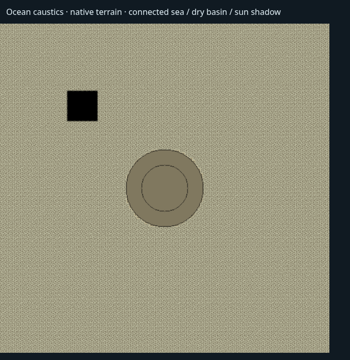

# Ocean — terrain caustics ve sığ su optiği

O4'ün dip ışığı bağlantısı eklendi. Ocean, Lake/River ile aynı terrain
caustics registry'sini ve doğrudan güneş ışığı hesabını kullanır. Desen,
Three.js/CSM gölgesi uygulanmadan önce irradiance'a katılır; emission veya
ikinci ışık/render pass'i yoktur. Güneş katkısı yoksa desen de ışık üretmez.
Bu, mevcut animasyonlu ışık deseninin Ocean'a uyarlanmasıdır; FFT dalga
merceklerinden hesaplanan fiziksel odaklama simülasyonu değildir.

`OceanWaterBody.caustics`, mevcut `WaterCaustics` sözleşmesini kullanır:
`enabled`, `strength`, `scale`, `speed`, `depthFade`. Varsayılan kapalıdır;
eski seviyelerin görünümü değişmez. Details → Seabed Caustics kontrolleri
undo/redo, Save, reload ve runtime Play yolunu kullanır. Loader ve save
validator aynı Ocean allowlist'ini çağırır; bilinmeyen alanlar dropped-fields
raporuna bırakılır, hatalı sayılar reddedilir.

Ocean'ın azami 262.144 hücresi, Lake'in 256² maskesine küçültülmez.
Terrain shader'ı OceanSurface'in mevcut float yükseklik/kapsam dokusunu
ödünç alır. Alıcı nokta ve kırılmış güneş ışınının suya giriş noktası,
terrain'in b-c üçgenleri, bağlı yüz bitleri ve interpolasyonla bulunan
zemin yüksekliği üzerinden sınanır. Kuru adalar, bağlantısız çukurlar ve
kısmen suya batmış üçgenlerin kuru parçaları aydınlatılmaz. Giriş noktası
terrain sınırı dışındaysa authored offshore su kabul edilir; alıcı terrain
referansı eşleşmelidir.

Güneşten dibe yol, kırılma açısına göre hesaplanır. Ocean arayüzü ve dip
ışığı aynı linear RGB extinction fonksiyonunu kullanır: güneş→dip ve
dip→kamera ayrı optik yollardır. Yüzeyin temel sığlık/soğurulma hesabı da
artık dalgayla değişmiş yüzey yüksekliğini içerir. Scene snapshot'ın clear
depth örneği uzak bir dip gibi kırılmaz; normal/reversed depth temizleme
değeri kontrol edilerek authored su kolonu korunur.

Desen animasyonu wall-clock yerine FFT saatini izler. Dairesel warp fazı,
FFT'nin 300 saniyelik döngüsünde değer ve hız sürekliliğini korur. Pause/hidden/capture
ve yardımcı render pass'leri saati ilerletmez. Caustics, renk ve soğurulma
düzenlemeleri terrain hazırlığını veya FFT'yi yeniden başlatmaz. Grafik kalite
profilinin mevcut `causticsAllowed` sınırı kullanılır. Hide, sıfır Strength,
kalite kapatma, silme ve level kapanışı registry referansını bırakır; kapsam
dokusunu yalnız OceanSurface dispose eder.

Ortak sekiz gövde sınırı korunur. Kapasite doluyken yeni kaynak yayımlanmaz;
geçerli önceki kaynak korunur. Ocean geometrisinin yenilenmesi kendi eski
registry slotunu eşzamanlı olarak devralabilir. Etkin Ocean caustics bir ek
sampler kullanır; ilk terrain çiziminden önce CSM bütçesine dahil edilir.
Kapalıyken sampler shader'dan çıkarılır. Yeni kapsam/atlas veya draw call yoktur;
ortak desen dizisine bir 256 KiB taban katmanı eklenir (mipmap'lerle yaklaşık
341 KiB). Desen dokusu canlı parametre düzenlemelerinde yeniden oluşturulmaz.

## Doğrulama

- `npx tsc --noEmit` ve tam `npm run build:verify` geçti: 2.587 motor
  kontrolü, import/type sınırları, production build, strict dist ve world-data.
  Son GLSL uyumluluk düzeltmesi production build ile ayrıca doğrulandı.
- `npm run check:assets` geçti: 0 hata, mevcut baseline'daki 6 cover uyarısı.
- Beş ayrı Chromium/WebGL senaryosu geçti: Ocean caustics, native editör/Play,
  Ocean optik/override/lifecycle, ortak planar ve River caustics akış sürekliliği.
  Son shader için caustics + River dosyaları yeniden çalıştırıldı (2/2).
  Native test gerçek FFT/planar ve mevcut test-only RAF pacing kullanır;
  yazılımsal GPU'da genişleyen UI akışının süre sınırı 900 saniyedir.
  Bu, render performansı kabulü değildir.
- Motor kontrolleri: kayıt/okuma/partition ve hatalı değerler; canlı görünüm
  düzenlemeleri; kalite/hide/disposal; ödünç doku sahipliği; sekiz dolu slotta
  başarısız ekleme ve eski Ocean slotunu devralma; sampler/cascade bütçesi.
- Chromium/WebGL native TerrainRenderer ölçümü: 512² hücre ve 65.536 hücre
  sınırının ötesindeki ıslak bölge; kuru çukur, gerçek güneş gölgesi, derinlik,
  extinction, gece, yanlış terrain, FFT pause ve üç kalite aç/kapa döngüsü.
- Native editör: caustics açma, Strength undo/redo, Save, reload ve runtime
  Play; ayrıca Ocean optik/planar ve River caustics regresyonları.

Bu teslim O4/O7'nin tamamını kapatmaz. Su altı kamera geçişi, su çizgisi,
fog/distortion, FFT'den odaklama, ortam profilleri ve referans kameralarında
son görsel kabul açıktır. Sonlu native terrain dibinin offshore sınırında
sürekliliği ayrıca çözülmelidir; bu değişiklik yeni bir okyanus tabanı üretmez.
Production release boyut bütçesinin önceki durumu da ayrıdır:
[Önceden var olan bütçe sınırı](OCEAN_RELEASE_BUDGET_CHECK.md).

## GPU ölçümü ve görsel kayıtlar

Chromium/SwiftShader, 2026-11-09; değerler native terrain'in linear float
hedefinde eşlenmiş açık/kapalı görüntülerin ortalama mutlak RGB farkıdır.
Güneşten dibe katkı ölçülür; bu bir FPS veya donanım GPU performans kabulü değildir.

| Durum | Ortalama fark |
| --- | ---: |
| Bağlı sığ deniz, 2 m | 0.174921 |
| 12 m derinlik | 0.018748 |
| 0.5 m absorption distance | 0.001176 |
| Kuru çukur / güneş gölgesi / gece / yanlış terrain | 0 |
| Pause / aynı FFT karesi | 0 |
| Döngü başlangıcı ve 300. saniye | 0 |
| 299.999 → 0 saniye sınırı | 0.00000181 |

4 draw call açık/kapalı aynı; sampler sayısı 9→10. FFT saati 0→0.25 s
ilerletildiğinde update sayısı 1→2 olur, tekrar render edilince değişmez.
Üç kalite aç/kapa döngüsünde doku sayısı büyümez. Ayrıntılar:
[Ölçüm JSON'u](evidence/ocean-caustics/measurements.json).

[Native editör](images/ocean-caustics/native-editor.png) ve
[runtime Play](images/ocean-caustics/native-runtime.png) kayıtları düşük maliyetli
test profiliyle entegrasyon akışını gösterir. Sonlu dip sınırı görünür;
bunlar Water Pro referans görünümünün tamamlandığına dair görsel kabul değildir.
