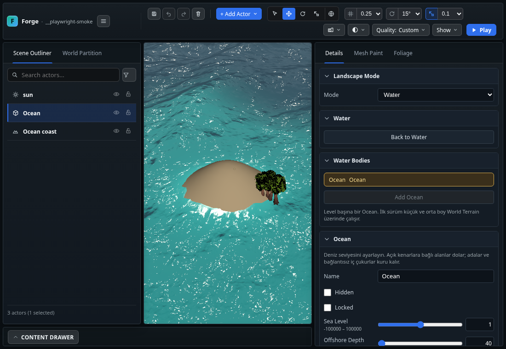
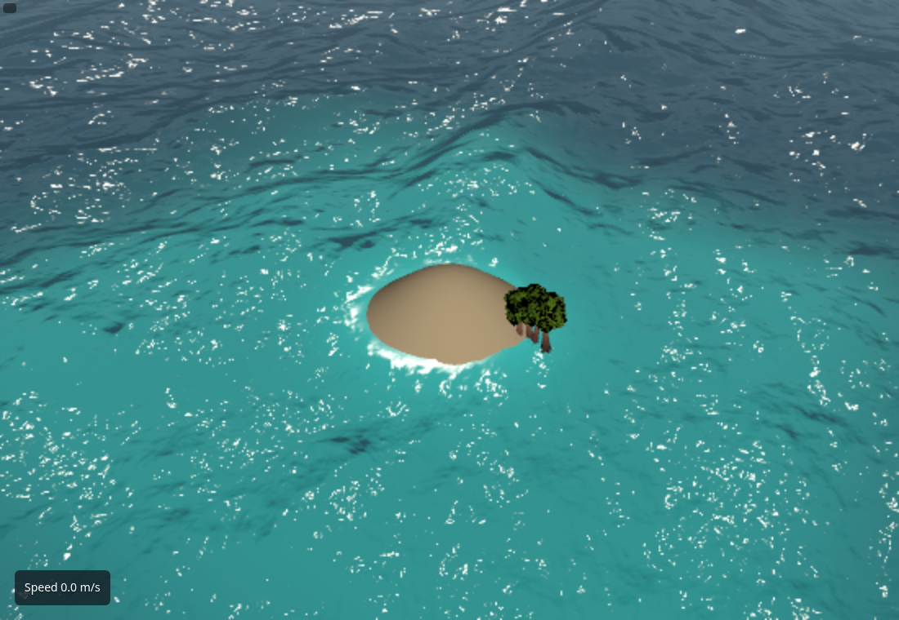

# Ocean — native editör ve runtime bağlantısı

Durum: ilk native entegrasyon uygulandı; tam su görsel sistemi kabulü açık.
Önceki teslim: [O1–O3 prototipi](OCEAN_O1_O3_PROTOTYPE_2026-11-08.md).
Ana plan: [Ocean geliştirme planı](../planned/OCEAN_DEVELOPMENT_PLAN.md).

## Kullanım

World Terrain seçin, Details → Landscape Mode → Water → **Add Ocean**.
Ocean Outliner ve Water Bodies listesinde görünür. Sea Level, açık kenarlar,
Offshore Depth, rüzgâr/swell parametreleri, ilk renk/roughness ve crest köpüğü
ayarları değiştirilebilir. Ad, Hidden ve Locked desteklenir. Oluşturma,
düzenleme ve silme undo/redo komutlarıdır; kayıt mevcut Save Layout yolundan geçer.
İlk deniz kotu terrain origin'inin Y değeridir; arazinin şekline göre ayarlanır.

Level başına tek Ocean ve en fazla 262.144 native terrain hücresi sınırı
sürer. Domain bütün terrain'i kapsar; bu sınırı aşan büyük dünyalar için
yakın kıyı/streaming tasarımı henüz tamamlanmadı. Eksik terrain verisi offshore
olarak doldurulmaz. Prototip sayfası da ayrı karşılaştırma aracı olarak kalır.

## Değişen davranış

`OceanWaterController` hem `SceneApp` hem `RuntimeSceneApp` tarafından kullanılır.
Native terrain hazırlandıktan sonra kapsam hazırlanır, FFT/surface oluşturulur;
aynı authored `oceanWaters` verisi editörde, Reload'da ve Play/runtime'da okunur.
Controller kapatıldığında veya level değiştiğinde pending iş iptal edilir ve
sunum kaynakları bırakılır. Silme sırasında geç dönen bir tile işi suyu geri
getiremez.

Ocean frame owner tarafından bir kez ilerler; reflection/draw callback'leri
simülasyon zamanını değiştirmez. Runtime pause/time-scale simülasyon deltasını
kullanır. Hidden Ocean güncellenmez. Başarısız terrain yenilemesi önceki geçerli
sunumu korur; kaynak terrain tamamen kaldırılmışsa eski sunum bırakılır.

Terrain yükseklik patch'leri Ocean hazırlığını invalidate eder. Origin taşınırken
Ocean bounds ve su kotu aynı undo edilebilir world-space dönüşümü izler.
Kaynak parametreler değişmemişse controller FFT kaynaklarını yeniden ayırmaz.
Sadece renk/lock gibi değişiklikleri daha dar katmanda uygulama optimizasyonu
henüz yapılmadı; bu ilk entegrasyonda yeni sunum hazırlanabilir.

## Doğrulama kapsamı

Engine tarafında toplam on Ocean kontrolü bulunur: ilk yedi veri/kapsam/native
terrain/LOD testine ek olarak ortak controller'ın hata/hidden/dispose davranışı,
geç tile sonucu–silme/travel yarışı ve gerçek SceneApp komutlarının
create/edit/lock/delete undo/redo davranışı test edilir. Ocean seçim kimlikleri
ve terrain move dönüşümü de aynı regresyonlar içindedir.

`ocean-editor.spec.ts`, kullanıcının verilerine dokunmayan izole bir native
terrain kurar; gerçek editörde Add Ocean, seviye düzenleme, undo/redo, diskte
Save, Reload, gerçek Play penceresi ve Delete/Undo akışlarını sınar. Sadece
schema testinin geçmesi kullanıcı akışının kabulü yerine kullanılmaz.
İzole projede olmayan favicon isteği 204 ile yanıtlanır; uygulama/shader
console hataları filtrelenmez.

Son native Playwright koşusu başarılıdır: bir test, 4,5 dakika (yazılımsal GPU).
Gerçek level boot logu ve loading akışı beklenerek runtime görüntüsü alınmıştır;
yalnız canvas'ın varlığı başarı sayılmamıştır. Kamera odağının genel küçük-obje
mesafe tavanı Ocean'da adanın içine giriyordu; Ocean'a özgü mesafe düzeltildi.

Sabit ekran görüntüsü hareket/fizik veya hedef donanım performans kabulü
değildir. Tarayıcı ortamındaki yazılımsal GPU koşusu shader/işlev regresyonu
içindir. Hatalı terrain yenilemesinde eski geçerli cache'in hata durumunu
yanlışlıkla Ready'ye çevirmemesine ayrıca regresyon eklenmiştir. Son birleşik
doğrulama sonucu aşağıda kaydedilir.

| Kontrol | Sonuç |
|---|---|
| `npm run build:verify` | Başarılı, çıkış 0; slow dahil 2.581 engine kontrolü (10 Ocean), import sınırları, smoke/content/UI türleri, build, strict dist ve world-data kontrolleri geçti |
| `FORGE_CHROMIUM_EXECUTABLE=/usr/bin/chromium npm run smoke:browser -- ocean-editor.spec.ts` | Başarılı; native create/edit/undo/save/reload/gerçek Play/delete–undo; console/page error yok |
| `ocean-reference.spec.ts` | İlk FFT prototipinde başarılı; dört kademe, float probe, pause, analitik karşılaştırma, kaynak/rebuild kontrolleri; ilk prototip raporunda sınırları kayıtlı |
| `git diff --check` | Başarılı |

Gerçek GPU p95/bellek tepesi ve kullanıcı görsel kabulü bu sonuçlara dahil değildir.

## Kalan işler

Bu entegrasyon O6'nın temel editör/kayıt bağını getirir; O6 bütünü tamamlandı
sayılmaz. Kalite varyantları ve tavanları, uzun kaynak döngüleri, viewport'ta
deplase yüzeye doğru picking, tam production browser ve gerçek GPU bütçesi açık.
Ocean seçimi şu anda Outliner/Water listesi üzerinden yapılır; transform gizmosu
kullanılmaz. Deniz kotu Details üzerinden ayarlanır.

O4 ortak optik/ortam/planar/snapshot bağlantısı henüz tamamlanmadı; mevcut
Ocean shader'ının ilk renk/ışık sunumu nihai Water Pro görünümü değildir.
WES üzerinden canlı spektrum/ışık adaptasyonu, üç bağımsız köpük katmanı,
kıyı breaker/swash, su altı, yüzdürme, wake ve kapalı hacim maskeleri sonraki
işlerdir. Bu sınırlı teslim mevcut Lake/River/Puddle sistemlerinin yerine geçmez.
