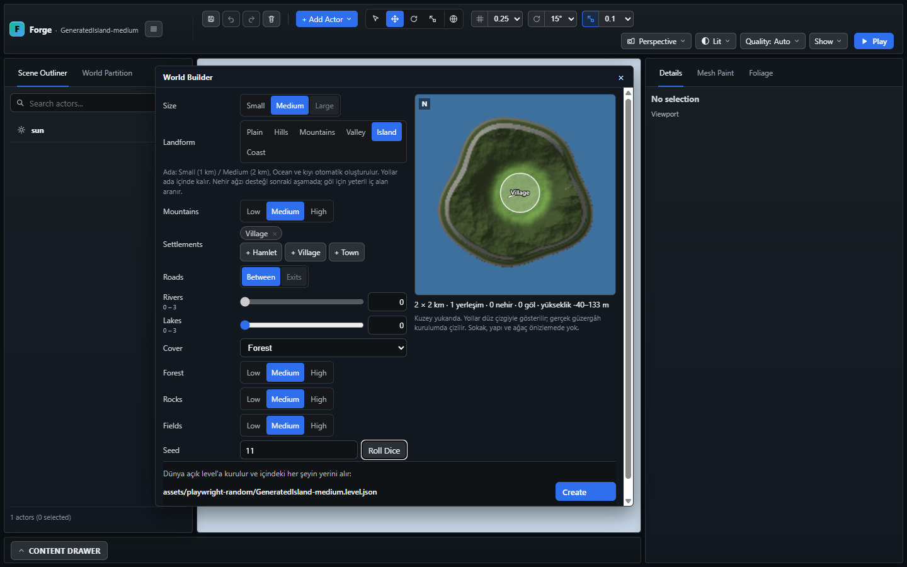
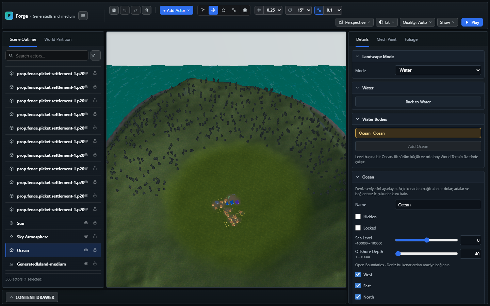
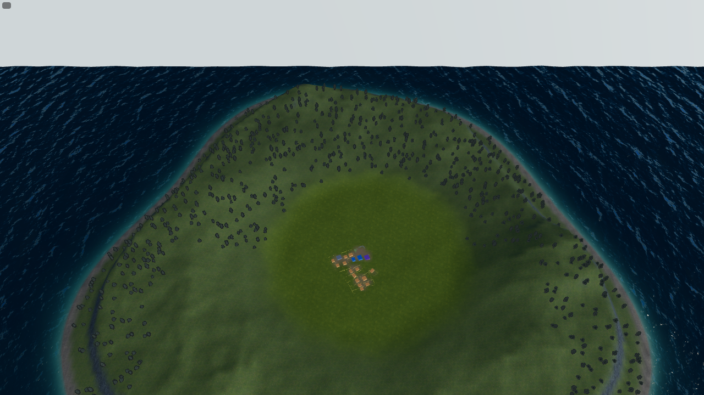
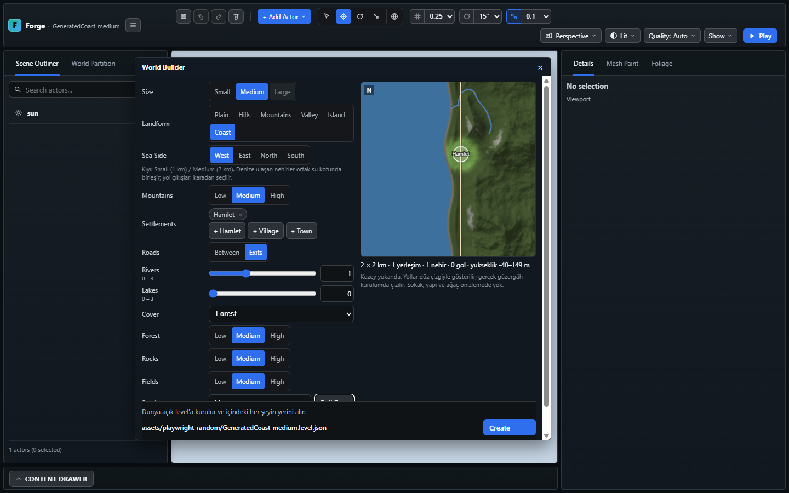
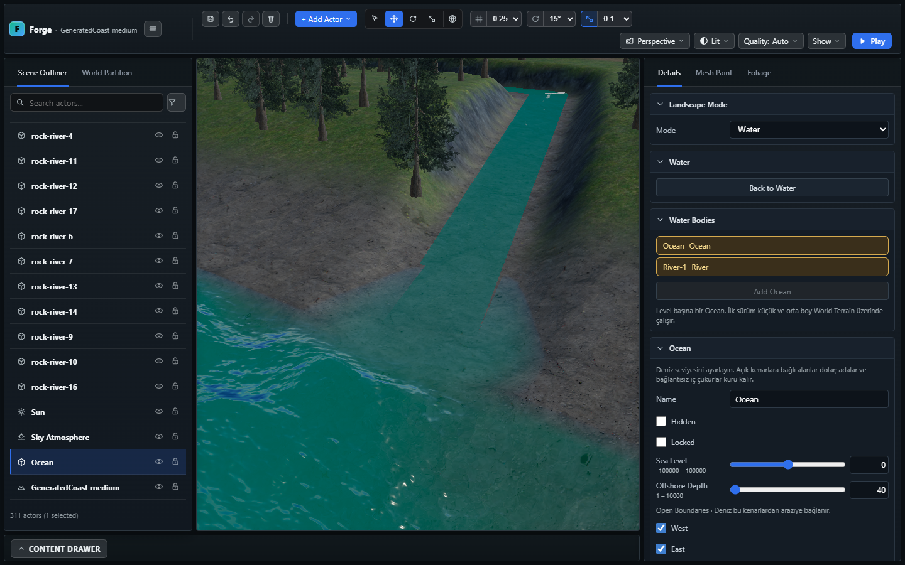
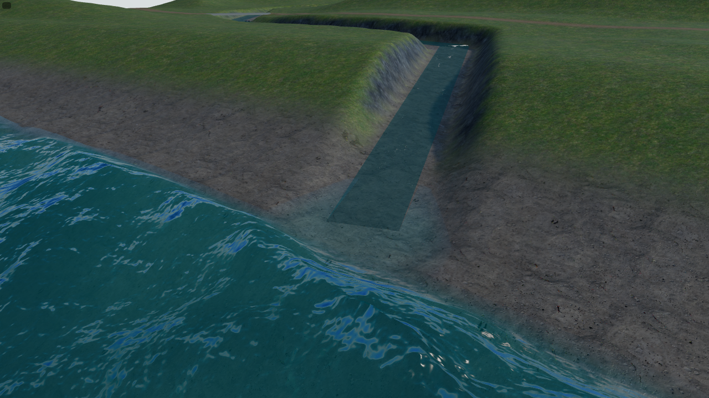
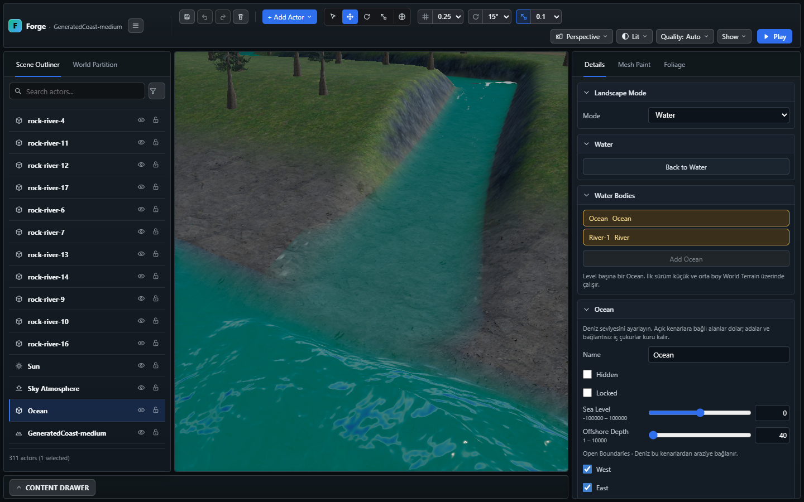
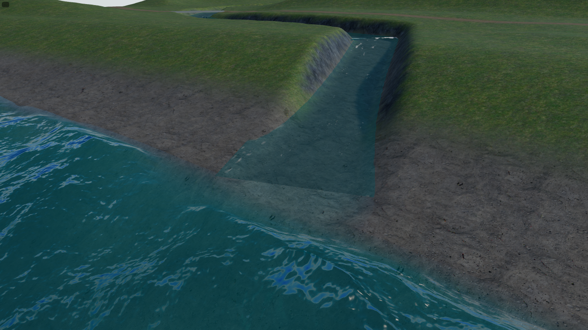

# World Builder — Medium Island/Coast ve Ocean atlası

9 Kasım 2026. [O9-B](../planned/OCEAN_DEVELOPMENT_PLAN.md) üçüncü adımın
Medium dilimi. [Tasarım](../planned/OCEAN_MEDIUM_LARGE_COVERAGE_DESIGN.md)
native çözünürlük ve mevcut Small kayıtları korunarak uygulanır. Large ve
Ada'da nehir bu teslimin dışındadır. Commit/push yapılmaz.

## Kullanıcıya yansıyan davranış

World Builder'da Island ve Coast için **Small ve Medium** seçilebilir. Medium
2.048×2.048 m, 8×8 tile, tile başına 128 quad, 2 m aralık ve 1024×1024 native
hücre kullanır. Large kapalı kalır ve doğrudan üretim isteğinde de reddedilir.
Ada'da dış yol çıkışı/nehir kısıtları sürer; Coast'ta deniz yönü, River Width
Scale ve nehir ağzı geçişi korunur.

Boyut normalizer'ı, UI düğmeleri, worker/generator ve endpoint istek kontrolü
aynı Three bağımsız `oceanWorldSizeSupported` politikasını kullanır. Ortak
numeric cap `engine/scene/oceanBudget.ts` içindedir; World Builder'a renderer
veya su materyali bağımlılığı eklenmez. Native builder ve Ocean hazırlığı da
aynı 1.048.576 hücre tavanını uygular. Yeni kalıcı şema alanı yoktur.

## Uygulama

- Hazır yükseklikler ve sekiz hücrenin iki bitlik bağlantı bayrakları tek R32F
  atlasında tutulur. CPU heights bu atlasın view'ıdır; 16V RGBA paketleme kopyası
  kaldırılır. Aynı Float32 değerleri, b–c interpolasyonu, offshore ayrımı ve
  kapalı çukur bağlantısı kullanılır.
- Maskenin paketlenmesi ve önceden boyutlandırılmış typed grid buffer'larının
  doldurulması cooperative generator'dır. Min bed hazırlıkta hesaplanır; surface
  kurucusunda yeniden tüm height dizisi taranmaz.
- GPU atlası, public renderer API'siyle en çok 256 KiB bandlarda yüklenir.
  Her cooperative task sınırında iptal kontrol edilir. Sonraki bind'ler bütün
  atlası yeniden yüklemez. Surface ve normal/depth programları yayın öncesinde
  `compileAsync` ile hazırlanır.
- Async sunum generation/document/revision kontrolleri sonrası yayınlanır.
  Reflection/caustics kaydı await içermeyen commit kısmında alınır. Eski geçerli
  sunum staging sırasında korunur; stale/iptal edilen sunum kendi kaynaklarını
  bırakır. Dirty terrain varken width editinin eski coverage'ı güncel sayması
  engellenir. Caustics atlası ödünç alır ve tek texture sahibi surface'tir.
- Context kaybında geçersiz GPU sunumu bırakılır; restore sonrasında en son
  doğrulanmış Ocean değerleriyle yeniden staging yapılır. Arada silinen Ocean
  geri getirilmez. Bu lifecycle Node event testiyle doğrulanır; gerçek GPU
  context-restore performans kabulü ayrıca açıktır.
- Medium kuşbakışı görüntüde eski 1536 m dış grid yarıçapı uzak seafloor'u
  açıkta bırakıyordu. Fiziksel domain genişliğine göre sınırlı dış halkalar
  eklenir: Small yedi, Medium sekiz ring; Medium dış yarıçapı 3072 m'dir.
  Yakın yedi ring'in vertex değerleri değişmez. Bu, sonsuz ufuk teslimi değildir.

## Kaynak hesabı ve ölçüm

Önceki [RGBA ölçümü](evidence/ocean-medium-large/budget.json) korunur. Yeni
sonuç ayrı [atlas ölçümünde](evidence/ocean-medium-large/budget-atlas-medium.json)
tutulur. Yeni araçtaki `packMs` alanı cooperative grid hazırlığı + kısa kurucuyu
ifade eder; eski senkron RGBA kurucusuyla aynı iş değildir. Tanı bundle'ında
Large hâlâ yalnız in-memory cap değişikliğiyle ölçülür; üretim desteği değildir.

| Medium temel kaynak | Boyut |
| --- | ---: |
| 1025×1153 R32F atlas | 4,51 MiB |
| Dört cascade FFT format hesabı | 22,67 MiB |
| Sekiz ring grid | 0,94 MiB |
| Temel Ocean GPU toplamı | 28,11 MiB |
| Eski + yeni temel GPU replacement | 56,23 MiB |
| Kalıcı Ocean CPU typed buffer'ları | 6,45 MiB |

Tasarımın yedi ring tablosundaki 28,00/55,99 MiB, ek dış halka nedeniyle
uygulamada 28,11/56,23 MiB olur. Bunlar format/byte hesabıdır; fiziksel VRAM veya
GPU timer ölçümü değildir. Planar/snapshot/diğer ekran kaynakları toplamı ve
64/96 MiB tam bütçe kabulü ayrı kalır. Atlas bir sampler kullanır; mevcut
terrain cascade rezervini azaltan ikinci bir kapsam sampler'ı eklenmedi.

Son dış halkayla iki warmup ardından beş örnek alınmıştır. Medium hazırlık p50
Island resident/disk için 293,3/427,9 ms; Coast için 196,6/264,4 ms'dir. Cooperative
grid + kısa surface kurulumu p50 5,0–7,3 ms; kaydedilen en büyük CPU dilimi 4,9 ms'dir.
Bu tepe tasarımın 4 ms hedefini aşar; performans kabulü tamamlanmış sayılmaz.
Ölçüm sırasında build/test yükü de vardır; disk yolu OS cache'i temizlemez.
Node/setImmediate süreleri gerçek browser CPU/GPU kabulü değildir; tam cold/warm
protokolü ve >50 ms Ocean long-task kabulü bu işlev dilimiyle kapanmaz.

## Doğrulama

| Kontrol | Sonuç |
| --- | --- |
| TypeScript + smoke/perf type-check | Başarılı |
| Tam engine grubu (`test:engine:slow`) | 2606 kontrol başarılı; 205,0 s |
| Gerçek GPU atlas probe | 2.097.152 üçgen örneği, sıfır fark; tüm 65536 maske sözcüğü; 19 band; en büyük upload 258300 byte; normal bind'de 0 tekrar upload; aktif offscreen target korundu; abort başarılı; GL hata 0 |
| Atlas + Ocean reference/planar/caustics browser grubu | Dört senaryo geçti; 36,6 s |
| Medium Island/Coast authoring akışı | Son dış halka ile iki senaryo başarılı; toplam 3,0 dakika. Create/Save/Reload/Play, Coast dar/geniş width ve undo/redo |
| `build:verify` kapıları | Import/fixture/content/UI/tool/project kontrolleri, TypeScript/Vite build, tam engine, strict dist ve world-data başarılı |

Engine kontrolleri gerçek Medium Island/Coast kurulumunu, native atlas boyutunu,
dört Coast yönünü, canlı width kaynağını, read/save round-trip'i ve Large reddini
kapsar. Async create sırasında terrain değişimi + width edit, stale publication,
context restore/delete ve atlas tail/word sınırları ayrıca test edilir.

Browser akışı Create → Save → Reload → gerçek Play kullanır. Coast için Width
Scale 0,5 ve 1,5, undo/redo ve her iki genişlikte Play görüntüsü alınır. Bilinen
isteğe bağlı sidecar 404'leri mevcut sınıflandırmayla ayrılır. İlk headed koşuda
yalnız `favicon.ico` 404'ü hata sayılmıştır; iz kaydı kontrol edilip yalnız bu
istek mevcut favicon filtresiyle ayrılmıştır. Uygulama/shader hataları saklanmaz.

## Görseller ve kalan sınırlar

1440×900 editör ve 1280×720 Play görüntüleri aynı izole kayıtlardan alınmıştır.
World Builder önizleme/kontrol penceresi 900 px genişlikte de kontrol edilir.
Dalga fazları eşzamanlı değildir; görseller piksel veya performans benchmark'ı değildir.

River/Ocean renk/ışık sınırı hâlâ seçilebilir. Native domain dışındaki Ocean
mesh'i sonludur; sonsuz ufuk, son ürün optik kabulü ve hedef donanım p95 GPU/
transient tepe kabulü açık kalır. Small ve Medium işlev desteği, O6/O9'un bütün
görsel/performance hedeflerinin tamamlandığı anlamına gelmez.

Testler `.playwright-smoke/run-*` içinde çalışır. Çalışma sırasında kapsam dışı
`public/project.3dgame.json`, manifest ve `Levels/S1*` verileri değişmiştir;
bu dosyalara dokunulmamış veya geri alınmamıştır. WebGPU master planı korunur.
Codex Security diff incelemesi önerildi; tarama başlatılmadı.

## A1 devamı — 10 Kasım 2026

Coast alan dağılımı ve kuru kumsal, yalnız yeni Small/Medium üretim için
güncellendi. [A1 raporu](WORLD_BUILDER_COAST_A1.md) ölçüm tanımını, üç seed ×
dört yön sonuçlarını, native tile karşılaştırmasını ve yeni editör/Play
görüntülerini içerir. İç kara %69,994–70,032; kıyıya dik ortalama kuru kumsal
60,32–60,82 m (eskiye göre 2,548–2,555 kat). Kumsal %30 içinde sayılır.
Coast Save/Reload, Width Scale 0,5/1,5, undo/redo ve gerçek Play yeniden geçti.
Bu ek A2 sığ taban profili, A3 ada çeşitliliği veya tam Ocean performans
kabulünü kapatmaz; yukarıdaki Medium atlas kanıtları kendi kapsamıyla korunur.

## A2 devamı — 10 Kasım 2026

Yeni Small/Medium Island/Coast üretiminde sığ su altı profili eklendi.
[A2 raporu](WORLD_BUILDER_SHORE_A2.md): 35 m açıkta yaklaşık 2 m derinlik,
150 m'de derin tabana yaklaşma; kuru arazi ve kıyı çizgisi korunur. Small
Island'da native domain dışına çıkan kesitler ayrıca raporlanır. Dört izole
Create/Save/Reload/Play akışı, Coast 0,5/1,5 ağızları ve üretim GLSL GPU probe'u
geçti. A3 ada çeşitliliği, Large ve tam Ocean performans/görsel kabulü açık kalır.

## A3 devamı — 10 Kasım 2026

Yeni Island üretiminde alanı koruyan seed ana biçimleri ve kıyı örnekleri
eklendi. [A3 raporu](WORLD_BUILDER_ISLAND_A3.md), aynı-seed önce/sonra kara
alanını, Small/Medium farklı seed görüntülerini, native ve yerleşim/yol/göl
güvenliği kontrollerini içerir. A2 ve eski kullanıcı kayıtları korunur.
2610 tam engine kontrolü ve browser akışları geçti. Birleşik kapının ilgisiz
project-roots testinde kapanış takılması ve kalan kapıların ayrı tamamlanması
raporda açıkça ayrılır; tam Ocean GPU ve A4 birleşik kabulü açık kalır.
