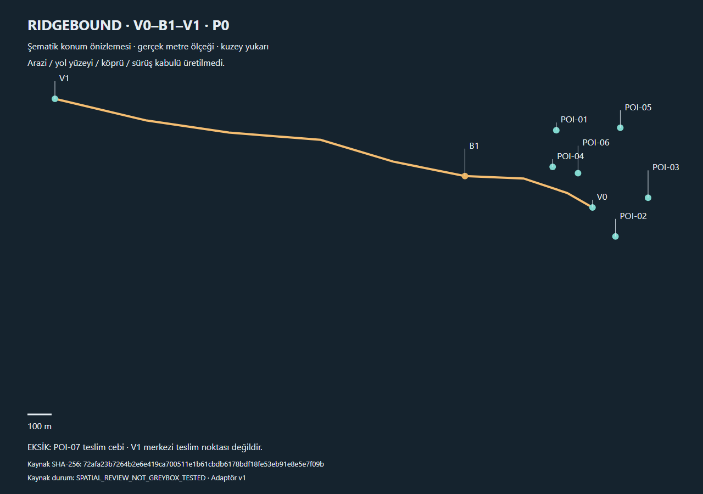
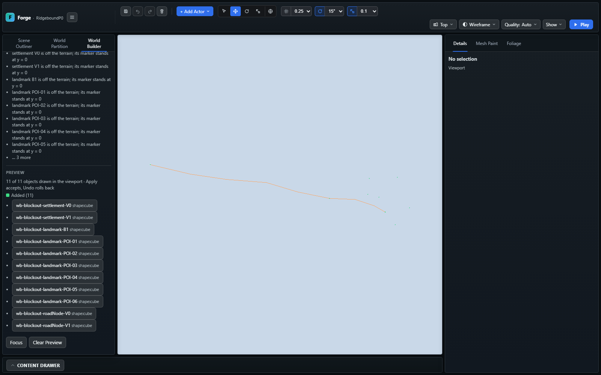

# Ridgebound P0a — metrik konum aktarımı

**Tarih:** 2 Kasım 2026. **Durum:** İlk konum aktarımı tamam; arazi/yol/köprü ve
oynanış kabulü açık. Repo tabanı `2ee2d15e`; değişiklikler yerel çalışma ağacında,
commit/push yapılmadı. Başlangıçtaki bağımsız kullanıcı değişiklikleri korundu.

## Teslim

Canlı Drive masterının ham baytları doğrulandı:
`72afa23b7264b2e6e419ca700511e1b61cbdb6178bdf18fe53eb91e8e5e7f09b`.
Sabit test girdisi bu kaynakla aynı. Güncel kaynak v0.2 ve
`SPATIAL_REVIEW_NOT_GREYBOX_TESTED` durumunda; bu çalışma tasarım onayı vermez.

- `npm run world:ridgebound`: varsayılan dry-run; açık `--out` ile yeni ve ayrı
  inceleme paketi. SHA kontrolü, 2 MiB sınırı, hatalı eksen/topoloji reddi,
  mevcut çıktı üzerine yazmayı ve public/ hedefini reddetme.
- Mevcut World Recipe normalizerıyla uyumlu V0/V1, B1, POI-01–06 ve R01.
  Koordinatlar resimden tahmin edilmedi; yüzde eğim dereceye çevrilip raporlandı.
- Ölçekli SVG, kaynak/fark/eksik alan raporu ve Plan blockout ile açılan level.
  Kaynak formülleri çalıştırılmadı. Mevcut sahne, varsayılan proje, master ve
  üretim görselleri değiştirilmedi.
- Kilometrelik planın Focus işleminde 80 m ortografik tavana ve uzak kesme
  düzlemine takıldığı görsel incelemede bulundu. Genel preview kamera hesabı
  viewport oranıyla sığdırıyor; Top görünüşün kuzey yönünü koruyor.

İnceleme paketi `output/ridgebound/p0-20261102/` altında; kaynak kodu ve
[kullanım sözleşmesi](../world-builder/RIDGEBOUND_METRIC_IMPORT.md) ayrı tutulur.
Oyun-özel kurallar `tools/world/ridgeboundSpatial.ts` adaptöründe, genel metrik
dönüşüm ve kamera hesabı ortak modüllerdedir.

## Doğrulama

- `npx.cmd tsc --noEmit`: geçti.
- Son kamera düzeltmesi dahil `npm.cmd run build:verify`: **geçti**;
  **2224 engine kontrolü**, smoke/content/UI tip kontrolleri, araç testleri,
  katman sınırları, üretim derlemesi, strict runtime dist ve world-data dahil.
- `npm run verify:ridgebound-tools`: build gate içinde geçti; yeni çıktı,
  hash reddi, public/ sınırı ve elle düzenlenmiş çıktıyı koruma.
- İzole Chromium/Playwright `ridgebound-spatial.spec.ts`: **1/1 geçti**,
  son koşu 27,7 s (toplam 32,1 s). Preview → Apply → Undo/Redo → Save Layout →
  reload → yeniden dry-run (11 unchanged). Konsol/pageerror listesi boş.
- İlk browser koşusunun işlemleri geçmesine karşın ekran boştu. Kamera
  düzeltmesi sonrası test, gerçek render kamerasında bütün preview köşelerinin
  viewport ve yakın/uzak kesme düzlemlerinin içinde olmasını da kontrol ediyor.
- SVG Chromium'da 1280×900 açıldı; taşma yok, R01 ve dokuz kontrol noktası
  okunuyor. Editor görüntüsü ayrı incelendi. GPU performansı/sürüş ölçülmedi.
- `git diff --check`: temiz. Esbuild'in sandbox üst dizin okuma hatası sonrası
  kontroller gerekli erişimle çalıştırıldı; engellenen ilk koşu başarı sayılmadı.

## Açık sınırlar ve sonraki iş

Bu paket terrain yüksekliği, U16 yeniden örnekleme, yol yüzeyi/düşey kotu,
köprü tabliyesi/colliderı, POI bina/parsel/avlu veya görev/yük sistemi üretmez.
Plan blockout işaretleri düz şematik zemine dayanır. V1 merkezi teslim cebi
yerine kullanılmadı; **POI-07 eksik** uyarısı korunuyor.

Stage sahipliği, elle değiştirilen/silinen işaretleri korur; bu testlidir.
**Yeni masterı düzenlenmiş recipe ile birleştirme henüz yoktur.** Yeni inceleme
klasörü üretilir; eski çıktı üzerine yazılmaz. Mevcut Roads/settlement üreticileri
authored geometriyi değiştirebildiği için P0a'da yalnız Plan blockout kullanılır.

Sonraki teknik dilim: seçilen pilot ızgarasında heightfield; ardından authored
R01 kotu, B1 ve ölçülü POI blokları. GPT tarafında POI-02 avlusu ve POI-07 aday
girişi/dönüş alanı bekleniyor. Bunlar F1b'nin üç gerçek referans/WB-13 veya
GDD'nin M0 → M1 → M2 kabulünün yerine geçmez. Codex Security diff incelemesi
önerildi, kullanıcı istemediği için scan çalıştırılmadı.
