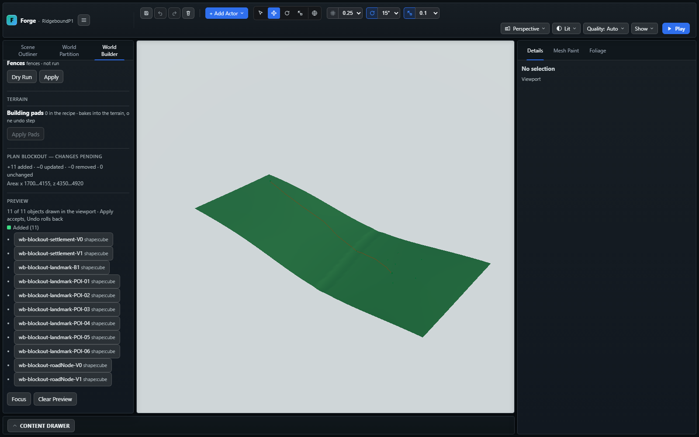
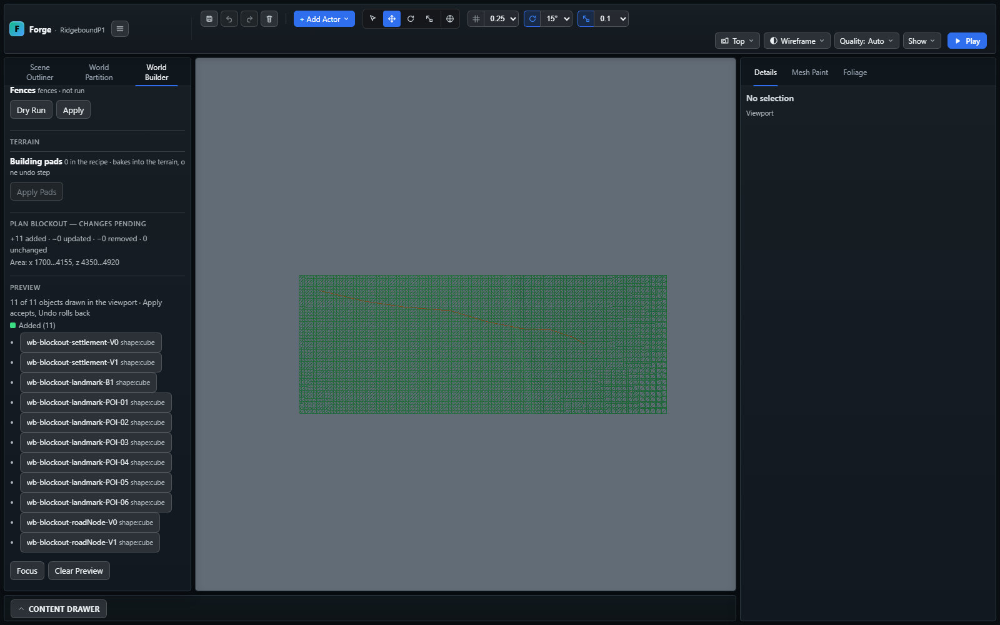

# Ridgebound P1 — kaynak heightfield aktarımı

**Tarih:** 2 Kasım 2026. **Durum:** TERRAIN VERİ/EDİTÖR KABULÜ TAMAM;
ROAD/BRIDGE/SÜRÜŞ KABULÜ AÇIK. Repo tabanı `74a7abe8`; bu değişiklikler yerel,
commit/push yapılmadı.

**Ayrı dosya gerekçesi:** P1 kaynak terrain aktarımının dondurulmuş test/kanıt
kilometre taşıdır; yaşayan teknik planın veya masterın yeni kopyası değildir.

## Kaynak ve örnekleme

- [Master v0.2](https://drive.google.com/file/d/1mM5MiOrvq0RRPoc2QNDQXtxk81wG0ZY9/view)
  SHA-256: `72afa23b7264b2e6e419ca700511e1b61cbdb6178bdf18fe53eb91e8e5e7f09b`.
- [Makro U16 PNG](https://drive.google.com/file/d/1mVdVcTWfzyOvJNAZkd6bvF2OtdIZfNU5/view)
  SHA-256: `bc0c67e06eded7f5533c582d540420b7963d33e46d7c131a1fa7cbf8ae623934`.
  Drive'dan indirilen ham dosya yerel Offroad kopyasıyla birebir eşleşti.
- Kaynak 1001×1001, 16-bit gri, satır 0 kuzey; aralık 6 m. Kod çözümü
  `100+(u16/65535)*750 m`. Mevcut kuzeybatı datum/eksen sözleşmesi korundu.
- Kaynak üzerinde `[x=256,z=704,width=513,height=193]` penceresi kesildi.
  **Yeniden örnekleme, 1 m ayrıntı üretme, kenar doldurma veya formül çalıştırma yok.**
- Teknik test seçimi: 100 m çevre payı, 64 quad/tile, 8×3 tile, **3072×1152 m**.
  Terrain origin `[1536,0,4224]`; kaynak doğu 1536…4608 / kuzey 624…1776 m.
  Bu grid seçimi mekânsal onay veya kesin pilot sınırı değildir.

## Teslim

`world:ridgebound` aracına isteğe bağlı `--heightmap` ve
`--expect-heightmap-sha256` eklendi. Varsayılan P0 konum aktarımı korunur.
Heightmap seçilirse ayrı P1 level/recipe, terrain tanımı, 24 tile, global harita,
kesilmiş U16 ve kaynak/eksik alan raporu üretilir. Yeni klasör kuralı korunur;
public/, mevcut çıktı ve kullanıcı sahneleri üzerine yazılmaz.

İnceleme paketi `output/ridgebound/p1-terrain-20261102/` altında **32 dosya /
836.507 bayt**. [Kullanım sözleşmesi](../world-builder/RIDGEBOUND_METRIC_IMPORT.md)
aynı yaşayan dosyada P1 bölümüyle güncellendi.

| Kontrol | World x/z | Ham terrain kotu |
|---|---|---:|
| V0 | 3925 / 4800 | 250,6409 m |
| V1 | 1700 / 4350 | 386,0609 m |
| B1 | 3397 / 4670 | 209,8383 m |
| POI-02 | 4020 / 4920 | 253,5935 m |

B1 değeri **yatak** kotudur; tabliye veya yol kotu değildir. 11 Plan blockout
işareti bu kez gerçek kaynak arazinin üstüne oturur. R01 çizgisi plan overlay'idir;
fiziksel yol yüzeyi değildir. Yeni save endpoint'i/şema alanı eklenmedi.

## Doğrulama

- `npx.cmd tsc --noEmit`: geçti; son görüntüleme testi için ayrıca
  `tsc --noEmit -p tsconfig.smoke.json` geçti.
- `npm.cmd run build:verify`: **geçti; 2227 engine kontrolü**, araç testleri,
  import sınırları, smoke/content/UI tip denetimi, üretim derlemesi, strict
  runtime dist ve world-data dahil. Log: `output/ridgebound/build-verify-p1-20261102.log`.
- Motor testleri: tüm kesim kodlarının byte-exact export/reload'u, 24 tile'ın
  bütün ortak kenarları, kuzey/kot kontrol noktaları, PhysicsSubsystem statik
  heightfield üçgenleri ile terrain sorgusunun eşitliği; bozuk PNG/kodlama/sınır reddi.
- CLI: yanlış raster hash'i reddedilir; dry-run, yeni çıktı ve önceki koruma
  testleri geçer. Kaynak ve raster kimliği birlikte raporlanır.
- İzole Chromium/Playwright: **2/2 geçti** (P0 ve P1). P1: 24 tile yüklenmesi,
  zemine oturan işaretler, Save Layout/reload, 11 unchanged ve bütün terrain
  binary dosyalarının değişmeden kalması. Konsol/pageerror boş.
- Kamera görüntülerinde crop çevre payını da göstermek için normal zoom-out
  girdileri eklendi; yalnız P1 tekrar koşusu **1/1 geçti**. İki nihai açı görsel
  olarak incelendi; arazi kenarları görünüşe sığıyor. Sürüş/GPU performansı ölçülmedi.
- `git diff --check`: temiz. Master, mevcut görsel onayları ve kullanıcı
  varsayılan sahnesi değiştirilmedi.

## GPT devri ve sonraki teknik iş

GPT'nin World Builder v0.6 / §0.3.2–0.3.3 ve Pilot Fişi v0.2 devri okundu.
POI-02 bina/parsel/giriş ile avlu/yaya/yükleme işlevlerinin ayrımı korunur.
POI-07 A/B seçimi yapılmadı ve mastera koordinat eklenmedi. P0a kabulü tarihsel
olarak korunur; bu P1 onun üstüne kaynak araziyi ekler.

Sonraki teknik dilim: gerçek araç profilini ölçmek; authored R01 düşey kotu,
B1 tabliye/approach/collider ve POI-02 saha testini bu terrain üzerinde hazırlamak.
POI-07 A/B yalnız ölçülü öneri olarak karşılaştırılmalı. 6 m raster, tek başına
4–6 m yol enkesiti/köprü yaklaşımı veya depo düzlüğü kabulü vermez. Yerel 1 m
heightfield birleştirmesi, yol/pad deformu, su yüzeyi ve görev/yük/ödül sistemi
bu dilimde yoktur. Genel F1b/WB-13 veya M0 → M1 → M2 kapatılmadı.
