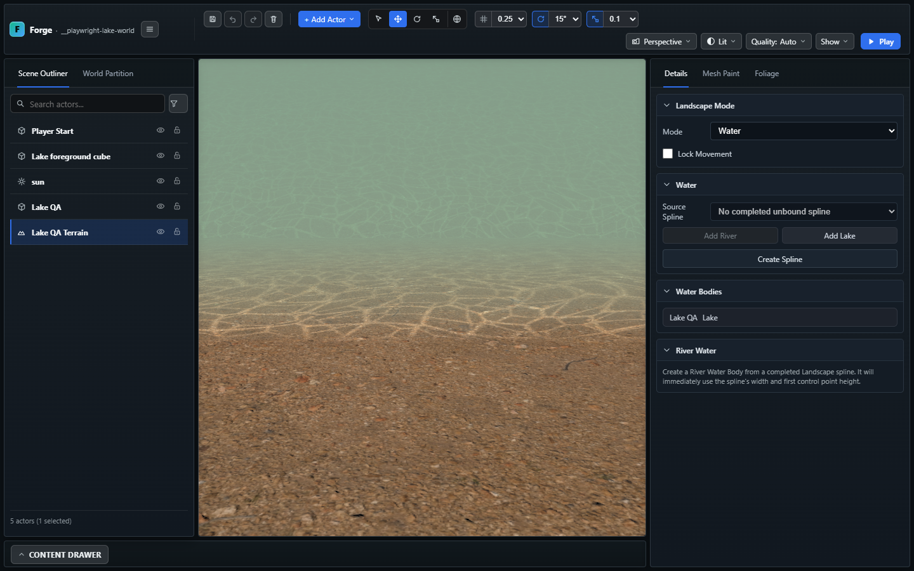

# Sığ su zemini ve Lake caustics — 2026-10-27

## Kullanım

1. Landscape'in boyanacak katmanında materyal olarak **M_Shallow_Water_Bed** seçin.
   Göl tabanına veya nehir yatağına Paint ile uygulayın. Materyalin doku tekrarı
   **2,4 m**'dir; terrain boyutu değişince taşların ölçeği değişmez.
2. Lake aktörünü seçin, **Caustics → Enabled** açın. Şiddet, desen boyutu (m),
   hız ve derinlikte sönme ayrı ayarlanır. Önceki Lake kayıtlarında varsayılan
   kapalıdır. Su görünürlüğü için Appearance bölümündeki Bed Visibility ve
   Absorption Distance (m) alanları kullanılabilir.
3. Aynı dip materyali nehir altında da kullanılabilir. River caustics entegrasyonu
   bu ilk teslimde yoktur; [ana planın C4 dilimidir](../planned/WORLD_TERRAIN_WATER_BODY_PLAN.md).

Materyal boyama, su aktörü veya terrain yatağı üretmez. Kullanıcı sahnesi/tile'ları
otomatik boyanmadı; mevcut sahne, ışık ve fizik ayarları değiştirilmedi.

## Uygulama

- Dip: Poly Haven **Gravelly Sand**, CC0. 1K renk/roughness ve 1K OpenGL normal
  haritası. Kaynak dosyalar yeniden adlandırılmış orijinallerdir; normal PNG
  16 bit/kanaldır. Kaynak/MD5 kaydı:
  [SHALLOW_WATER_BED_SOURCE.md](../../public/assets/starter-content/Textures/SHALLOW_WATER_BED_SOURCE.md).
- Terrain: tüm katmanlar için optional normal map; lineer RGBA8 doku dizisi,
  paint ağırlıklarıyla normal karışımı, editor/runtime yükleme ve dispose.
  Normal içermeyen katmanlar düz mikro-normal kullanır; eksik normal haritası
  renk katmanının yüklenmesini engellemez.
- Materyal ayarı: optional `terrainMetersPerRepeat`; runtime normalizer ve save
  validator alanı korur. Eski materyaller mevcut terrain tekrarını kullanır.
- Caustics: bağlı Lake kaynak üçgenleri hücre başına iki bayrakla saklanır.
  Shader aynı b–c diyagonalini seçer; maskeye ek olarak su seviyesi/zemin farkı
  kontrol edilir. Böylece ada, kuru kıyı ve ayrı çukur aydınlatılmaz. Maske
  terrain referansı ve görünürlükle sınırlanır; Lake kaldırılınca kaynak bırakılır.
- Özgün periyodik ışık ağı/warp alanı bir kez üretilip maskenin B/A kanallarına
  paketlenir. Dünya koordinatında iki farklı yönde kayan, bükülen ve mipmap ile
  filtrelenen örnekler animasyonu oluşturur. Güneş yönü, yaklaşık kırılma ve
  kıyı/derinlik sönmesi kullanılır. Baskın yönlü ışığın alanı bir kez hazırlanır;
  CSM kademeleri aynı alanı kullanır ve mevcut gölge hook'u korunur. Ek desen
  sampler'ı veya çizim geçişi yoktur. Fiziksel ışın izleme/su hacmi simülasyonu
  eklenmez.
- Lake görünüm alanları ortak runtime/save allowlist'tedir. Kontroller mevcut
  Lake edit, undo/redo ve Save/Reload/Play yolunu kullanır.

## Kaynak maliyeti

- Maske/desen: göl başına 256×256 RGBA8 = **256 KiB** ana seviye; mipmap'lerle
  yaklaşık **341,3 KiB** GPU. Sekiz gölde yaklaşık **2,67 MiB** GPU ve **2 MiB**
  CPU upload buffer. Paylaşılan CPU desen alanı **128 KiB**'dir. Bağlantılı
  kaynak yüzler ayrıca hücre başına iki byte tutar; mevcut toplam hücre
  sınırında en çok **512 KiB**. Geometri byte hesabına yüz bayrakları dahildir.
  Maskeler filtrelenmiş mip seviyelerinden okunmaz; `texelFetch(..., 0)` ile
  tam kaynak bayrakları alınır. Desen aynı dokunun filtrelenen B/A kanallarındadır.
- Bu 1K materyalin tek normal array katmanı: **4 MiB** ana seviye buffer;
  mipmap'lerle teorik GPU doku boyutu yaklaşık **5,33 MiB**. Decoder, kaynak
  image/cache ve toplam tarayıcı heap'i bu rakama dahil değildir. Birden çok
  katmanda array ortak çözünürlüğü ve katman sayısıyla büyür.
- Normal array ve caustics maskesi birer fragment sampler ekler. CSM bütçesi
  `litFragmentSamplers` üzerinden bunları da sayar. Caustics açık/kapalı aynı
  çizimi kullanır; yeni sahne capture'ı veya kare başına geometri üretimi yoktur.

## Doğrulama kaydı

- Tam `npm.cmd run build:verify`: **çıkış 0**, **2.009 engine kontrolü**,
  TypeScript, fixture/content/UI tipleri, production build, strict dist ve world
  data geçti. [Son gate logu](../../.dev-server/caustics-final-gate.log).
- Ek yeni engine/smoke test dosyası tip kontrolü geçti:
  [tip logu](../../.dev-server/caustics-final-qa-types.log).
- Chrome/D3D11/RTX 3060'da dört CSM kademesiyle caustics açık/kapalı, animasyon,
  normal map farkı ve gece sönmesi; kuru kıyı/ada/ayrı çukur örneklerinde eşit
  renk; UI toggle/undo; gerçek Save/Reload ve runtime geçti. Beklenmeyen
  konsol/GL hatası yok. [Kabul](../../.dev-server/caustics-gpu-bounded.log),
  [son görsel tur](../../.dev-server/caustics-final-visual.log).
- Lake sculpt/undo, uzak tile 503/Retry, River UI/Save/Reload/Play ve uzak
  Retry, wet-mud görüntüsü ve bed-glare kontrolleri: **6/6 geçti**.
  [Regresyon logu](../../.dev-server/caustics-regression.log).

### Donanım GPU pilotu ve açık sınır

RTX 3060, Chrome/ANGLE D3D11; beş warm-up, 300 çift örnek, **704×752** editor
canvas. Sabit kamera ve sahne; yalnız efekt açık/kapalı. Bu, doğrudan renderer
pilotudur; tam composer/oyun FPS veya tam ekran runtime kabulü değildir.

| Ölçüm | Sonuç |
| --- | --- |
| Baseline GPU p95 | 0,229 ms |
| Caustics açık GPU p95 | 3,941 ms |
| Çift açık/kapalı farkının p95'i | **3,719 ms** |
| Ek draw | **0** (karşılaştırmada 8 → 8) |
| CSM | 4 kademe |

**1 ms hedefi karşılanmadı; performans kabulü açık.** Efekt eski kayıtlarda
varsayılan kapalıdır. Tam ekran runtime, çok gövdeli büyük dünya ve toplam
browser heap/tepe bellek bu pilotla kabul edilmiş sayılmaz.
[Ölçüm JSON'u](../../.dev-server/caustics-gpu-bounded-results/terrain-lake-editor-Lake-c-73cf2-eload-and-render-in-runtime-chrome-gpu/caustics.json).

### Görsel

Son fixture yakın planında sığ su ışık ağı ve küçük taşlı kum birlikte incelendi.
Bu bağımsız QA sahnesidir; kullanıcı LandscapeTest içeriği değildir.

### Kaynak sahne sınırı

Testler yalnız `.playwright-smoke/run-*` altındaki izole projelere yazdı.
Başlangıçta 69 authored dosyanın hash'i alındı. Çalışma sırasında LandscapeTest
level/terrain/global ve iki tile dahil beş dosya dışarıdan değişmiş görüldü;
bu değişiklikler geri alınmadı. Hash-eşit/temiz authored sahne iddiası yoktur.
[Karşılaştırma](../../.dev-server/caustics-authored-after.json).

Save/load alanları ve dış kaynaklı asset eklenmesi nedeniyle Codex Security diff
incelemesi önerilir. Kullanıcı scan onayı vermediğinden scan çalıştırılmadı.
