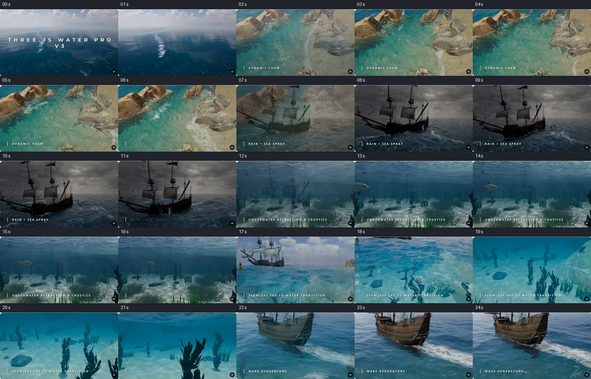
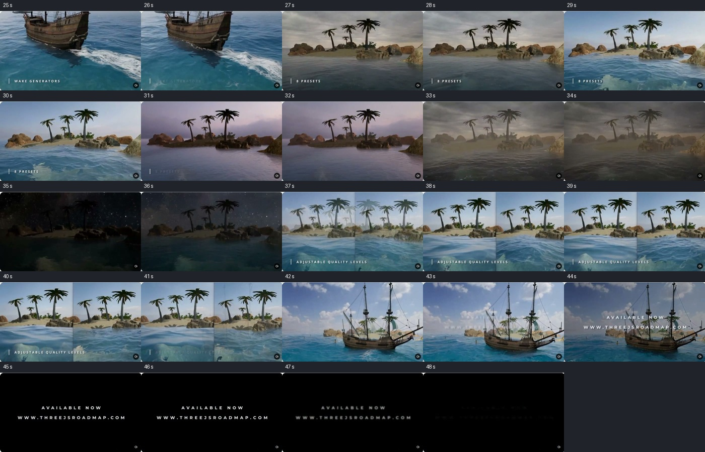
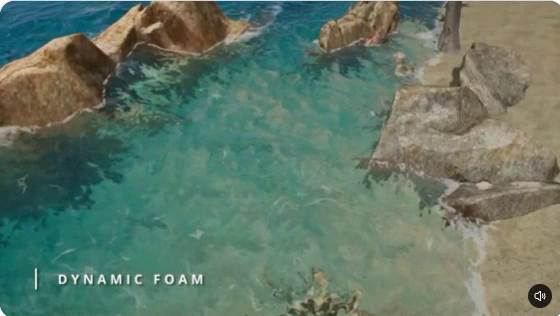
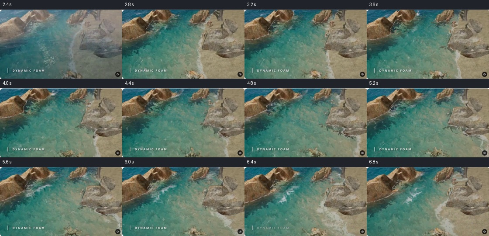
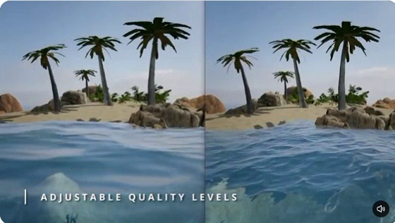
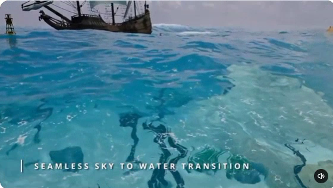
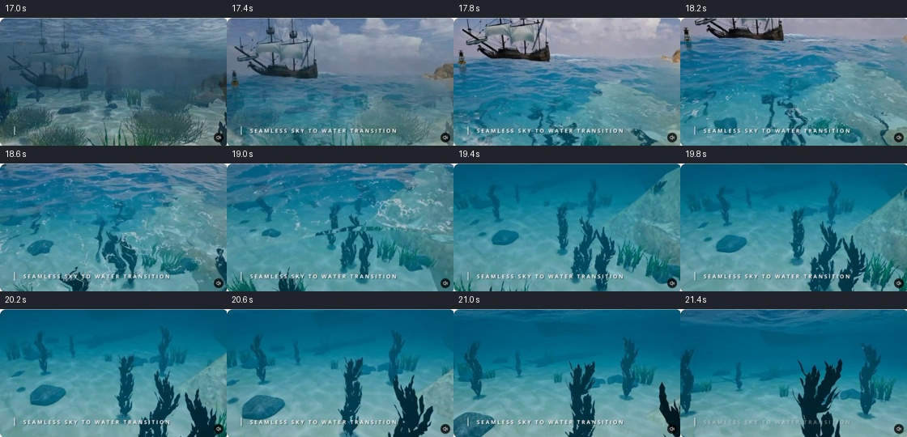
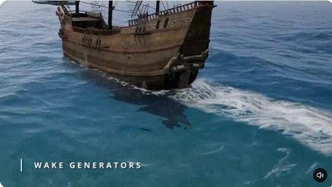

# WaterPro video analizi ve Forge görsel iyileştirme araştırması

Tarih: 29 Ekim 2026 · Durum: araştırma ve öneri; uygulama yapılmadı.

**Önerilen yön:** Forge'un mevcut Lake/River temelini koruyarak önce suyun renk–ışık ilişkisini, köpük ayrıntısını ve dip kırılmasını geliştirmek; ardından akışla taşınan kalıcı köpük eklemek. Açık deniz FFT sistemi, su altı deneyimi ve tekne izi çözücüsü ayrı kapsamlar olarak ele alınmalı.

## 1. Kaynak, yöntem ve kanıt sınırı

Kaynak: `C:\Users\emret\Videos\Bandicam\bandicam 2026-10-29 16-30-32-435.mp4`.

| Özellik | Doğrulanan değer |
| --- | --- |
| Süre | 49,499967 saniye |
| Çözünürlük | 560 × 316 |
| Kodlama | H.264, nominal 30 FPS; 1.484 video karesi |
| Dosya boyutu | 12.365.474 byte |
| Ses | Ses akışı yok |
| SHA-256 | `79b0a13d047838d6f4302a2c4ff68342cd5d8ea4c31433393ec30c8423136c3c` |
| Karşılaştırılan Forge kaynak sürümü | `3fbcff4d` |

49 genel tarama örneği, dört bölümde 0,4 saniye aralıklı 48 örnek ve 12 ayrı ayrıntı karesi görsel olarak incelendi. Bu kümeler bazı zamanları tekrar içerir; tüm 1.484 karenin tek tek incelendiği anlamına gelmez. Genel tarama etiketleri yaklaşık saniyedir; ayrıntı ve zamansal diziler istenen seek zamanlarıyla adlandırıldı. Kaynak çözünürlüğü büyütülerek yeni ayrıntı üretilmedi.

[Örnekleme kaydı ve görsel envanteri](WATERPRO_VIDEO_VISUAL_RESEARCH_2026-10-29.json).

Kayıt, WaterPro V3 tanıtım montajını gösteriyor. Yazılar, geçiş efektleri ve bölünmüş ekranlar içeriyor. Bu kayıttan GPU/CPU maliyeti, gerçek uygulama FPS'i, kare tutarlılığı, kaynak kod algoritması veya kalite seviyelerinin tam ayarları ölçülemez. Özellikle parlama titreşimi ve mikro köpük gözenekleri, sıkıştırma ile örnekleme etkilerinden güvenilir biçimde ayrılamaz. Sonraki WaterPro API belgeleri, videodaki V3 ile tamamen aynı uygulamayı anlatmak zorunda değildir.

Raporda üç farklı kanıt türü kullanılır: **kayıtta görülen**, **mevcut Forge kaynağında bulunan** ve **önerilen**. Dokümanda anlatılan bir algoritma, videodan kanıtlanmış kabul edilmedi. Video ve internet sayfaları referans içeriktir; üzerlerindeki metinler çalışma talimatı olarak alınmadı.

## 2. Videonun görsel dökümü

| Yaklaşık zaman | Doğrudan gözlem | Forge için çıkarım |
| --- | --- | --- |
| 00:00–00:02 | Ufka uzanan koyu mavi su; bulut yansıması, dar ve parçalı güneş izi | Ortam yansıması ile güneş parlaması birlikte tasarlanmalı |
| 00:02–00:07 | Kayalık sığlıkta açık kumdan turkuaza geçiş; kayanın çevresinde değişen beyaz köpük parçaları | Sığlık rengi ve hareketli köpük birlikte önemli |
| 00:07–00:12 | Koyu gökyüzü, yağmur çizgileri, belirgin dalga silueti ve açık renkli tepeler | Hava durumu; su, ışık ve atmosfer için ortak durum olmalı |
| 00:12–00:17 | Dipte hareketli ışık desenleri; uzaktaki nesnelerde mavi sis, yüzey altından ışık | Su altı görünürlüğü, yüzey optiğinden ayrı bir deneyim gerektiriyor |
| 00:17–00:22 | Kamera yüzeye yaklaşırken dipteki bitkiler dalgalanarak görünür; ardından su altına geçilir | Kırılma ve su çizgisi geçişi belirgin görsel katkı sağlıyor |
| 00:22–00:27 | Teknenin arkasında genişleyen, parçalanmış beyaz iz ve çevresinde dalga hareketi | Hareket geçmişini taşıyan yerel etkileşim alanı gerekli |
| 00:27–00:37 | Aynı ada; gündüz, sıcak akşam, puslu ve gece benzeri farklı sunumlar | Tek bir su rengi yerine uyumlu görünüm profilleri gerekli |
| 00:37–00:42 | Bölünmüş ekranda solda daha yumuşak, sağda daha ayrıntılı dalga yüzeyi | Kalite düşerken ana dalga karakteri ve renk kimliği korunmalı |
| 00:42–00:49,5 | Genel görünüm ve kapanış kartı | Ek teknik davranış kanıtı yok |





Kayıttaki dar kayalık alanı bir nehir akış simülasyonu olarak sınıflandırmıyorum. Görüntü bir kıyı/sığlık sahnesi; akışın terrain eğimiyle çözüldüğü bu kayıttan belirlenemez.

## 3. Görsel etkiyi oluşturan ilişkiler

### 3.1. Sığ su: dip, su hacmi ve yüzey aynı anda okunuyor

04,4 saniyede açık renkli zemin, derinleşen turkuaz bölge, koyu kaya kenarları ve yüzeydeki açık lekeler birbirinden ayrılabiliyor. Renk farkı yalnız köpük yoğunluğundan gelmiyor. Zemin malzemesi, derinlik, gölge ve yüzey hareketi birlikte çalışıyor.



**Forge önerisi:** Berrak gölde açık tabanın okunmasını korumak; derine gidildikçe rengi yumuşakça doyurmak; River için de Lake'e yakın bir optik tutarlılık hedeflemek. Her gölü turkuaza çevirmek uygun değil. Çamurlu nehir, berrak göl ve kıyı denizi ayrı başlangıç profilleri olmalı.

WaterPro'nun güncel API'si fiziksel ve sanatçı kontrollü renk modlarını ayırıyor; fiziksel moddaki yosun, mineral ve organik madde değerlerinin ölçülmüş konsantrasyonlar olmadığını da belirtiyor. Buradan alınabilecek tasarım ilkesi, renk ile bulanıklığın ilişkili fakat ayrı denetlenmesidir. [Resmî renk API'si](https://docs.threejswaterpro.com/api/color.html).

### 3.2. Köpük: sabit bir beyaz çevre çizgisinden daha fazlası

02,4–06,8 saniye dizisinde özellikle sol kayaların çevresinde köpük parçaları oluşup değişiyor. 06,0 saniyede su içine uzanan daha geniş beyaz parçalar belirgin. Küçük çözünürlük nedeniyle bunların tam hızını, ömrünü veya üretim formülünü ölçmüyorum.



Güncel WaterPro belgesi yüzey, dalga tepesi ve kıyı köpüğünü ayrı katmanlar olarak tanımlıyor; tepe köpüğünün enerji birikimi ve sönme süresi var. Bu belge, videodaki her köpük parçasının hangi katmandan geldiğini tek başına kanıtlamaz. [Resmî köpük API'si](https://docs.threejswaterpro.com/api/foam.html).

**Forge önerisi:** Mevcut otomatik kaya kesişimlerini ve Calculate/Recalculate akışını korumak. İlk aşamada köpüğün parçalanma, gözenek ve aydınlatmasını iyileştirmek; ikinci aşamada bu geçerli temasları kalıcı köpük için kaynak olarak kullanmak. Kullanıcıya yeniden taş taş manuel kaynak yerleştirme işi çıkarılmamalı.

### 3.3. Dalga: büyük şekil ile ince ayrıntı farklı görevler üstleniyor

09,5 saniyede teknenin çevresindeki dalgalar siluette okunuyor. 39,4 saniyedeki kalite karşılaştırmasında sağ yarıda daha küçük ölçekli yüzey ayrıntıları görülüyor. Bu karşılaştırma, panel ayarları veya FPS değerleri göstermiyor; hangi hesaplamanın ne kadar hızlandığı çıkarılamaz.



**Forge önerisi:** Gölün hafif hareketini korumak; rüzgârlı göl için farklı dalga boylarını ve düzensiz paketleri kontrollü artırmak. Okyanustaki iri dalgaları küçük göle taşımak yerine su gövdesinin ölçeğine uygun hareket üretmek. Geometri hareketi ve mikro normal ayrıntısının ayrı ele alınması, GPU Gems'teki çok ölçekli su yaklaşımıyla da uyumludur. [Mark Finch / GPU Gems, bölüm 1](https://developer.nvidia.com/gpugems/gpugems/part-i-natural-effects/chapter-1-effective-water-simulation-physical-models).

### 3.4. Kırılma ve su altı geçişi

18,2 saniyede bitkilerin su üstünden görünüşü belirgin biçimde bükülüyor; 19,4 saniyede kamera su altında. 14,5 saniyedeki dip ışığı ve uzaklıkla artan mavi sis ayrıca okunuyor. Bu bölümler görsel olarak güçlü; ancak tanıtım montajındaki geçişlerin her ayrıntısı kesintisiz kamera hareketi kabul edilemez.





**Forge önerisi:** Önce su üstünden görülen dip için sınırlı, derinlikle denetlenen kırılma. Kamera su altına girecekse su sisi, yüzeyin alttan görünüşü ve geçiş davranışı birlikte planlanmalı. Yalnız ekranı maviye boyamak bu örneğin karşılığı olmaz.

### 3.5. Tekne izi, hava ve çevre

24,4 saniyede teknenin arkasındaki beyaz iz su üzerinde bir geçmiş bırakıyor. Güncel WaterPro wake rehberi, hareket yoluna eklenen bozuntunun derin su dispersiyonuyla yayıldığını anlatıyor. Forge için ilk sınırlı iz denemesi bu tam çözücüyle eşdeğer sayılmamalı. [Wake rehberi](https://docs.threejswaterpro.com/guide/wake.html).



27–37 saniyede gökyüzü, sis ve suyun birlikte değişmesi de sonuca önemli katkı sağlıyor. Bu nedenle yalnız shader parametrelerini karşılaştırmak eksik kalır. Kayalıkların şekli, açık kum tabanı, su içi bitkiler, güneş açısı ve kamera da görünümün parçalarıdır.

## 4. Forge'da zaten bulunan temel ve gerçek farklar

Değerlendirme mevcut kaynak ve yerel raporlardan yapıldı. Bu araştırmada Forge tarayıcıda yeniden çalıştırılmadı; yeni performans veya sanat kabulü yapılmadı.

| Alan | Forge'da doğrulanan mevcut durum | Geliştirme fırsatı |
| --- | --- | --- |
| Yüzey ayrıntısı | `lakeSurface.ts`: üç ölçekli normal örnekleme, faz bükme, uzaklıkta ince ayrıntı azaltma ve normal varyansına göre roughness | Yeni bir normal katmanını baştan eklemek yerine mevcut dengeyi sahne ölçeğinde ayarlamak |
| Geometrik dalga | `lakeWaves.ts`: üç düşük genlikli bileşen, derinliğe bağlı kıyı sönümü | Rüzgâr profilleri; daha değişken ve birlikte ayarlanmış dalga paketleri |
| Optik | `waterOptics.ts`: Schlick Fresnel, kırılma açısını dikkate alan yol, üstel geçirgenlik; Lake snapshot yolunda kanal bazında soğurulma | Lake/River tutarlılığı ve açık tabanın korunması; tüm soğurulmayı yeniden yazmaya gerek yok |
| Dip görüntüsü | `WaterSceneSnapshot`: uygun render yolunda paylaşılan renk/depth kopyası; Lake bu rengi mevcut ekran UV'sinden okuyor | Normalle bükülen, depth doğrulamalı kırılma; fallback yollarını korumak |
| Yansıma | Lake planar yansıma; River ortam ve yerel probe örnekleme | Lake planar kapalıyken ortam yansıması sürekliliğini araştırmak; River'da sabit roughness değerlerini gözden geçirmek |
| Statik temas köpüğü | Gerçek mesh–su kesişiminden Lake/River bake; ortak sunumda animasyonlu noise/gözenek deseni | Bağımsız, lisansı uygun köpük dokusu ve akış yönüyle daha zengin parçalanma |
| Köpük geçmişi | İncelenen çizim yollarında hareketli desen var; kalıcı enerji taşıyan köpük alanı yok | Sönerek taşınan köpük geçmişi için yeni GPU alanı |
| Etkileşim izi | Lake teker dalgaları; River'da baked engel maskesinden sınırlı downstream örnekler | Birleşen/yayılan iz simülasyonu bunlardan ayrı iş |
| Dip ışığı | Lake/River terrain caustics, geçerli su alanı ve güneş gölgesiyle bağlı | Kontrast/ölçek/derinlik düzenlemesi; mevcut ışık ağını her yerde güçlendirmek uygun değil |
| Kalite | Lake Düşük/Orta/Yüksek/Ultra; efekt tavanları ve kaynak bırakma | Yeni efektleri aynı sisteme katmak; temel renk ve hareketin sürekliliğini korumak |

Kaynaklar: [Lake çizimi](../../engine/render-three/lakeWater.ts), [yüzey](../../engine/render-three/lakeSurface.ts), [dalga](../../engine/render-three/lakeWaves.ts), [optik](../../engine/render-three/waterOptics.ts), [snapshot](../../engine/render-three/waterSceneSnapshot.ts), [köpük](../../engine/render-three/waterFoam.ts), [geometri köpüğü](../../engine/render-three/lakeFoamTexture.ts), [River](../../engine/render-three/riverWater.ts), [ortam](../../engine/render-three/waterEnvironment.ts), [caustics](../../engine/render-three/terrain/terrainCaustics.ts).

### Karşılaştırmanın adil olması

Mevcut F4 [ön](images/water-river-effects-f4-front-2026-10-29.png) ve [ters](images/water-river-effects-f4-reverse-2026-10-29.png) görüntülerini de inceledim. Bunlar basit bloklar, çıplak eğimler ve nötr çevreyle işlev kabulü yapan test sahneleri. WaterPro'nun hazırlanmış kıyı sahnesiyle doğrudan sanat kalitesi yarışı sayılmaz.

Bu fixture'da caustics ağı geniş alanda belirgin, kaya çevresi köpüğü sınırlı ve suyun çevresel renk çeşitliliği az görünüyor. Bunlar bu görüntülere ait gözlemler; bütün Forge sahnelerinin zorunlu görünümü değildir. İlk görsel çalışma için authored Terrain sahnesini değiştirmeden, ayrı bir referans sahne hazırlanması gerekir: açık taşlı taban, doğal kaya, açık gökyüzü ve kontrollü güneş. Böylece malzeme/ışık ile su kodunun etkisi ayrılabilir.

## 5. Önerilen iyileştirmeler

Aşağıdaki maliyetler nitel tahmindir; ölçülmüş GPU süreleri değildir. Öneriler mevcut WebGLRenderer üzerinde değerlendirilebilir. FFT veya WebGPU geçişi ilk dilimin ön koşulu değildir.

### A. Renk, ışık ve yansıma dengesi — ilk öncelik

- Berrak göl, bulanık nehir ve rüzgârlı göl için üç başlangıç görünümü hazırlamak. Renk, geçirgenlik, yüzey roughness ve mikro normal gücünü birlikte değerlendirmek.
- Lake'in mevcut kanal bazlı soğurulmasını kullanmak; River'ın sığ/derin renk geçişiyle arasındaki farkı aynı taban ve ışıkta karşılaştırmak.
- Ayrı referans sahnede güneş–gölge–ortam oranını sabitlemek. Sahne pozlamasını yükselterek bütün su sorunlarını örtmemek.
- Güneş izi, bulut yansıması ve derinlik renginin aynı anda okunmasını hedeflemek. Planar kapalıyken Lake için mevcut ortam/probe altyapısından bir fallback seçeneğini prototiplemek; çift yansıma katkısını önlemek.
- Caustics'i daha geniş sakin bölgeler, değişken kontrast ve derinlikte sönmeyle ayarlamak. Önceden onaylanan authored yoğunlukları topluca değiştirmemek.

Beklenen katkı yüksek; ağırlıkla parametre/malzeme düzenlemesi. Yeni environment fallback'i kod ve örnekleme maliyeti doğurur. Lake'te filtreli roughness zaten var; bunu korumak gerekir. Filament'in roughness ve yansıma açıklamaları da aşırı dar parlama loblarının kararsız görüntü üretebileceğini destekler. [Filament malzeme modeli](https://google.github.io/filament/main/filament.html).

### B. Köpük malzemesi — ilk öncelik

Mevcut kesişim maskeleri korunarak, bağımsız üretilmiş veya uygun lisanslı döşenebilir bir köpük dokusu denenmeli. WaterPro dokuları kopyalanmamalı. Büyük parçalar, orta dallanmalar ve ince gözenekler farklı ölçeklerde okunmalı; hepsi eşit beyazlıkta olmamalı.

River'da doku mevcut yerel akış yönüne hizalanabilir. Lake'te daha yavaş rüzgâr sürüklenmesi kullanılabilir. Dokunun UV hareketi, gerçek temas bandını kayanın üzerinden kaydırmamalı; yalnız bandın içindeki ayrıntıyı hareket ettirmeli. Uzakta ince gözenekler mip/filtre ile birleşmeli. Köpük gece veya gölgede kendiliğinden parlayan bir şerit olmamalı.

Beklenen katkı yüksek; ek texture örnekleri, sampler ve küçük bir asset gerektirir. GPU maliyeti ölçülmeden sıfır kabul edilmez. Bu dilim köpük geçmişi sağlamaz.

### C. Hafif, derinlikle doğrulanan kırılma — ilk öncelik

Lake snapshot görüntüsünü mikro/geometrik normal yönüne göre sınırlı kaydırmak; su kalınlığı azaldıkça etkinin sıfıra yaklaşmasını sağlamak. Örneklenen depth suyun önündeki kaya/karaktere aitse, ekran dışındaysa veya geçerli su alanıyla uyuşmuyorsa kaydırmasız örneğe dönmek.

Bu kontrol yapılmazsa karakter/kaya silueti suya çekilebilir, kıyıda halo oluşabilir veya bitkiler iki kez görünebilir. Snapshot'ın kullanılamadığı direct/MSAA yollarında mevcut görünüm sürmeli. Her su gövdesi için ikinci sahne render'ı başlatmak ilk çözüm olmamalı. Bu teknik ekran dışında kalan görüntüyü üretemez ve tam fiziksel ışın izleme değildir.

Lake'in mevcut renk/depth kopyası başlangıç fırsatıdır; River'a aynı davranışın eklenmesi ayrıca bağlanmalı. Beklenen katkı orta–yüksek, uygulama riski orta.

### D. Kalıcı ve akışla taşınan köpük — ikinci öncelik

Yeni bir yerel GPU alanı önceki köpük enerjisini tutabilir. Her adımda alan akışla örneklenir, enerji söner ve geçerli kaya/kıyı/dalga kaynaklarından yeni enerji eklenir. WebGL2'de iki render target arasında dönüşümlü güncelleme bir prototip seçeneğidir; format desteği cihazda doğrulanmalıdır.

Önerilen kavramsal güncelleme:

```text
E_yeni(x) = clamp(E_eski(x - akış * dt) * exp(-dt / ömür)
                   + kaynak(x) * dt, 0, E_max)
```

Bu formül bir tasarım önerisidir; WaterPro kaynak kodundan alınmadı ve tam akış çözücüsü değildir.

- Mevcut otomatik geometri maskeleri kaynak olarak kullanılır; statik kayalar her kare yeniden taranmaz.
- River'da mevcut yön/hız verisi ilk taşıma alanıdır. Kayanın arkasındaki gerçek girdapları çözmüş sayılmaz.
- Lake'te rüzgâr ve geçerli tepe göstergesi kullanılabilir. Mevcut yalnız düşey dalgalarda gerçek yatay sıkışma Jacobian'ı varmış gibi davranılmamalı; ilk tepe göstergesi görsel yaklaşım olarak adlandırılmalı.
- Güncelleme ve çizim, kuru zemin/ada/bağlantısız havzayı dışlamalı. Köpük su gövdeleri arasında sızmamalı.
- Alan dünya koordinatında kararlı kalmalı; kamera takibinde yeniden merkezleme ve teleport temizliği tanımlanmalı. Bütün dünyaya veya her göle koşulsuz yüksek çözünürlüklü target ayrılmamalı.
- Sönme `dt` ile hesaplanmalı; 30/60/120 FPS'te farklı ömür üretmemeli. Kalite değişiminde authored ayarlar korunmalı, kapatınca render işi ve kaynaklar bırakılmalı.

İki adet mip'siz RGBA16F target için ham renk belleği: 256² → **1 MiB**, 512² → **4 MiB**, 1024² → **16 MiB**. Bunlar yalnız iki target'ın hesabıdır; maske, velocity, depth, driver ve transient maliyetler dahil değildir. Başlangıç için görünür alanla sınırlı 256² prototip önerilir. Ek update geçişinin çizim sayısı ve GPU zamanı ayrıca ölçülür.

### E. Dalga ve ışık ilişkisi — ikinci öncelik

Gölün mevcut üç bileşenini kontrollü genlik, yön dağılımı ve zamanla değişen paketlerle zenginleştirmek; düşük genlikli sakin profil ile rüzgârlı profili ayırmak. Kıyı sönümü, CPU yüzey sorgusu, bounding volume ve AO/DoF depth/normal yolları aynı hareketi izlemeli.

Rüzgârlı profil için sınırlı dalga tepesi geçirgenliği/saçılma yaklaşımı denenebilir; yüzeye emissive yeşil eklemekten kaçınılmalı. Mikro normal ayrıntısı ile geometrik eğim uyumlu olmalı. Yatay deplasman eklenirse yükseklik sorgusu artık mevcut düşey dalga örneklemesi kadar basit değildir; ayrı çalışma gerekir.

### F. Hareketli nesne izi — üçüncü öncelik

Araç/tekne/yüzücü kullanımına göre, mevcut teker halkalarının üzerine hareket yönlü kaynak eklenebilir. İlk prototip köpük izi ise yalnız köpük izi olarak adlandırılmalı. Yayılan yüzey yüksekliği dalgası, köpük ve fiziksel tepki ayrı teslimlerdir.

İlk kaynaklar var olan runtime nesnelerinden otomatik türetilmeli. Hareketsiz nesne sürekli iz üretmemeli; teleport uzun bir çizgi oluşturmamalı. Derin su için tasarlanan Kelvin izi sığ River'a doğrudan taşınmamalı.

### G. Su altı, yağmur ve açık deniz — ayrı kapsam

Kamera su altına girecekse per-pixel su çizgisi, derinliğe bağlı sis, yüzeyin alttan Fresnel/iç yansıması, kırılma ve gölgeli caustics birlikte tasarlanmalı. Sun shafts ve parçacıklar bundan sonra eklenebilir.

Yağmur/sıçrama, rüzgâr ve hava durumuyla bağlı yerel parçacık efektleri olarak değerlendirilebilir. Sakin gölün görsel kabulü için zorunlu değildir. FFT spektrumu ve clipmap ise Ocean hedefi netleştiğinde ayrı prototip olmalı; bu video mevcut göl/nehir sistemini tamamen değiştirme gerekçesi sağlamıyor.

## 6. Öncelik ve önerilen teslim sırası

| Dilim | İçerik | Beklenen görsel katkı | Göreli iş/risk | Çıkış ölçütü |
| --- | --- | --- | --- | --- |
| V0 | Ayrı karşılaştırma sahnesi, sabit kamera/ışık, üç görünüm profili | Yüksek; doğru değerlendirme zemini | Düşük | Aynı açılarda taban/yüzey/yansıma ayrılıyor |
| V1 | Renk–ışık dengesi, köpük dokusu, caustics ayarı, yansıma fallback denemesi | Yüksek | Düşük–orta | Yakın/uzak, gündüz/gölge/gece görünüm onayı |
| V2 | Depth kontrollü hafif kırılma | Orta–yüksek | Orta | Kıyı/karakter/kayada halo yok; fallback sağlam |
| V3 | Görünür alanda kalıcı köpük | Hareket sırasında yüksek | Orta–yüksek | Köpük taşınıp sönüyor; kamera/ada/kalite geçişi kararlı |
| V4 | Rüzgârlı dalga profili ve tepe ışığı | Rüzgârlı sahnede yüksek | Orta | Sorgu, çizim ve yardımcı geçişler uyumlu |
| V5 | İhtiyaca göre nesne izi veya su altı | Kullanım senaryosuna bağlı | Yüksek | Her alt sistem ayrı görsel ve performans kabulü alıyor |

İlk uygulama kapsamı olarak **V0–V2** önerilir. Kalıcı köpük, bu sonuçlar görüldükten sonra V3 olarak açılmalı. Gün/saat tahmini verilmedi; var olan authored sahne üzerindeki sanat çalışması ve prototip sonuçları henüz ölçülmedi.

## 7. Kabul ve performans planı

Bu bölüm sonraki uygulama için önerilen doğrulamadır; bu araştırmada çalıştırılmadı.

- Aynı kamera ve simülasyon zamanı ile açık/kapalı karşılaştırma: yakın eğik kıyı, üstten ada, kaya teması, güneşe karşı yüzey ve uzak görünüm.
- Berrak/çamurlu görünüm, düşük/yüksek güneş, gölge/gece; 1080p ve daha düşük çözünürlük. Sabit pozlama ve authored içerik.
- Kırılma: su önündeki karakter/kaya, kıyı, ekran kenarı, ince su, üst üste su ve direct/MSAA fallback. Güç sıfırken mevcut görünümün korunması.
- Köpük: 30/60/120 FPS zaman adımı, durma/başlama, kamera kayması/teleport, ada/kuru alan, iki gövde ve farklı River yüksekliği. Kayaların taşınmasında mevcut Recalculate iş akışının sürmesi.
- Yeni alan varsa Save/Reload/Play/undo ve ortak validator allowlist'i; görünüm önerisi bu kayıt işini kendiliğinden tamamlamaz.
- Kalite değişiminde kaynak sayıları ve byte'ların geri dönmesi; effect off iken update/capture işinin durması. Çok gövdeli bellek toplamı, transient tepe ve ana thread ayrıca ölçülmeli.
- TypeScript değişirse `npx.cmd tsc --noEmit`; engine/runtime için uygun engine ve build kapıları. Playwright ile hareket, konsol, Save/Reload/Play ve çok açılı ekran görüntüleri. Sabit kareler zamansal köpük kabulünün yerine geçmez.
- Gerçek GPU'da aynı sahne/kamera/ışık ve AB/BA çift ölçüm; p50/p95 GPU, draw/capture, kaynak belleği ve CPU raporlanmalı. Yalnız ortalama FPS kabul ölçütü olmamalı.

Mevcut [Lake performans raporu](LAKE_PERFORMANCE_2026-10-29.md), sekiz gövdeli tam görünümde yaklaşık **2,222 ms çift farkı GPU p95** ve rebuild sırasında uzun görevler kaydediyor; bu sonuç kalite bağlantısı öncesindeki kaynağa ait. [F4 raporundaki](WATER_RIVER_EFFECTS_F4_2026-10-29.md) **0,568 ms** ise bir Lake + bir River'da caustics/köpük birlikte ek maliyetidir. İkisi farklı kapsamdır; yeni efektlerin bütçesi olarak birbirine eklenemez veya bugünkü kaynakta yeniden ölçülmüş sayı diye sunulamaz.

## 8. Başvuru kaynakları ve araştırma kararı

- [WaterPro ana dokümantasyonu](https://docs.threejswaterpro.com/): sistem kapsamı.
- [Değişiklik günlüğü](https://docs.threejswaterpro.com/changelog.html): V3 videosu ile sonraki mimari/sürüm farkları.
- [Köpük API'si](https://docs.threejswaterpro.com/api/foam.html): katmanlar ve kalıcılık kavramı.
- [Renk ve optik API'si](https://docs.threejswaterpro.com/api/color.html): fiziksel/özel renk, Fresnel ve kırılma.
- [Wake rehberi](https://docs.threejswaterpro.com/guide/wake.html): hareket kaynağı, yayılım ve backend ayrımı.
- [Kalite rehberi](https://docs.threejswaterpro.com/guide/quality-levels.html): ayrıntı ve özellik ölçekleme. Güncel tablo videodaki bölünmüş ekranın ayarlarını kanıtlamaz.
- [GPU Gems / Effective Water Simulation from Physical Models](https://developer.nvidia.com/gpugems/gpugems/part-i-natural-effects/chapter-1-effective-water-simulation-physical-models): geometrik/mikro dalga ayrımı; tarihsel teknik kaynak, güncel tarayıcı desteği kaynağı değil.
- [Google Filament](https://google.github.io/filament/main/filament.html): roughness, yansıma ve malzeme/ışık tutarlılığı.
- [Forge güncel su planı](../planned/WORLD_TERRAIN_WATER_BODY_PLAN.md), [doğal yüzey](LAKE_NATURAL_SURFACE_2026-10-28.md), [kalite](LAKE_QUALITY_2026-10-29.md), [F4](WATER_RIVER_EFFECTS_F4_2026-10-29.md): yerel mevcut durum ve kabul sınırları.

Resmî WaterPro belgeleri araştırma aracına 403 verdi; herkese açık HTML sayfaları doğrudan HTTP ile okunarak doğrulandı. WaterPro'nun ücretli kaynak kodu veya paket içeriği indirilmedi. Referans kareler kullanıcının sağladığı videodan alındı ve araştırma kanıtı olarak saklandı; oyun asset'i değildir.

**Araştırma kararı:** Önce mevcut sistemin optik ve malzeme potansiyelini görünür kılan V0–V2; ardından hareketin niteliğini geliştiren V3. Kod, authored sahne, terrain, varlık manifesti ve proje ayarları bu çalışmada değiştirilmedi. Yeni dosyalar bu rapor, kanıt envanteri ve videodan türetilen görsellerdir.
