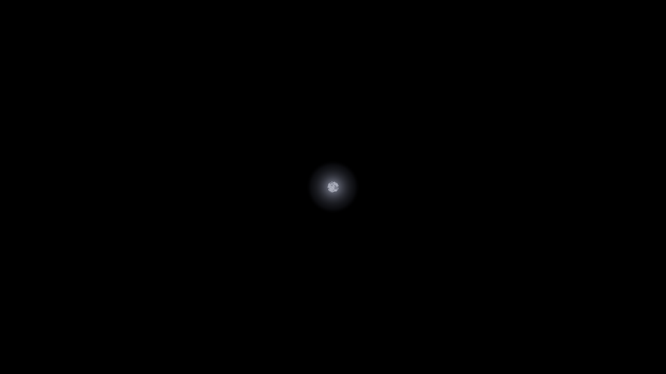
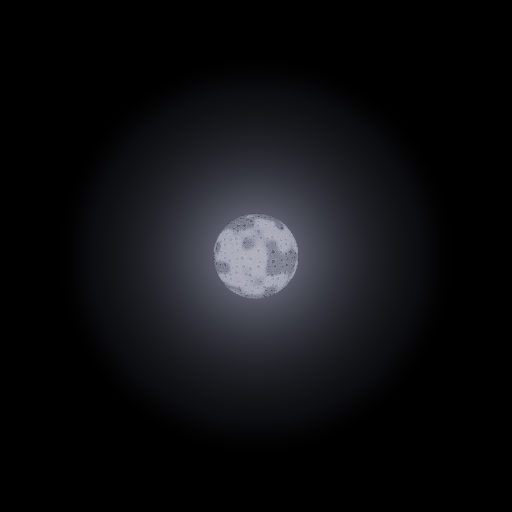
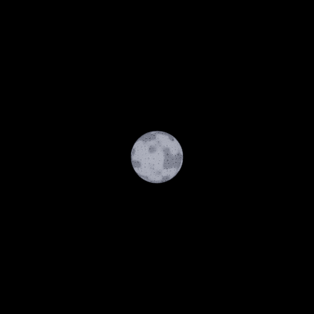
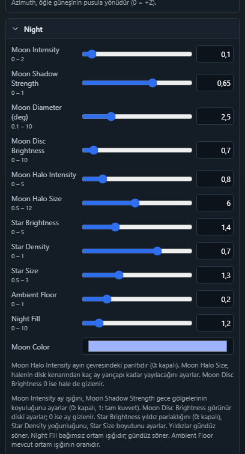

# WES — bağımsız ay halesi

8 Kasım 2026

WES → Night altında ayın çevresine yumuşak bir parıltı eklenir:

| Ayar | Varsayılan | Aralık |
|---|---:|---|
| Moon Halo Intensity | 0.5 | 0–5; 0 kapatır |
| Moon Halo Size | 4 | 0.5–12 ay yarıçapı, disk kenarından itibaren |

Hale, diskin dışında açısal uzaklıkla sönerek çizilir. Diskin içindeki
krater/yüzey hesabı korunur. Ayla birlikte hareket eder, akşam belirir ve
şafakta söner. Moon Disc Brightness 0 olduğunda hale de gizlenir. Bulutlar ve
opak sahne nesneleri mevcut çizim sırasıyla halenin önünde kalır.

Bu, canlı gökyüzü shader'ındaki bir katmandır; post-process bloom kapalıyken
de görünür. Genel bloom ölçeği `0.001` ve güneş shader'ı değiştirilmedi.
Ek draw call, doku, ışık, gölge haritası veya IBL hotspot'u oluşturulmaz.

Kayıt alanları `night.moonHaloIntensity` ve `night.moonHaloSize`.
`tools/saveValidator.ts`, ortak `normalizeWorldEnvironment` üzerinden bu
alanları allowlist'e dahil eder. Eski WES kayıtları varsayılanları kullanır;
authored level dosyalarının güncellenmesi gerekmez.

Doğrulama: normalizer sınırları, bozuk veriler, sıfır değerleri, maximal
kayıt turu, şafak/gece geçişi ve WES kapanışında uniform temizliği motor
kontrollerine eklendi. `world-environment-moon-halo.spec.ts` gerçek WebGL'de
hale gücü/boyutu, ay yüzeyi, kamera hareketi, bulut/nesne örtülmesi, ayı
gizleme ve gündüz güneş görüntüsünü karşılaştırır. WES editör smoke'u iki
ayarı değiştirip kayıt/yeniden açma akışını doğrular.

TypeScript, `build:verify` (2571 motor kontrolü, strict runtime dist ve
world-data dahil) ve ilgili 5 Playwright senaryosu geçti. Sabit test
sahnesinde ay yüzeyinin merkezindeki değişim, gündüz güneş görüntüsü farkı,
kamera ötelemesindeki örnek farkı ve bulut/nesne arkasındaki hale katkısı
0 ölçüldü. [Ham ölçümler](wes-k1/moon-halo/measurements.json).
Bu sonuçlar izole WebGL test sahnesine aittir; gerçek GPU performans bütçesi
ve bütün authored sahnelerin görsel kabulü anlamına gelmez.

