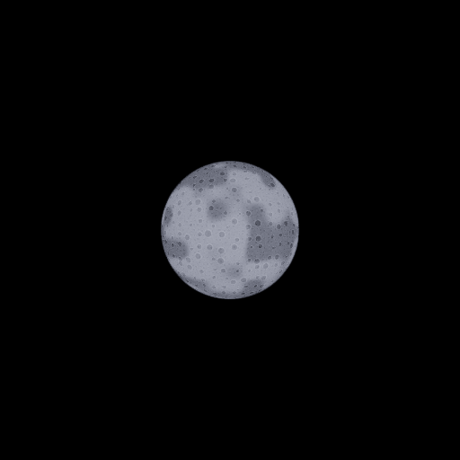

# WES — görünür ay

**Tarih:** 2 Kasım 2026 · **Taban:** `main@2a84372`.

Kraterleri, koyu yüzey bölgeleri ve kenar kararması olan prosedürel bir dolunay eklendi. Ay, WES'in gece directional ışığıyla aynı yönde görünür. Gün batımında yumuşakça belirir, şafakta söner. Mevcut saat, güneş yolu, ay ışığı ve Night Fill davranışları korunur.

Görüntü gerçek WebGL çıktısıdır: 23:00, 1.2° ay çapı, 512×512, ayrıntıyı göstermek için **4° kamera FOV**. Normal oyun kamerasında ay daha küçük görünür. Görsel dosyası bir rapor kanıtıdır; runtime onu yüklemez. Yüzey shader içinde üretildiği için imagegen veya harici ay dokusu gerekmedi.

## Kullanım

Level'da görünür bir **Sky Atmosphere** ve **World Environment** bulunmalıdır. World Environment → Night:

| Ayar | Varsayılan | Etkisi |
|---|---:|---|
| Moon Diameter (deg) | 1.2 | Görünür açısal çap, 0.1–10° |
| Moon Disc Brightness | 1 | Disk parlaklığı, 0–10; 0 diski gizler |
| Moon Intensity | 0.08 | Mevcut directional ay ışığı çarpanı |
| Moon Color | `#9fb4ff` | Işık rengi; disk bu rengin beyaza yaklaştırılmış tonunu kullanır |

Yeni kayıt alanları `night.moonAngularDiameterDeg` ve `night.moonBrightness`. Normalizer, save allowlist, maximal round-trip fixture, dropped-fields ve serialization-drift kapsamına eklendi. Editor smoke'u düzenleme/kayıt/reload akışını doğrular. Level veya asset dosyaları topluca değiştirilmedi; alanı olmayan WES actor'leri varsayılanları okur.

## Render bağı

`engine/render-three/moonDisc.ts`, yalnız canlı Sky shader'ına ay fonksiyonunu ve uniform'larını ekler. `AuthoredEnvironment` editör ve Play için aynı ay verisini uygular; WES bittiğinde parlaklık sıfırlanır. Sky gizliyse ay da görünmez; Sky olmayan sahneye gizli bir dome eklenmez.

- Mevcut gökyüzü çizimine dahildir: ay için ek draw call, sampler, runtime doku dosyası veya gölge haritası yoktur. Detay hesabı yalnız diskin kapladığı küçük bölgede çalışır.
- Dünya yönüne bağlı yüzey koordinatları sayesinde kamera ötelemesi/roll hareketi ayı kameraya yapıştırmaz veya kraterleri döndürmez.
- Mevcut gökyüzü/bulut derinlik düzeni korunur: opak sahne nesneleri ve bulutlar ayı örter.
- IBL için kullanılan ayrı, disksiz Sky değiştirilmedi. Yüksek enerjili disk PMREM'e girmez; sahnenin gece ışığı mevcut ay ışığı ve Night Fill'den gelir. Suya özel ayrı bir analitik ay yansıması eklenmedi.
- Bu dilim mevcut art-directed gece yolunda dolunay gösterir. Astronomik evre/takvim sistemi içermez.

## Doğrulama

- `npx tsc --noEmit` ve `npm run build:verify`: geçti; **2196 motor kontrolü**, strict runtime dist ve world-data doğrulaması dahil.
- `world-environment-moon.spec.ts`: gerçek WebGL shader derlemesi, krater kontrastı, gündüz disk etkisinin sıfırlanması, kamera ötelemesi, opak nesne ve bulut örtülmesi, tek sky draw call kontrolü geçti.
- `world-environment-night.spec.ts`, `world-environment.spec.ts`, `sky-light-capture.spec.ts`: geçti. Gece dolgusu, editor/Play önizleme-kayıt akışı ve IBL regresyonu yok.
- Motor testleri görünür ay yönünün ışıkla eşitliğini, şafak/gün batımı sönmesini, alan sınırlarını, 0 parlaklıkla kapatmayı ve WES kapanınca shader uniform'unun temizlenmesini kapsar.

Ölçüm ortamı Chromium 154 / Linux / ANGLE Vulkan **SwiftShader**. [Ham WebGL kontrol değerleri](wes-k1/moon/measurements.json): 256×256, 8° kamera FOV; disk merkezinde kapalı/açık parlaklık farkı 159.30/255, detay bölgesinde kontrast 95.79/255, kamera ötelemesinde merkez farkı 0, foreground örtülmesinde 0/255. Bunlar sabit test sahnesinin görsel regresyon kontrolleridir; GPU performans bütçesi veya fiziksel luminans ölçümü değildir.

Gerçek GPU'daki görsel kabul ve E-015 performans ölçümleri K1'in kalan işi olarak açık kalır.
