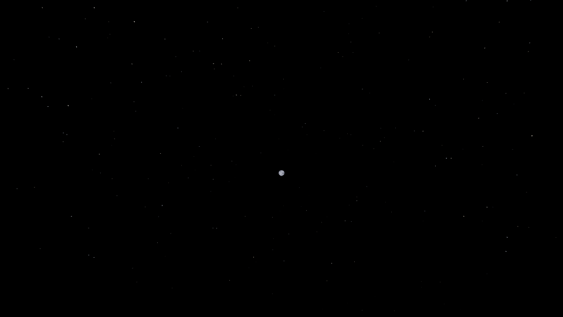
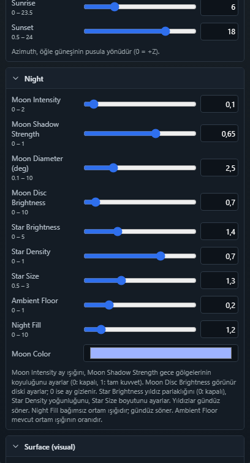

# WES — yıldızlı gece gökyüzü

8 Kasım 2026

Görünür Sky Atmosphere ve etkin World Environment olan sahnelerde gece
prosedürel yıldızlar görünür. Eski WES kayıtları da aşağıdaki varsayılanları
okur; level dosyalarını topluca güncellemek gerekmez.

| WES → Night | Varsayılan | Aralık / kullanım |
|---|---:|---|
| Star Brightness | 1 | 0–5; 0 yıldızları kapatır |
| Star Density | 0.5 | 0–1; sabit yıldız dağılımının görünür oranı |
| Star Size | 1 | 0.5–3; açısal boyut çarpanı |

Yıldızlar güneş ufkun altına indikçe belirir ve −12° yükseltide tam
parlaklığa ulaşır. Şafakta aynı geçiş tersine işler. Ufuk yakınında ve ay
çevresinde sönükleşir; Fog preset'inin şiddeti de görünürlüğü azaltır.
Ay diski, bulutlar ve sahne nesneleri yıldızların önünde çizilir.

`engine/render-three/starField.ts`, mevcut canlı Sky shader'ına yıldız
katmanını ekler. Küp yüzleri üzerinden dünya yönüne bağlı sabit bir dağılım
kullanır; yıldız merkezleri yüz sınırlarından uzak tutulur ve dağılım
olasılığı izdüşümün katı açısına göre dengelenir. Farklı parlaklıklar ve hafif
sıcak/soğuk tonlar kullanılır. Pikselden küçük yıldızlar ekran ayak izine göre
filtrelenir. Ek draw call, doku, ışık veya gölge haritası oluşturulmaz.
IBL için kullanılan ayrı Sky değiştirilmez.

Editör ve Play aynı environment resolver ve render binding'i kullanır.
WES kapatılınca yıldız uniform'ları sıfırlanır. Sky yoksa veya gizliyse
yıldız da görünmez. Kayıt alanları `night.starBrightness`,
`night.starDensity`, `night.starSize`; `tools/saveValidator.ts` bunları
ortak `normalizeWorldEnvironment` allowlist'i üzerinden doğrular.

İlk sürüm sabit bir yıldız alanıdır; takvim, astronomik gökyüzü dönüşü,
Samanyolu, takımyıldız veya animasyonlu parıldama içermez.

## Doğrulama kapsamı

TypeScript ve smoke TypeScript kontrolleri geçti. `npm run build:verify`
geçti; 2570 motor kontrolü, strict runtime dist ve world-data doğrulaması
dahil. Yıldız, WES editör/kayıt/Play, ay (iki senaryo), gece aydınlatması ve
Sky Light capture Playwright kontrolleri geçti. Mevcut WES editör testindeki
eski oluşturma-preset beklentileri güncellendi; başlangıç saatini ölçerken
bir dakikalık gün döngüsünün sonucu etkilememesi için test saati durduruldu.

- Motor kontrolleri: varsayılanlar, sınırlar, bozuk veriler, sıfır değerleri,
  bütün alanların kayıt turu, serialization/dropped-field uyumu, gece–gündüz
  geçişleri, sis ve render yaşam döngüsü.
- `world-environment-stars.spec.ts`: gerçek WebGL, normal 60° FOV, kamera
  ötelemesi, yoğunluk/boyut/parlaklık değişiklikleri, gündüz, kapatma,
  bulut/nesne örtülmesi, WES kapanışı, bloom, farklı gökyüzü yönleri,
  draw call ve doku sayıları. GPU timer-query desteklenirse eşleştirilmiş
  açık/kapalı ölçümleri rapora eklenir; yazılım renderer'ında ölçülmez.
- `world-environment.spec.ts`: üç alanın editör üzerinden değiştirilmesi,
  kayda gönderilmesi ve yeniden açıldığında korunması.
- Ay, gece aydınlatması ve Sky Light capture tarayıcı regresyonları.

Tarayıcı kanıtları Playwright raporundaki eklerde bulunur. Görsel test
sahnesi izoledir; bütün oyun sahneleri için görsel kabul veya cihazlar arası
GPU performans bütçesi anlamına gelmez.

Sabit 960×540 test sahnesinin [ham ölçümleri](wes-k1/stars/measurements.json):
yıldızlar açık/kapalı gökyüzü çizim sayısı 1/1, ek doku sayısı 0. Gündüz,
sıfır yoğunluk ve foreground örtülmesinde piksel farkı sıfır. Bloom açık
gece görüntüsünde 420 pikselde 8/255 üzerinde yıldız katkısı ölçüldü; bu
yıldız adedi veya fiziksel luminans ölçümü değildir. Tarayıcı ANGLE Vulkan
SwiftShader kullandığından gerçek GPU timer ölçümü `null`; donanım maliyet
kabulü ayrıca yapılmalıdır.

