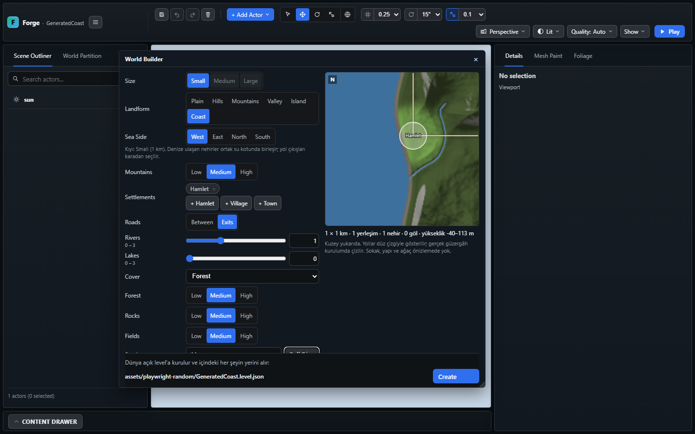
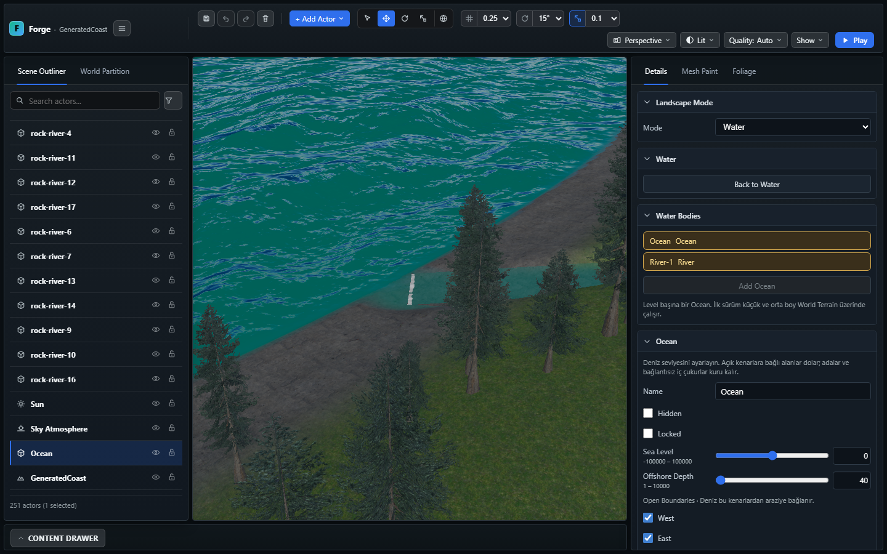
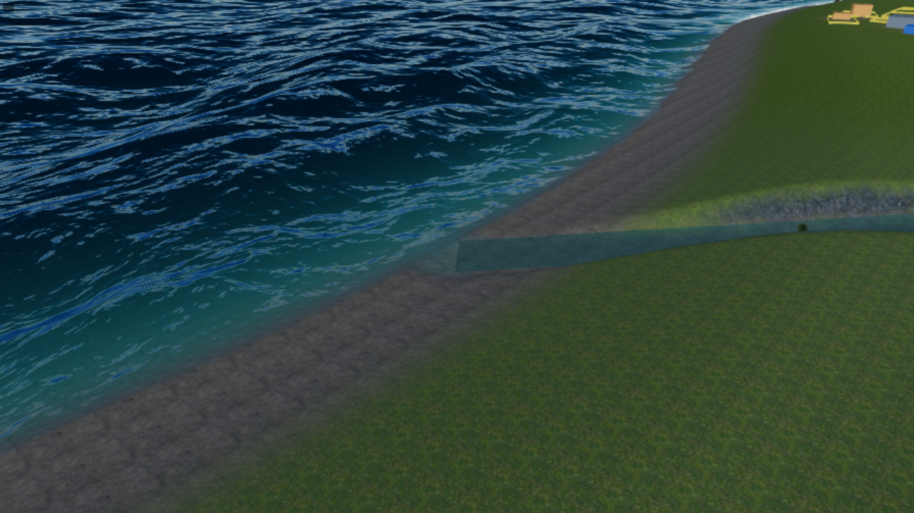

# World Builder — küçük Kıyı ve nehir ağzı

9 Kasım 2026. İlk Ada aşaması `0396ad79` ile commit edildi. Bu rapor onu
izleyen ikinci dilimin teknik ve görsel kabul kaydıdır.

## Kullanım

Add Actor → Terrain → World Builder… → Landform → **Coast**.
Small otomatik seçilir. **Sea Side** denizin West/East/North/South yönünü
seçer. Yerleşimler ve yol çıkışları karada kalır; nehir/göl istenebilir.
Sığmayan yerleşim veya güvenli akış yolu bulunamayan su, notlarda bildirilir.
Create mevcut level'ı yeniden kurma onayını kullanmaya devam eder.

CLI örneği:

```powershell
npm.cmd run world:random -- --out assets/Worlds/MyCoast.level.json --size small --landform coast --sea-side west --settlements hamlet --roads exits --rivers 1 --seed 11
```

## Değişen davranış

- Kıyının arazi şekli, deniz tabanı, boya, önizleme ve kara maskesi aynı
  deterministik kıyı sorgusundan gelir. Yerleşim/yol güvenlik bandı korunur.
- Ocean'ın yeni `offshorePolicy: "connectedBoundary"` davranışı denizi yalnız
  ıslak, denize bağlı sınır parçalarından dışarı devam ettirir. Kara yönündeki
  harita dışı alan otomatik deniz olmaz. Eski Ocean kayıtları değişmez.
- Kıyı nehri denize doğru drenaj izler; son düz kesiti kıyı kanalında, ham
  kıyının yaklaşık 4 m içinde deniz kotuna bağlanır. İlk denemede açık denize
  uzanan düz şerit, yakın görsel kontrolden sonra bu konuma taşınmıştır.
- Ocean, `inlets` içinde belirtilen terrain spline'larının son düz kesitini
  çizmez. CPU kapsam sorgusu, yüzey shader'ı, depth/normal yardımcı çizimleri
  ve Ocean caustics aynı kesit sınırını kullanır. Gerçek River ribbon'ıyla
  uç boyunca/enine örneklerde çift yüzey ve boşluk kontrol edilir.
- Outlet River'da geometrik dalga kapalıdır; mikro yüzey ve akış sürer.
  Renk/soğurma/roughness Ocean'a yaklaştırılır. Son kesit sabit genişlikli ve
  düz olmalı, ucu deniz kotunda bitmelidir; bozuk referans hata verir.
- Kıyı seçenekleri uzayınca Create düğmesi pencere altında sabit kalır.
  Seçimler değişir değişmez eski worker isteği geçersiz sayılır; debounce
  sırasında eski sonuç yeni seçimler için "hazır" olarak gösterilmez.

`inlets` en çok üç benzersiz spline kimliğidir. Yeni Ocean alanları aynı
`validateOceanWater` üzerinden read/save yoluna girer; ayrıca layout alanı
veya dev endpoint eklenmemiştir. `world:brief` aynı kayıtları üretebilir.

## Doğrulama

| Kontrol | Sonuç |
| --- | --- |
| İlk aşama commit öncesi TypeScript + ilgili engine paketi | Başarılı; 109 ilgili kontrol |
| İkinci dilim `npm.cmd run build:verify` | Başarılı; 2.597 engine kontrolü, import/smoke/content/UI türleri, build, strict dist ve world-data |
| Kıyı odaklı kontroller | Dört deniz yönü, kuru yerleşim/çıkış, yokuş aşağı nehir, deniz kotunda uç, gerçek River/Ocean tamamlayıcı kapsamı, read/save, önizleme ve istek sınırları başarılı |
| `World Builder coast` Playwright | Son geometriyle başarılı; 6,5 dakika. West/East önizleme, Create düğmesinin 1440/900 px görünürlüğü, Create, Save, Reload, yakın kamera ve gerçek Play; uygulama/shader hatası yok |
| `World Builder preview` Playwright | Başarılı; 13,7 s. Hızlı seed değişimi → aynı seed'e dönüş, aynı önizleme ve görünür Create |
| `ocean-caustics.spec.ts` | Başarılı; 20,4 s. 262.144 hücre, kuru çukur, gölge/derinlik, pause, kaynak/kalite ve shader regresyonu |

Tam kapının ardından eklenen son önizleme iptali ve caustics offshore sınır
düzeltmesi ayrı TypeScript/build ve son iki browser kontrolüyle doğrulanır.
Hedef donanım GPU süresi/belleği ve production paket bütçesi bu raporun kabulü
değildir. Codex Security taraması önerilmiştir; çalıştırılmamıştır.
Kullanıcının Island sahnesi, manifest, proje seçimi ve eşzamanlı WebGPU planı
bu çalışmada değiştirilmemiştir.

## Görseller







## Açık sınırlar

- Small: 1.024×1.024 m, 512×512 native hücre. Orta/büyük Ocean hazırlığı sonraki dilimdir.
- Ada'da nehir seçeneği kapalı kalır; bu nehir ağzı teslimi Coast içindir.
- İlk teslimdeki `widthScale=1` sınırlaması sonraki
  [canlı genişlik eşlemesi](WORLD_BUILDER_INLET_WIDTH.md) diliminde giderildi.
- Sonlu dünya sınırı vardır; haritanın ötesine anakara geometrisi üretilmez.
- İlk görünüm ve işlev teslimidir. River/Ocean optiklerinin tam eşleşmesi,
  haliç geometrisi/akıntısı, kıyı breaker/swash ve nihai görsel kabul açıktır.
