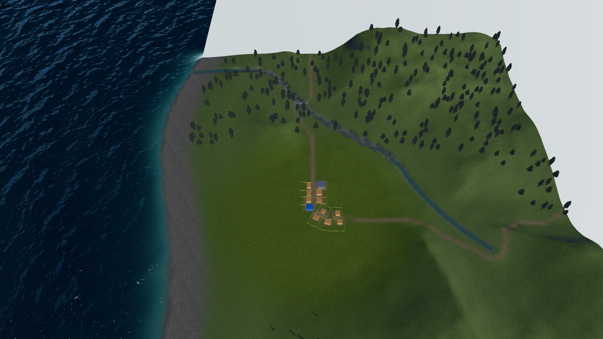
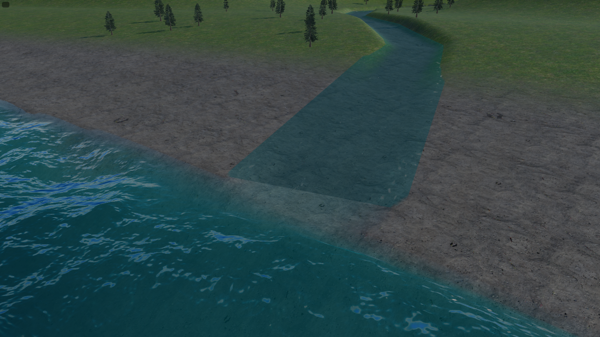

# World Builder — A1 Coast alan dağılımı ve kuru kumsal

10 Kasım 2026. [Kıyı planı A1](../planned/WORLD_BUILDER_SHORELINE_PLAN.md)
uygulaması. Yalnız yeni Small/Medium Coast üretimi; A2/A3 başlamadı.

## Ölçüm tanımı

- Alan paydası haritanın 1.024² / 2.048² m karesidir. Harita dışında devam
  eden Ocean dahil edilmez. 8 m hücre merkezlerinde sınıflandırma yapılır.
- Deniz, yerel ortalama su seviyesinin altındaki native üçgen terrain'dir.
  Kuru kumsal, su seviyesinin üzerindeki zeminde normalize kıyı/bed boyasının
  en az %50 olduğu bölümdür. İç kara, geri kalan kuru alandır. Yumuşak boya
  geçişi bu eşikle tek bir sınıra dönüştürülür; çok az boya kalmış tüm geçişi
  kumsal saymak farklı bir ölçümdür.
- Genişlik, gerçek native üçgen terrain'in sıfır su çizgisinden %50 normalize
  **8 bit tile boyasına** kadar, kaynak kıyının kara yönündeki normalinde
  ölçülür. Her senaryoda 256 kesit; harita köşesinde normalin dışarı çıkmasını
  önlemek için along ekseninde 80 m kenar payı; sınır aramada 28 bisection.
  Tablo, kesitlerin ortalama genişliğini verir; dört yön arasındaki aralık
  native üçgen/boya örnekleme farklarını da içerir. Boya CPU sorgusu renderer'ın
  bilinear ağırlık okumasını kullanır.
- Oran matrisi **2 boyut × 4 yön × 3 seed = 24** senaryodur. İç nehir/göl ve
  yerleşimler kapalıdır: nehir yatağının aynı `bed` katmanını kullanması,
  kıyı kumsalı alanını şişirmez. Bu matriste nehir ve göl alanı ayrı ayrı %0'dır.
  Nehirli gerçek build/browser örnekleri aşağıda ayrıca doğrulanır; iç su
  alanları kıyının %30'una eklenmez. %70 bütün iç arazinin düz olduğu garantisi değildir.
- Baseline, kod değişmeden önce gerçek `createBriefTerrain` + `coverPaint`
  kaynaklarıyla kaydedildi. Native baseline, aynı açık eski brief'i
  (`center:[0,0]`, `shoreWidth:60`, `beachWidth` yok) yalnız bellekte tekrar
  üreterek tamamlandı. Kullanıcı sahnesi veya eski kayıt dönüştürülmedi.

Kaynak boya/yükseklik ölçümleri:
[önce](evidence/coast-a1/baseline.json), [sonra](evidence/coast-a1/after.json).
Native tile ölçümleri:
[önce](evidence/coast-a1/native-baseline.json), [sonra](evidence/coast-a1/native-after.json).
JSON'lar her yönün sonucunu ayrı tutar. 8 m alan örneklemesi tam poligon
integrali değildir; kabul toleransı ±2 yüzde puandır.

## Sonuçlar

Her satır West/East/North/South sonuçlarını birleştirir. Alan yüzdeleri iki
ondalığa yuvarlanmıştır; native JSON daha fazla basamak içerir.

| Boyut | Seed | Önce iç kara % | Yeni iç kara % | Kuru kumsal % | Deniz % | Önce ort. genişlik m | Yeni ort. genişlik m | Kat |
| --- | ---: | ---: | ---: | ---: | ---: | ---: | ---: | ---: |
| Small | 4 | 46,00 | 70,03 | 6,11 | 23,86 | 23,81–23,82 | 60,81–60,82 | 2,554 |
| Small | 11 | 47,96 | 70,01 | 6,09 | 23,90 | 23,61–23,66 | 60,32–60,36 | 2,551–2,555 |
| Small | 29 | 46,26 | 70,03 | 6,07 | 23,90 | 23,77–23,78 | 60,65–60,68 | 2,551–2,552 |
| Medium | 4 | 49,02 | 70,00 | 3,06 | 26,94 | 23,71–23,73 | 60,45–60,48 | 2,548–2,551 |
| Medium | 11 | 48,73 | 69,99 | 3,06 | 26,95 | 23,72 | 60,52–60,53 | 2,552 |
| Medium | 29 | 48,97 | 70,00 | 3,06 | 26,94 | 23,69–23,70 | 60,49–60,52 | 2,553–2,554 |

24 senaryonun tamamı %70±2 puan ve 2–3 kat koşulunu sağlar. Yeni iç kara
%69,9936–70,0317; kumsal+deniz %29,9683–30,0064'tür. Kaynak boya %50 sınırı
eksene göre 25 → 62,5 m'dir; kaynak eğrisine dik ortalama 24,52–24,73 →
61,30–61,82 m'dir. Native kuru genişlik, keskin su altı/kuru terrain eğrisinin
2 m hücrede interpolasyonu nedeniyle biraz küçüktür; bu yüzden yalnız
`shoreWidth` veya 62,5 parametresi kabul kanıtı olarak kullanılmamıştır.

## Uygulama ve uyumluluk

- Yeni random Coast brief'ine `beachWidth:62.5` yazılır. Alan, %50 kıyı boya
  mesafesidir; %100 boya 45 m'ye kadar, geçiş 80 m'de biter. Kara rampası
  150 m'ye yayılır; relief bunun ardından yumuşakça eklenir. Nehir/göl yatak
  boyası ve mevcut malzemeler korunur; yeni bir kum materyali eklenmedi.
- Kıyı, denize doğru boyuta/yöne göre kaydırılır. Mevcut 35/20 m salınımlar ve
  140/310 m ölçekleri aynen kalır; seed'in harita içindeki ortalaması 1.024
  kesitle dengelenir. Kumsalın %50 iç sınırı %70 araziyi belirler. Önce alanı
  ayarlayıp ardından iç karadan kumsal kesilmez.
- `oceanBeachWeight`, önizleme/cover ve fallback boyada ortaktır.
  `oceanLandDistance`, 80 m tam geçişin dışından yol, yerleşim, parsel,
  scatter ve göl/kaynak güvenliği ölçer. Gerçek Ocean mesafesi, drenaj çıkışı,
  nehir ağzı ve su sınıflandırması için ayrı kalır.
- Yeni Coast foliage kurallarında en düşük boya ağırlığı 0,51'dir. Çoğunluğu
  kumsal olan noktada tüm diğer katmanlar birlikte en fazla 0,5 olacağından
  bu kuru bantta otomatik bitki oluşmaz. İç karadaki karışım geçişleri bu daha
  yüksek eşikten etkilenebilir; eski sahnelerin kuralları değişmez.
- İlk regresyon, yeni kıyıda seed 11 Small ağzının harita kenarına yaslanıp
  River mesh'inin eksik tile yüzünden kesilebildiğini buldu. Yeni Coast drenaj
  hücreleri sınırdan `river.width × 10 + 2 m` uzakta tutulur. Terminal şerit
  desteklenen en geniş canlı width'te de native arazi içinde kalır.
- Nehir ağzı hâlâ kaynak kıyı mesafesi yaklaşık +4 m'de biter; sabit genişlikli
  terminal reach ve River/Ocean yüzey sahipliği korunur. Renderer/controller
  inlet eşleme koduna müdahale edilmedi.
- `beachWidth` yalnız WorldBrief normalizer'ında yeni opsiyonel alandır.
  Layout/environment veya skeleton alanı değildir; `saveValidator.ts` için
  yeni allowlist alanı gerekmez. Mevcut `shoreWidth` anlamı, eksik yeni alanda
  legacy 18–32 m boya, 60 m kara rampası, Island ve su altı eğrisi korunur.
  Kıyıdan kaynak mesafesi -10 m'de derinlik hâlâ yaklaşık 6,14 m'dir: A2 yapılmadı.

## Doğrulama kapsamı

| Kullanıcıya yansıyan koşul | Kontrol ve sonuç |
| --- | --- |
| %70 iç kara, %30 kumsal+deniz | 24 kaynak + 24 yeni native + 24 eski native ölçüm; yukarıdaki sonuçlar |
| Doğal kıyı ve determinism | Small/Medium, dört yön, seed 4/11/29; aynı brief aynı sonuç, kıyı salınımları korunur |
| Önizleme ve gerçek zemin/boya | Ortak kaynak sorguları; native kumsal vertex kontrolleri; Small/Medium önizleme ve gerçek editör/Play görüntüleri |
| Foliage/yol/yerleşim | %50 kumsalda foliage eşiği; gerçek build yol/street konumları ve native boya; 24 yön/seed yerleşim/çıkış güvenliği |
| Eski kayıtlar | Yeni alanın yokluğunda normalize round-trip ve eski 25 m boya; yeni alan için geçersiz değer reddi |
| Dar/geniş ağız | Gerçek River ribbon ile 0,05/0,5/1,5/2 engine sahiplik kontrolü; 10× için gerçek terminal segment; browser 0,5/1,5 |
| Geri alma/kalıcılık/Play | İki boyutta gerçek Create, Save, Reload, width undo/redo, iki genişlikte Save ve gerçek Play; brief korunumu |
| Hızlı/ters akış | Hızlı seed/Roll Dice değişiminde eski preview yayımlanmıyor; width undo → redo; harita kenarındaki inlet regresyonu |
| Pencere/console | 1440×900 ve 900×900 kontrol penceresi; Create görünür, yatay taşma yok; uygulama/shader hatası yok |

Teknik kapılar: `npx.cmd tsc --noEmit` geçti; smoke type-check geçti; ölçüm
aracının ayrı strict type-check'i geçti. İlk filtreli kıyı/Medium/önizleme
grubu 10 kontrol geçti (tam engine yerine sunulmaz). Headed Chromium grubu
**3/3 geçti, 2,2 dakika**; [Playwright sonucu](evidence/coast-a1/browser-result.json),
[akış logu](evidence/coast-a1/browser.log). PowerShell, NO_COLOR uyarısının
stderr yönlendirmesini NativeCommandError olarak yazdı; Playwright'ın kendi
sonucu `passed`, failedTests boş ve üç senaryo başarılıdır.

Tam engine başladıktan sonra genişletilen inlet uç değerleri ayrıca tek
odaklı koşuda geçti ([log](evidence/coast-a1/inlet-limits.log),
[exit 0](evidence/coast-a1/inlet-limits-exit.txt)); tam paket tekrarlanmadı.
10×'te tüm uzun nehrin `RiverSurfaceQuery` üçgen sayısı mevcut 131072 sınırını
aştı. Bu bütçe değiştirilmedi: 10× inlet eşlemesi gerçek son segment üzerinde
doğrulandı; 10× tüm-nehrin efekt/render kabulü iddia edilmez. Kullanıcının
dar/geniş 0,5/1,5 akışları tüm gerçek nehirle geçti.

`build:verify` bütün alt kapıları tamamladı: import sınırları, smoke/content/UI
türleri, WES/release/project-root/project-build kontrolleri, TypeScript/Vite,
**2607 tam engine kontrolü (158,7 s)**, strict dist ve world-data geçti.
[Birleşik log](evidence/coast-a1/build-verify.log).
PowerShell wrapper'ı engine'in beklenen `[save] shared warning` stderr satırını
NativeCommandError'a dönüştürdüğü için dış oturum kodu 1 göründü; logda bütün
alt kapılar tamamlandı ve test başarısızlığı yok. Tam kapı tekrar edilmedi;
yalnız son world-data kontrolü native `$LASTEXITCODE` kaydıyla ayrıştırıldı:
**exit 0**, 12 level / 5 world-data, sıfır issue
([log](evidence/coast-a1/world-data.log), [kod](evidence/coast-a1/world-data-exit.txt)).
Standart kapının dışında engine test dosyasını tek başına strict tsc'ye alma
denemesi, mevcut ReadonlyMap/unknown test türleri ve `randomWorldRun.ts`
opsiyonel `force` türü yüzünden geçmedi; engine testleri mevcut esbuild/Node
koşucusuyla yürütülür. Ölçüm aracının ayrı strict tsc kontrolü başarılıdır.

## Görüntüler

Small [önizleme](images/coast-a1/small-coast-preview.png),
[editör](images/coast-a1/small-coast-editor.png),
[Play](images/coast-a1/small-coast-runtime.png),
[dar ağız editör](images/coast-a1/small-coast-mouth-narrow.png),
[dar ağız Play](images/coast-a1/small-coast-mouth-narrow-runtime.png),
[geniş ağız editör](images/coast-a1/small-coast-mouth-editor.png),
[geniş ağız Play](images/coast-a1/small-coast-mouth-runtime.png).

Medium [önizleme](images/coast-a1/medium-coast-preview.png),
[editör](images/coast-a1/medium-coast-editor.png),
[Play](images/coast-a1/medium-coast-runtime.png),
[dar ağız editör](images/coast-a1/medium-coast-mouth-narrow.png),
[dar ağız Play](images/coast-a1/medium-coast-mouth-narrow-runtime.png),
[geniş ağız editör](images/coast-a1/medium-coast-mouth-editor.png),
[geniş ağız Play](images/coast-a1/medium-coast-mouth-runtime.png).





Görüntüler ayrı görsel okumayla incelendi: kıyıda kesintisiz geniş kuru bant,
kara/deniz tarafı, bitki sınırı ve iki ağız genişliği görüldü. River/Ocean optik
renk/ışık sınırı hâlâ seçilebilir; bu A1'de yeni optik birleşim kabulü değildir.
Editör/Play dalga fazı ve streaming anı aynı değildir; piksel karşılaştırması
veya performans benchmark'ı yapılmadı. Ufuk mesh'inin sonlu olması ve harita
dışındaki boş sahne arka planı önceki raporun sınırlarıdır.

## Yeniden üretme ve korunmuş kapsam

```powershell
node tools/world/run-coast-measurement.mjs baseline.json --legacy
node tools/world/run-coast-measurement.mjs after.json
node tools/world/run-coast-measurement.mjs native-baseline.json --native --legacy
node tools/world/run-coast-measurement.mjs native-after.json --native
# Kendi run-* projesini oluşturur; 5173'teki kullanıcı sunucusunu kullanmaz.
$env:FORGE_SMOKE_PORT='5286'
npx.cmd playwright test tests/smoke/world-builder-random.spec.ts --grep 'World Builder coast|rapid seed' --headed
```

Ölçüm build'leri bellekte, browser build'leri `.playwright-smoke/run-*` içinde
çalıştı. Başlangıç Git durumu temizdi. İş sırasında dışarıdan değişen
`public/project.3dgame.json`, manifest ve `Levels/L01*` dosyalarına dokunulmadı;
S1* ve WebGPU master planı düzenlenmedi. Kullanıcı sahnesi yeniden üretilmedi.
Commit/push yapılmadı. Large, Ada'da nehir, A2, A3 ve kıyıya vuran dalgalar kapsam dışıdır.

Yeni WorldBrief alanı/generation diff'i için Codex Security diff incelemesi
uygundur; kullanıcı isteği/onayı olmadan tarama başlatılmadı.
