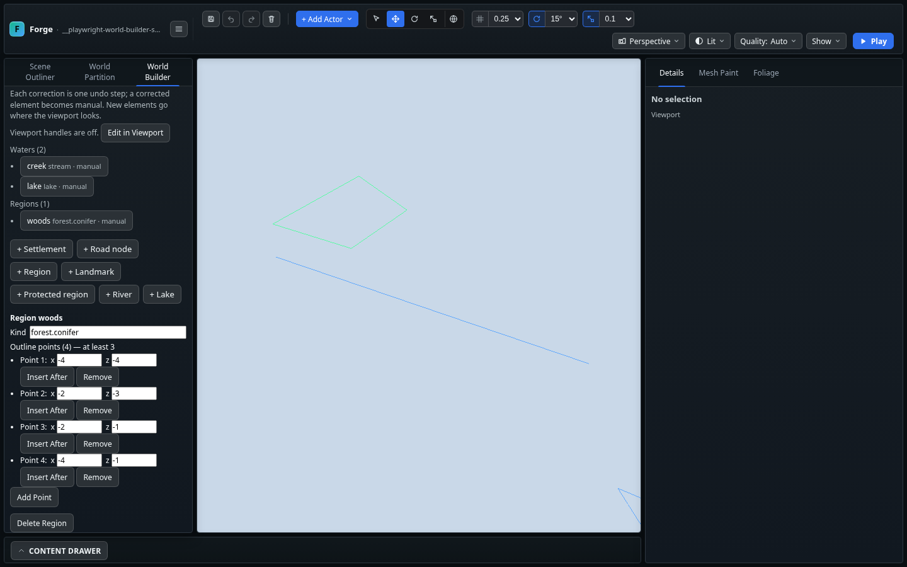

# World Builder F1b / 15c — su ve bölge noktaları

**Tarih:** 2 Kasım 2026 · **Taban:** `main@bfaab73`.
**Durum:** 15c tamam. F1b'de sıradaki iş T35 içe aktarma/birleştirme; üç referans görseliyle uçtan uca WB-13 kabulü açık.

## Kullanıcı akışı

World Builder → **Plan Corrections** artık su öğelerini ve bölgeleri listeler. Seçilen çizgi/çokgen viewport'ta yeşil vurgulanır. **Edit in Viewport** açıkken her su/bölge noktası mevcut tutamaç sistemiyle zemine sürüklenebilir; bırakmak tek undo adımıdır, iptal etmek recipe'yi değiştirmez.

Panelde:

- **+ River** iki noktalı açık su çizgisi, **+ Lake** dört köşeli göl sınırı, **+ Region** dört köşeli bölge planı ekler. Öğeler viewport'un baktığı yerde, `water-N` / `region-N` kimliğiyle başlar.
- Seçilen öğenin **Kind** etiketi ve her noktanın **x/z** koordinatları düzenlenir. Kind düzenlemesi çizgi/çokgen biçimini korur.
- **Insert After** seçilen noktadan sonra ekler. Çokgenin son noktasından sonra eklemek kapanış kenarını böler; açık çizginin sonunda son segment yönünde uzatır.
- **Add Point** en uzun segmenti böler; çokgen için kapanış kenarı da değerlendirilir.
- **Remove**, açık çizgide iki, çokgende üç noktanın altına inemez; bu sınırda düğmeler devre dışıdır. **Delete Water/Region** bütün öğeyi siler ve undo ile geri getirilebilir.
- Her gerçek düzeltme tek undo/redo adımıdır. Düzeltilen öğe `source: manual` olur; `observed` ve `confidence` tahminleri temizlenir. Undo geometriyle birlikte bu kaynak bilgisini de geri getirir.



Görüntü kaydedip yeniden açma sonrasında çekildi: bölge seçili, su çizgisi mavi, seçilen bölge yeşil. Test fixture'ı kullanıldı; kullanıcının level/asset dosyaları yazılmadı.

## Veri ve sınırlar

Mevcut `plan.water.path`, `plan.water.polygon` ve `plan.regions.polygon` alanları kullanılır. Recipe şemasına veya save endpoint'ine yeni alan eklenmedi. Düzenlemeler `WorldBuilderSession.editPlan` üzerinden mevcut normalizer kontrolü, history ve Save Layout akışından geçer. Geçersiz/stale indeksler ve geçersiz koordinatlar geometriyi kaybetmeden reddedilir.

Bu dilim plan çizgilerini/sınırlarını düzenler. Gerçek su yüzeyi ve makro arazi üretimi F2 aşamasında ele alınacak. Mevcut çokgen sözleşmesinin koordinat ve minimum nokta sayısı kontrolleri uygulanır.

## Doğrulama

- `npx tsc --noEmit`: geçti.
- `npm run build:verify`: geçti; **2201 motor kontrolü**, import sınırları, smoke-fixture type-check'i, üretim derlemesi, strict runtime dist ve world-data kontrolleri dahil.
- Beş yeni motor kontrolü: su/bölge tutamaçları ve undo/redo; açık çizgi bölme/uzatma/minimum; göl ve bölge kapanış kenarı/minimum; geçersiz indeks/koordinat reddi; öğe ekleme/etiketleme/silme/undo/kayıt.
- İlgili Playwright koşusu **3/3 geçti**: referans altlığı (WB-13), mevcut elle plan düzeltme (15b), yeni su/bölge akışı (15c).
- Yeni smoke gerçek pointer sürüklemesiyle hem su hem bölge seçimini, panel koordinatlarını, minimum nokta düğmelerini, ekle/sil/undo akışını, kaynak tahminlerinin temizlenmesini ve gerçek Save Layout → reload round-trip'ini kapsar.
- Koşum: Chromium 154 / Linux / SwiftShader. Bu kontroller editör işlevselliğine aittir; donanım GPU performans kabulü değildir.
- İzole World Builder smoke'larına favicon yanıtı eklendi: Chromium 154'ün ikon isteğindeki ilgisiz 404, gerçek editor console-error kontrollerini kirletmiyor.

Tekrar çalıştırma:

```bash
npm run build:verify
npx playwright test world-builder.spec.ts --grep "water and regions|plan corrections|World Builder reference"
```

## Sonraki kontrol noktası

**T35 — AI planını içe aktarma/birleştirme.** Referans analizinden gelen planın kullanıcıya önizlenmesi, kabul edilen verinin recipe ile uzlaştırılması ve yeniden analizde `manual` öğelerin korunması. Ardından üç test görseli ve WB-13 uçtan uca kabulü. F1b'nin bütünü bu dilimle kapatılmadı.
