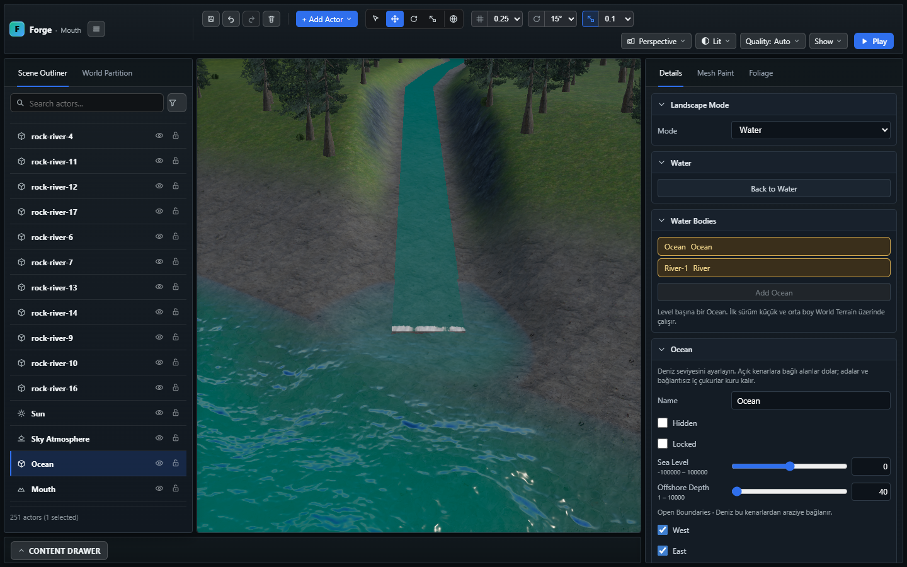
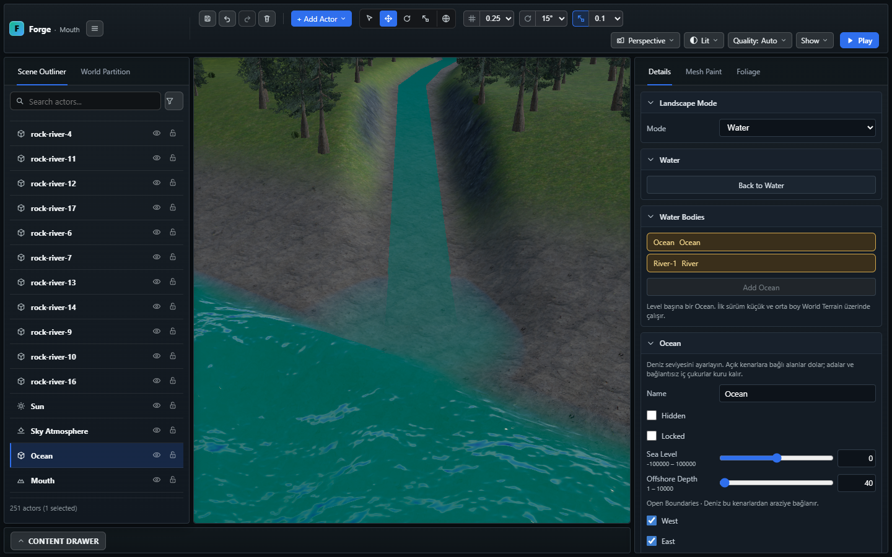
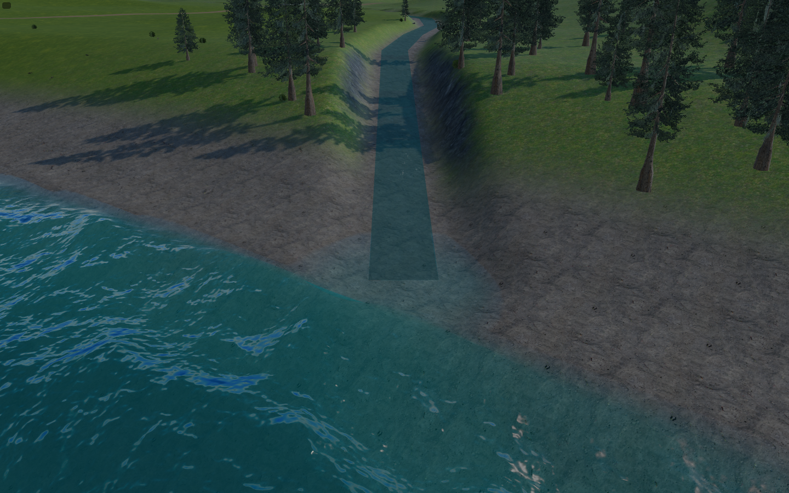
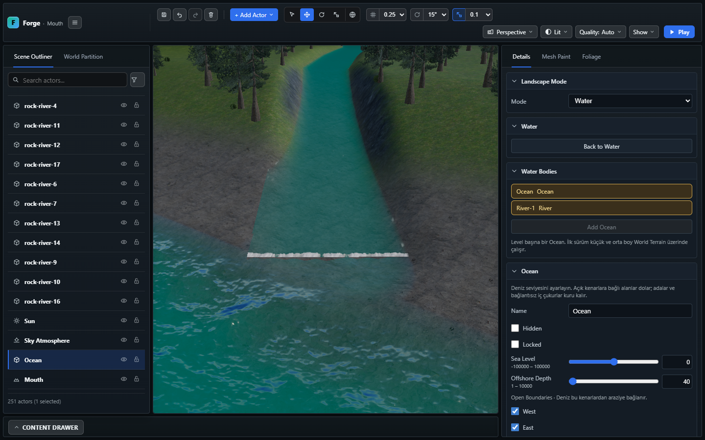
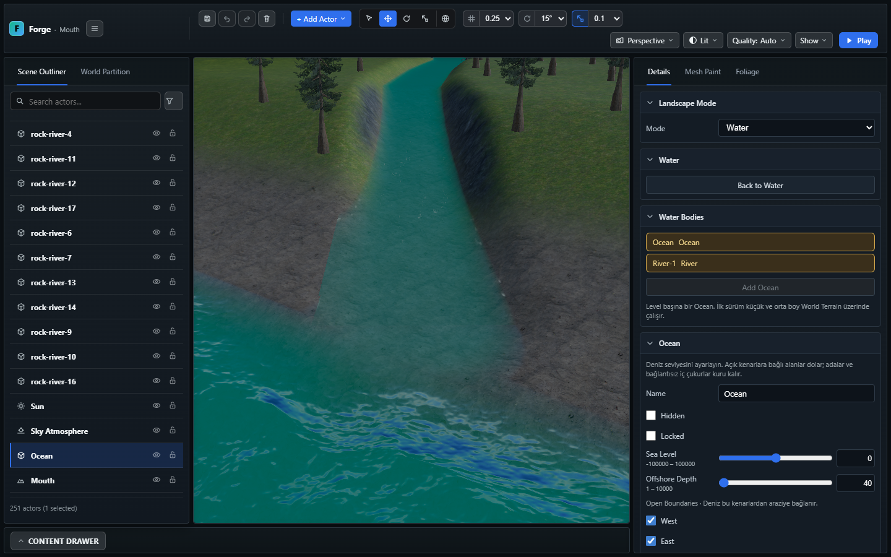
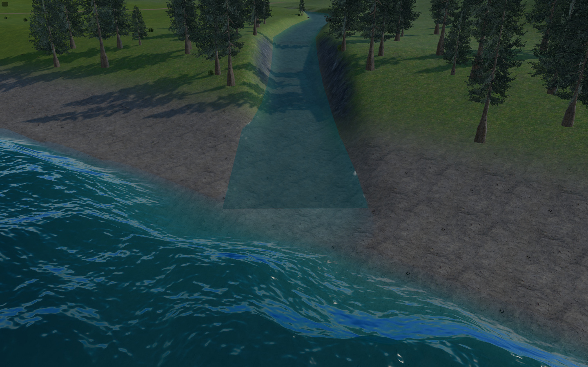
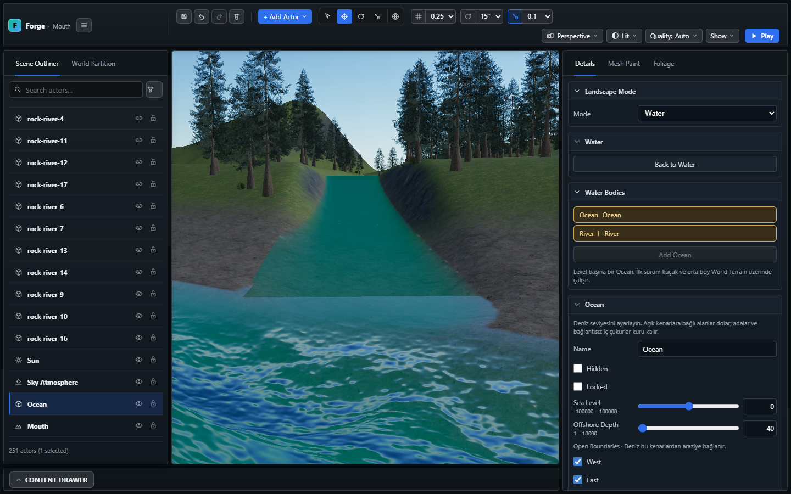

# World Builder — River/Ocean yüzey geçişi

9 Kasım 2026. Coast ve canlı genişlik eşlemesinin ardından yapılan sınırlı
renderer düzeltmesi. Başlangıçta çalışma ağacı temizdi; önceki genişlik işi
`7301c9a2` içinde bulunuyordu. Bu çalışma commit/push yapmaz.

## Tanı

Birleşimin iki ayrı nedeni vardı:

1. Ocean, son düz River kesitini tam genişliğinde keser. Bu kapsam eşlemesi
   doğrudur; fakat FFT deplasmanı, optik normal ve crest köpüğü yalnız su
   derinliğiyle azalıyor, River sınırına uzaklığı hesaba katmıyordu. Böylece
   sakin ribbon'ın yanında dalgalı deniz aniden başlıyordu.
2. River ribbon'ının ilk/son örneğinde komşulardan biri örneğin kendisidir.
   Sıfır uzunluklu yön, dönüş hesabında sert bir viraj gibi değerlendirilip
   `rapidness=1` üretiyordu. Sonuç uç boyunca yapay beyaz köpük çizgisiydi.
   İzole sahnede yalnız River Foam Opacity geçici sıfırlanınca çizginin
   kaybolması bu kaynağı ayırdı; nihai görüntüler normal köpük ayarıyla alındı.

River'ın son kesiti yatay olmak zorunda değildir; deniz kotunda **biten**, sabit
genişlikli düz bir kesittir. Bu dilim spline kotunu veya kıyı kanalını değiştirmez.

## Değişiklik

- Ocean tarafında sonlu inlet dikdörtgenine uzaklık hesaplanır. Kenar, uç ve
  köşeler aynı yerel geçişi kullanır. Bant uzunluğu canlı yarı genişlik × 1,5;
  en az 8 m, en çok 24 m'dir. İlk dörtte birlik bölüm düz bırakılır, devamında
  `smoothstep` ile normal Ocean hareketine dönülür. Bu küçük düz bölüm,
  kamera merkezli grid üçgenlerinin kesim sınırındaki yükseklik farkını da azaltır.
- Aynı ağırlık Ocean'ın geometrik dalgası, optik slope normali ve crest köpüğünü
  azaltır. Beauty ve depth/normal yardımcı çizimleri aynı dalga/normal yolundadır.
  FFT zamanı, uzak Ocean dalgaları ve mevcut LOD düzeni korunur.
- River uçlarında eksik komşudan dönüş üretilmez. Tek taraflı gerçek eğim,
  iç virajlar, elle verilmiş rapidness ve yukarıdan taşınan köpük korunur.
- CPU kapsamı, fragment kesimi ve caustics sahipliği değişmez; River genişliği,
  hidden/delete, undo/redo ve kayıt akışı önceki canlı eşlemeyi kullanır.
  Geçiş parametresi mevcut transient inlet uniformunun boş bileşenindedir;
  yeni kalıcı alan, mesh, texture, capture veya ek FFT adımı yoktur.

## Doğrulama

Kontrol listesi: Width Scale 0,5 ve 1,5; editör ve gerçek Play; aynı ağız
kamerası; undo/redo; Save/Reload; geniş ağızda alçak açı; boşluk, yapay uç köpüğü ve
shader/uygulama hataları. Ek sınır kontrolleri: bant dışındaki tam dalga
ağırlığı, rotated inlet, inactive/boş/çoklu inlet ve çok dar/geniş uniformlar.

| Kontrol | Sonuç |
| --- | --- |
| `npx.cmd tsc --noEmit` ve smoke TypeScript | Başarılı |
| Ocean / terrain river / Water look / River flow / Coast engine grubu | 42 başarılı; 2559 kapsam dışı. Tam engine kapısı değildir |
| Üretim `npm.cmd run build` | Başarılı; 490 modül |
| Kalıcı inlet GPU testi | Başarılı; 120 kenar/uç/köşe örneği, 8 iç/dış çifti; rotated, inactive, boş ve ikinci inlet |
| Ocean FFT/optik/depth/normal + caustics browser regresyonları | Başarılı; GPU testiyle birlikte 3 senaryo, toplam 3,6 dakika |
| Genişletilmiş Coast Playwright | Başarılı; 14,2 dakika. Width Scale 0,5/1,5, undo/redo, Save/Reload ve her iki genişlikte gerçek Play; uygulama/shader hatası yok |
| Etkileşimli izole smoke | Dar/geniş editör ve Play; Save/Reload; undo/redo başarılı. İsteğe bağlı bulunamayan asset sidecar 404'leri dışında uygulama/shader hatası yok |

Engine regresyonu düz ribbon'ın iki ucundaki sahte rapid/foam'u, gerçek eğimi,
virajı ve authored profili ayrı kontrol eder. Önceki gerçek Coast ribbon/Ocean
kapsam ve canlı kaynak kimliği kontrolleri de geçer. GPU testi üretimdeki GLSL
yardımcısını float hedefe çizip uzaklık ağırlığını ve ayrı kapsam maskesini okur.

Etkileşimli oturumdaki ayrı [60 örneklik GPU ölçümü](images/world-builder-inlet-transition/shader-probe.json)
de saklandı. Kalıcı test, döndürülmüş yönü ve sınırın hemen iç/dış örneklerini
ekler. Tam ondalık sınırın float32 yuvarlaması bu testte sahiplik değişikliği
sayılmaz; üretim kapsam maskesine tolerans eklenmedi.

1440×900 editörde canvas (313,93) konumunda 704×752; document boyutu viewport
ile aynıdır. Ana viewport ve Play düğmesi görünürdür. Önceki World Builder
kontrol yerleşimi bu çalışmada değiştirilmedi. Testler kullanıcının projesi
yerine `.playwright-smoke/run-*` köklerini kullanır.

## Görseller

Önce görüntüleri aynı seed=11 Coast, aynı deniz yönü ve aynı yakın kamerada,
tarayıcıya gönderilen iki değişikliğin geçici devre dışı bırakılmasıyla alındı;
diskteki kaynaklar geri çevrilmedi. Dalga fazları eşzamanlı değildir; bu
görseller piksel veya performans benchmark'ı değildir.

## Kalan sınırlar

- İncelenen dar/geniş görüntülerde açık su deliği ve yapay beyaz uç şeridi
  görülmez. Ocean'ın dalga/köpük geçişi yerelleşmiştir; **birleşim bütünüyle
  görünmez değildir**. River'ın eğimi ve ayrı normal, yansıma, geçirgenlik ve
  aydınlatma hesapları nedeniyle özellikle Play'de dikdörtgen renk/ışık sınırı
  hâlâ seçilebilir. Ortak bir optik shader veya estuary yüzeyi uygulanmadı.
- Bu bir hidrodinamik haliç, akıntı karışımı veya shore breaker/swash çözümü
  değildir. Çok uzak/kaba grid ve farklı ışık/hava profillerinde nihai görsel
  kabul, kullanıcı değerlendirmesi ve hedef donanım GPU ölçümü açıktır.
- En çok üç inlet için kısa uzaklık döngüleri eklendi. Ek doku/simülasyon
  kaynağı olmaması, GPU maliyetinin ölçülmüş veya sıfır olduğu anlamına gelmez.
- Orta/büyük Ocean arazileri ve adalarda nehir üretimi kapsam dışıdır.
  `public/project.3dgame.json`, kullanıcı sahnesi, manifest ve
  `docs/planned/FORGE_WEBGPU_EDITION_MASTER_PLAN.md` değiştirilmedi.
- Önceki 2600 kontrol ve `build:verify` sonucu geçmiş doğrulamadır; burada
  sınırlı renderer değişikliğinin ilgili engine/browser grubu ve build'i yenilenir.
