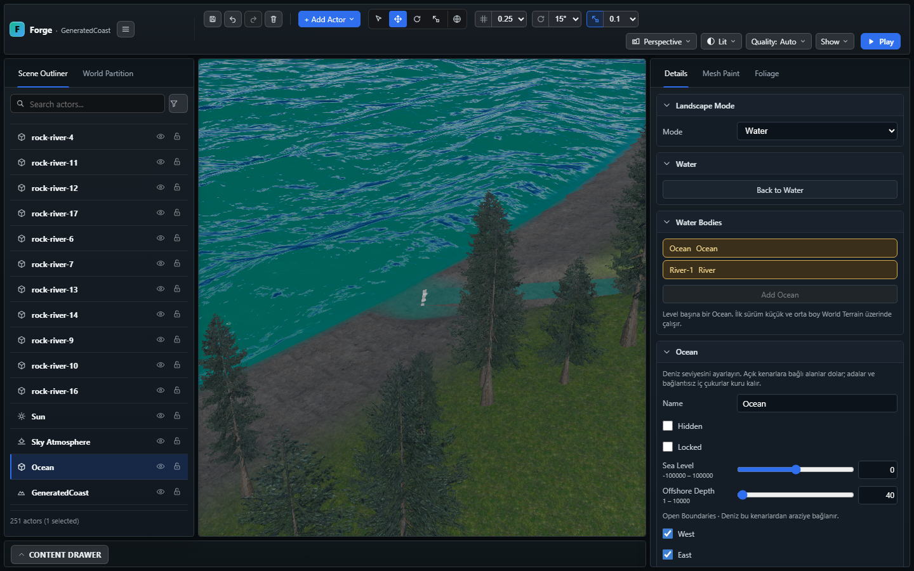
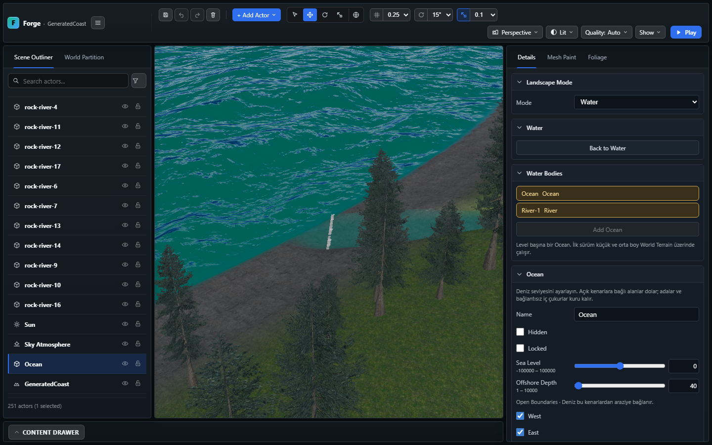
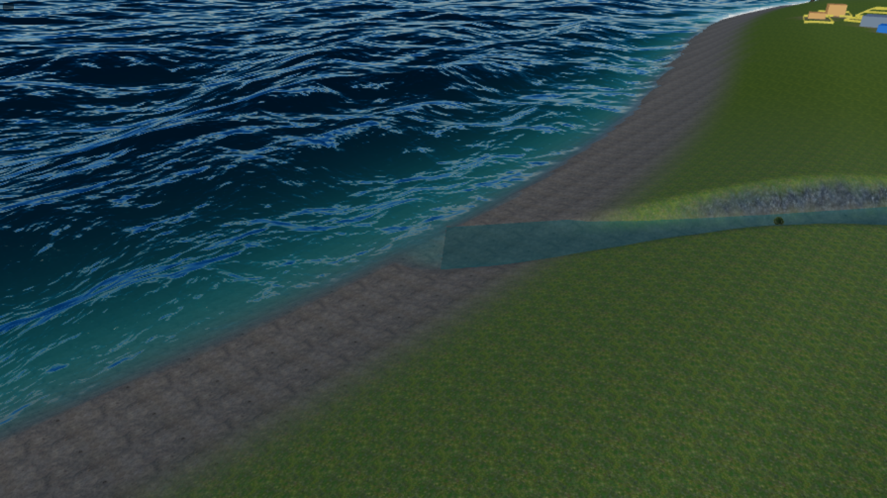

# Ocean–River canlı genişlik eşlemesi

Devam: [River/Ocean yüzey geçişi](WORLD_BUILDER_INLET_TRANSITION.md).
Canlı genişlik eşlemesi korunarak uç köpüğü ve Ocean geçiş bandı iyileştirildi;
ayrı renderer'ların tam optik eşleşmesi hâlâ açık.

9 Kasım 2026. Kıyı aşaması `9dc5e7be` ile commit edildikten sonra,
o teslimde açık kalan River genişlik eşlemesi ele alındı.

## Davranış

World Builder ile oluşturulan Coast level'ında Water → River → **Width Scale**
değiştirildiğinde Ocean, son düz nehir kesitinin gerçek genişliğini izler.
Daraltılan River'ın bıraktığı denize bağlı su alanını Ocean doldurur;
genişletilen ribbon'ın altında ikinci bir yüzey çizmez. Undo/redo aynı yolu
kullanır. Kaydedilen River değeri Reload ve Play'de yeniden okunur.

River gizlenir veya silinirse ilgili kesit Ocean'a bırakılır; geri geldiğinde
yeniden ayrılır. Başka terrain'e veya başka spline'a ait River'lar bu maskeyi
etkilemez. Son düz kesit, sabit spline genişliği ve ortak uç kotu şartları sürer.

## Uygulama ve kaynak sınırı

- Maskenin genişliği, spline genişliği × canlı River `widthScale` değeridir.
  World/legacy local kot dönüşümü River renderer ile aynı hesaptan gelir.
- Editör ve runtime aynı `OceanWaterController` üzerinden, ilgili River'ların
  küçük bir geometri girdisi snapshot'ını okur. Yeni kalıcı alan eklenmez;
  `oceanWaters.inlets` hâlâ spline kimliklerini taşır.
- Normal genişlik/görünürlük değişiminde native terrain tekrar okunmaz;
  coverage texture, geometri, materyal ve FFT korunur. CPU kapsamı, beauty,
  depth/normal ve caustics aynı aktif kesit listesine bağlanır.
- Çok geniş bir River arazi dışına taşarsa, native ribbon'ın çizilmediği
  offshore alanda Ocean deliği açılmaz.
- Hatalı genişlik, birden fazla görünür sahip veya yanlış uç kotu geçerli
  maskeyi bozmaz; Ocean hata durumu bildirir. Standalone terrain hazırlığında
  River listesi verilmezse önceki genişlik=1 davranışı korunur.

## Doğrulama

Odaklı beş engine kontrolü başarılıdır: gerçek Coast üretimi ve River ribbon'ı
ile 0,25 / 0,5 / 2 genişliklerinde ağız boyunca/enine boşluk ve çift yüzey;
0,05–10 aralığında kaynak çözümü; hidden/delete/restore; local/world kotları;
terrain move; geçersiz değerler; aynı geometri/doku/materyal ve simülasyon
kimliği; aynı caustics kaynakları ve güncellenen uniformlar.

| Kontrol | Sonuç |
| --- | --- |
| `npx.cmd tsc --noEmit` | Başarılı |
| Odaklı `ocean inlet,random world coast` engine grubu | 5 başarılı; 2595 kapsam dışı |
| `npm.cmd run build:verify` | Başarılı; 2600 engine kontrolü, üretim derlemesi, strict dist ve world-data kontrolleri geçti |
| Coast browser akışı | Width Scale 0,5 → undo/redo → 1,5 → Save → Reload → Play başarılı |
| Ocean caustics browser kontrolü | Başarılı; iki browser senaryosu toplam 13,2 dakika |

Browser görüntüleri aynı nehir ağzının dar/geniş editör durumlarını ve kaydedilen
1,5 genişliğiyle Play durumunu gösterir. İncelenen görüntülerde açık bir su deliği
görülmez. River'ın sakin yüzeyi ile Ocean dalgaları arasındaki görünür optik
geçiş sürer; bu çalışma o birleşimin nihai görsel kabulünü veya hedef donanımda
GPU performans ölçümünü tamamlamaz.

Testler izole smoke projesini kullanır; kullanıcı proje seçimi ve eşzamanlı
WebGPU planı değiştirilmemiştir. Bu çalışma orta/büyük Ocean grid bütçesini,
Ada'da nehir üretimini veya hidrodinamik haliç davranışını kapsamaz.
