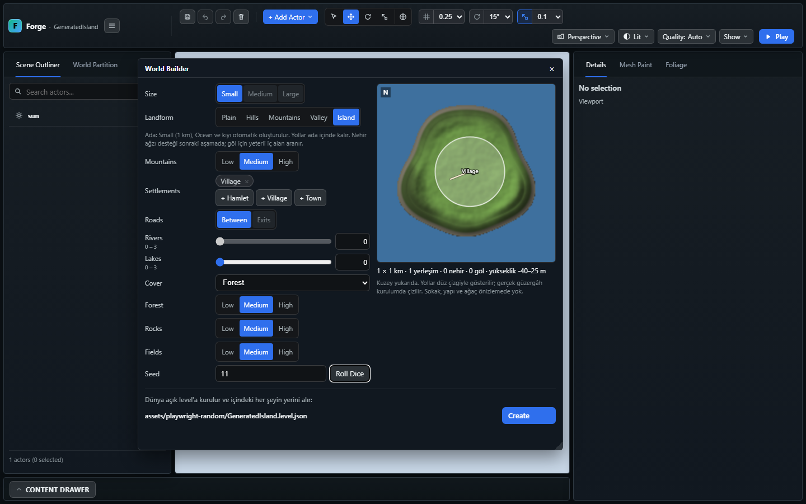
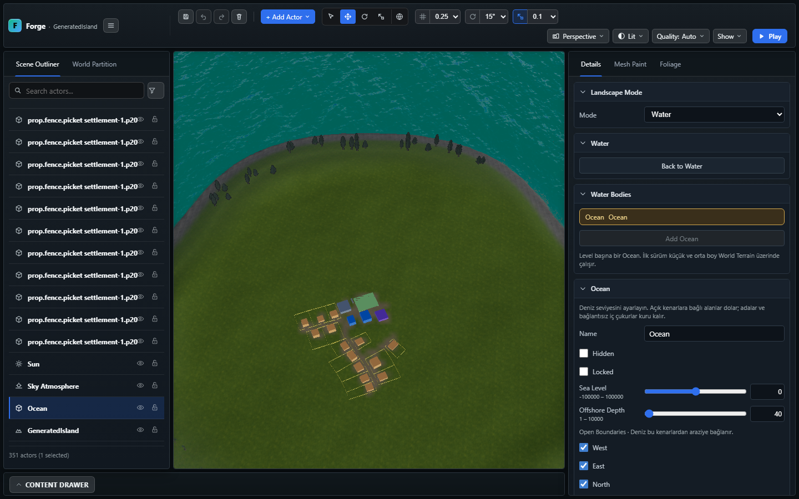
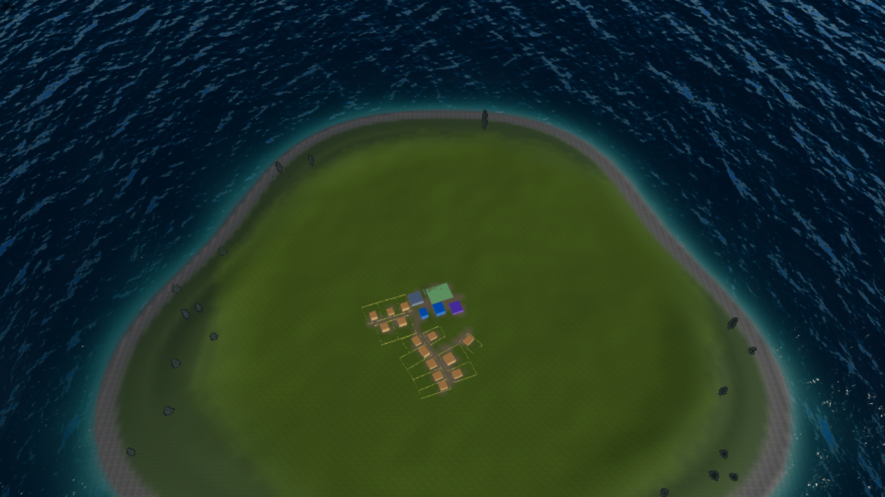

# World Builder — ilk Ada teslimi

9 Kasım 2026. Kapsam: Ocean planı O9'un küçük Ada dilimi. Kıyı landform'u,
nehir ağzı ve orta/büyük dünyalar bu teslimde açık kalır.

## Kullanım ve davranış

Add Actor → Terrain → World Builder… → Landform → **Island**.
Pencere Small / Between / 0 Rivers seçer. Medium/Large, dış yol çıkışları ve
nehir alanı kapanır; başka bir landform'a dönünce kontroller tekrar açılır.
İç göller için yeterli alan aranır, sığmayan yerleşim ve göller notlarda görünür.
Create'in mevcut level'ı yeniden kurma onayı sürer; bu, mevcut araziye Ocean
ekleme modu değildir. Elle Ocean ekleme mevcut Water panelinde kalır.

Kıyı, deniz tabanı ve iç rölyef aynı brief'ten üretilir. Ortak kıyı sorgusu
yerleşim yeri, çekirdek büyümesi, yol, sokak ve parselleri denizden uzak tutar.
Tek köy için ada içinde erişim yolu kurulur; harita dışına yol çıkarılmaz.
Deniz tabanı/kıyı örtünün `bed` katmanına boyanır, mevcut kara bitkileri bu
katmanda yetişmez. Rastgele göller kıyıdan uzak tutulur. Ocean gerçek terrain
bounds'u ve brief seed'iyle mevcut `oceanWaters` kayıt/runtime yolunu kullanır.

İlk sürüm 1.024×1.024 m, 512×512 native hücredir: mevcut Ocean hücre limitine
tam sığar. Büyük boyut ve nehir isteği hem istek doğrulayıcıda hem üreticide
reddedilir; dosyadan üretimde Ocean bütçesi terrain ayrılmadan önce denetlenir.
Şema `terrain.island` ve `ocean` alanlarını birlikte ister; vadi/nehirle
birleştirme bu ilk sözleşmede reddedilir. Ayrıntılar: [World Brief](../world-builder/WORLD_BRIEF.md).

Tarayıcıda bulunan ortak slider hatası da giderildi: sayı alanı kapanınca
disabled değişimini izleyen MutationObserver kendi range güncellemesini
tekrar izleyerek editörü kilitliyordu. Yalnız number kaynağı izlenir ve
slider'a yalnız durum değiştiğinde yazılır. Ada → Hills → Ada geçişi regresyondadır.
Üst uint32 seed'ler makro rölyefe aynı bitlerin int32 karşılığıyla aktarılır;
ardışık küçük seed'ler de görünür kıyı farklılığı verecek şekilde karıştırılır.

## Doğrulama

| Kontrol | Sonuç |
| --- | --- |
| `npm.cmd run build:verify` | Başarılı; 2.591 engine kontrolü, import/smoke/content/UI türleri, build, strict dist ve world-data |
| Son seed/daraltma düzenlemesinden sonra `npm.cmd run build` | Başarılı; `tsc --noEmit` ve Vite build |
| Son `random world island` paketi | 3 başarılı: determinism/sınırlar, native Ocean + kuru yapılar/yollar + bitkisiz deniz + save/read, iç göller |
| `World Builder island` Playwright | Başarılı, 4,0 dakika: seçim sınırları, geri dönüş, önizleme, 1440/900 px yatay taşma kontrolü, Create, Save, Reload, gerçek Play; uygulama/shader hatası yok |
| Mevcut `World Builder window` Playwright | Başarılı, 1,4 dakika: karasal seçenekler, önizleme, iptal, iki ayrı level'a üretim ve ilk level'ın korunması |
| `git diff --check` | Başarılı |

Tam kapıdan sonra eklenen üçüncü Ada testi odaklı pakette çalıştırılmıştır;
2.591 sayısı sonraki bir tam suite koşusu gibi yorumlanmamalıdır. İlk browser
koşusu slider döngüsü bulunduğunda durdurulmuş, düzeltmeden sonraki koşu geçmiştir.
Test sunucusu ve üretilen leveller izole smoke projesindedir; kullanıcıya ait
Island level'ı, manifest ve proje seçim dosyası değiştirilmemiştir.

## Görseller ve kabul sınırı

Görüntüler işlev ve ilk görünüm kaydıdır. Ufuk/kıyı dalgası kalitesi, hedef
donanım GPU/bellek bütçesi ve kullanıcı görsel kabulü tamamlanmış sayılmaz.
Ocean'ın su altı/yüzdürme/wake hedefleri bu üreticiye eklenmemiştir.
Codex Security taraması çalıştırılmadı; istek doğrulayıcı ve üretilen veri
değişiklikleri için dar kapsamlı diff taraması önerisi geçerlidir.
