# World Builder — A3 Island ana biçim ve seed çeşitliliği

10 Kasım 2026. [Kıyı planı A3](../planned/WORLD_BUILDER_SHORELINE_PLAN.md).
Small/Medium yeni Island üretimi tamamlandı. A2'nin commit edilmemiş çalışması
korundu; Coast dağılımı, sığ taban fonksiyonu ve eski kullanıcı sahneleri değiştirilmedi.
A4 birleşik kabulü ayrı kalır.

## Kullanıcıya yansıyan sonuç

Roll Dice artık ana yönü, asimetrisi, büyük koyları ve uzantıları değişen adalar
üretir. Uzatılmış, üç kollu ve geniş koylu biçimler aynı kara miktarıyla haritanın
farklı bölümlerine yayılır. Büyük uzantılar kenarlara yaklaşır; koylar bu alanı
dengelediğinden toplam kara artmaz. İnce kıyı ayrıntıları ana biçimin üstündedir.

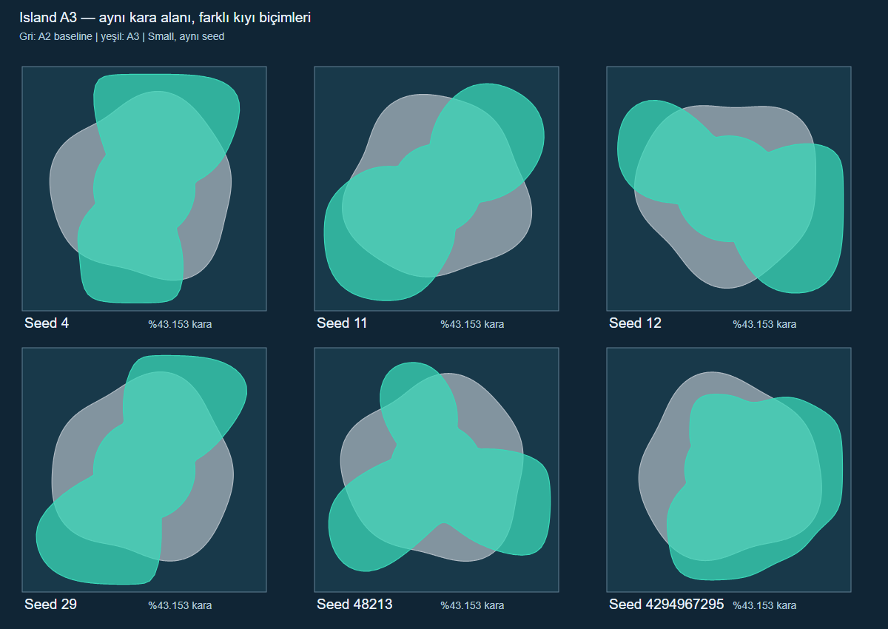

[Vektör karşılaştırması](evidence/island-a3/comparison.svg). Gri A2 baseline,
yeşil A3; her çerçeve aynı Small harita karesidir. Perspektif/kamera farkı
karşılaştırmaya karışmaz. Gerçek önizleme örnekleri aşağıda ayrıca verilir.

## Veri ve ortak kıyı sorgusu

- Yeni brief, `terrain.island.radii` içinde doğudan kuzeye eşit açılarda **128
  yarıçap** saklar. Seed ana yön/asimetri, geniş cape/bay etkileri ve küçük
  ayrıntıları türetir; son biçim açık metre değerleri olarak kaydedilir.
- Yeni üretimde `radius`, eski alan hedefinin referansıdır. `radii` varken
  gerçek sınırı bu liste belirler. Sonradan aynı brief'in yalnız seed'ini
  değiştirmek saklanan kıyıyı yeniden çizmez; Roll Dice yeni brief/radii üretir.
- Alan, eski `r(θ)=R(1+0,07sin(3θ+φ)+0,04sin(5θ−2φ))` adasının analitik
  `πR²×1,00325` alanına kalibre edilir. Kenar payına yumuşak yaklaşılır;
  uzantılar kare sınırında kesilip düz uçlara dönüştürülmez. Gerçek saklanan
  poligonun alanı kalibrasyonda kullanılır; kumsal dahil su çizgisi korunur.
- Yeni poligonun **gerçek işaretli metre mesafesi**, önizleme, terrain, boya,
  foliage ve yerleşim/yol/göl sorgularında ortaktır. Hücre başına aday kenarlar
  hesaplanarak imkânsız en yakın kenarlar elenir; mesafe yaklaşımı veya düşük
  çözünürlüklü SDF kullanılmaz. Genel tüm-kenar geometrisiyle 13.068 farklı
  örnekte mesafe ve iç/dış sınıfı karşılaştırılır.
- Eski `radii` içermeyen brief'ler eski iki-sinüs/radius yolunda kalır. Seed
  fazı hesabı Coast için aynıdır. A2'nin su altı eğrisi, 35 m / 2 m ve 150 m /
  40 m noktaları korunur; yeni kıyıda mesafe gerçek poligon sınırından ölçülür.
- Normalizer liste boyunu, sonlu/pozitif metreleri ve harita kenarında en az
  iki terrain hücresi deniz payını denetler. Yeni varsayılanlar bundan daha
  geniş, Small'da en az 32 m, Medium'da yaklaşık 61,44 m pay bırakır.
  Layout/environment veya skeleton alanı eklenmedi; save allowlist değişmedi.

## Aynı-seed alan ve bağlantı ölçümü

[Baseline](evidence/island-a3/baseline.json), [yeni sonuç](evidence/island-a3/after.json).
Baseline A3 kodu değişmeden önce alındı. Boyut başına seed 4, 11, 12, 29, 48213
ve 4294967295: toplam **12 senaryo**. Nehir/göl/yerleşim kapalıdır; iç su
alanları bu kıyı alanına karıştırılmaz. Harita dışındaki Ocean sayılmaz.

- Geometrik alan, kaynak kıyının 1024 açıdaki kesişiminden hesaplanır. Eski
  eğri örneklenir; yeni poligonun gerçek chord kesişimleri alınır. Eski
  örnekleme %43,152431; yeni %43,152719–43,152756 verir. Yaklaşık **%43,153
  kara / %56,847 deniz** korunur. Küçük farkın içinde eski eğrinin sonlu açı
  integrali ve metrelerin 0,001 hassasiyetle kaydı vardır; kabul sınırı 0,001
  yüzde puandır. Engine ayrıca yeni poligon alanını eski analitik alana karşı
  doğrudan denetler (bağıl tolerans 0,00001).
- Alan sayımı, 8 m hücre merkezlerinde su çizgisinin kara tarafını sayar.
  Bu bir raster alan tahminidir; tolerans 0,15 yüzde puandır. Dört senaryoda
  gerçek builder/native Ocean coverage ile aynı noktalar ayrıca sorgulanır
  (tabloda `*`). Noktalar 2 m native grid'e de denk gelir; bu sayı alanın daha
  hassas tam üçgen integrali olarak sunulmaz.
- İç çekirdek, kıyıya mesafesi en az 40 m olan 8 m grid hücreleridir.
  Dört komşulu bağlantı analizi yapılır. **12/12 örnekte tek bileşen**, hücrelerin
  %100'ü ana parçadadır. Bu, örneklenen biçimlerde kullanışlı geniş iç geçit
  kanıtıdır; yalnız tek merkez pikselinin karada olmasıyla yetinilmez.

| Boyut | Seed | Önce raster kara % | Yeni raster/native kara % | Önce en yakın kenar m | Yeni en yakın kenar m |
| --- | ---: | ---: | ---: | ---: | ---: |
| Small | 4 | 43,1335 | 43,1824 | 103,97 | 32,12 |
| Small | 11* | 43,1091 | 43,1641 | 113,20 | 40,85 |
| Small | 12 | 43,1885 | 43,1641 | 94,90 | 32,19 |
| Small | 29* | 43,1274 | 43,2129 | 101,15 | 32,34 |
| Small | 48213 | 43,1396 | 43,1763 | 107,71 | 35,25 |
| Small | 4294967295 | 43,1396 | 43,1702 | 102,14 | 35,72 |
| Medium | 4 | 43,1641 | 43,1442 | 207,95 | 61,70 |
| Medium | 11* | 43,1488 | 43,1488 | 226,39 | 79,82 |
| Medium | 12 | 43,1610 | 43,1488 | 189,80 | 61,85 |
| Medium | 29* | 43,1549 | 43,1580 | 202,29 | 62,15 |
| Medium | 48213 | 43,1625 | 43,1488 | 215,42 | 68,23 |
| Medium | 4294967295 | 43,1396 | 43,1412 | 204,27 | 69,24 |

En büyük raster/native fark **0,08545 yüzde puan**. Kıyı çevresi aynı-seed eski
biçimin 1,044–1,306 katıdır; daha fazla koy/uzantı, daha fazla kara anlamına gelmez.

## Yerleşim, yollar, foliage ve iç göller

Gerçek native Island build'inde binalar ve yollar Ocean dışında, yerleşim
yüksekliği güvenli ve suya boyanan vertex'lerde bitki katmanı sıfırdır.
Small/Medium iç Lake örnekleri ayrıca build edilir; gerçek Lake geometrisi
hazırdır, Lake seed'i Ocean coverage'ında kuru kalır, read/save round-trip geçer.
Ada'da nehir eklenmedi; mevcut istek reddi korunur.

Biçim değişince aynı seed'in gölüne yer bulunması değişebilir. Eski göl testindeki
seed 3/11/27/91'in Small örnekleri yeni biçimde yer bulamadı; güvenlik mesafeleri
ve ring eğim şartları gevşetilmedi. [0–63 taraması](evidence/island-a3/lake-probe.log)
Small'da 18, Medium'da 17 seed'de güvenli göl üretti (yerleşimsiz, medium relief).
Regresyonlar eski başarısız/uygun-yer-yok örneklerini ve yeni uygun örnekleri
birlikte kapsar; uygun olmayan yerde açık “room for 0” notu gerekir. Native
Lake örnekleri Small seed 12 ve Medium seed 3'tür.

## Editör ve Play kanıtları

İzole `.playwright-smoke/run-*` projelerinde Small ve Medium gerçek Create →
Save → Reload → Play geçti; saklanan 128 kıyı değeri değişmeden okundu. Ek
senaryoda iki boyutta altı seed'in önizlemesi, Roll Dice ve seed 11'e dönünce
aynı piksel hash'i doğrulandı. Büyük uzantılar ilk otomatik yakın kadraja
sığmadığından yalnız kanıt kameraları genişletildi. Medium kanıt level'ında
bu yüksek poz için `worldSettings.viewDistance=6000` sahnelendi; varsayılan
üretim ayarları ve kullanıcı level'ı değiştirilmedi. İlk Medium genel görüntü
far clip nedeniyle boştu; kabul edilmedi, bu fixture ayarıyla yeniden alındı.

| Örnek | Önizleme | Editör | Play | Yakın kıyı Play |
| --- | --- | --- | --- | --- |
| Small, seed 11 | [görsel](images/island-a3/small-preview.png) | [görsel](images/island-a3/small-editor.png) | [görsel](images/island-a3/small-runtime.png) | [görsel](images/island-a3/small-shallow-runtime.png) |
| Medium, seed 48213 | [görsel](images/island-a3/medium-preview.png) | [görsel](images/island-a3/medium-editor.png) | [görsel](images/island-a3/medium-runtime.png) | [görsel](images/island-a3/medium-shallow-runtime.png) |

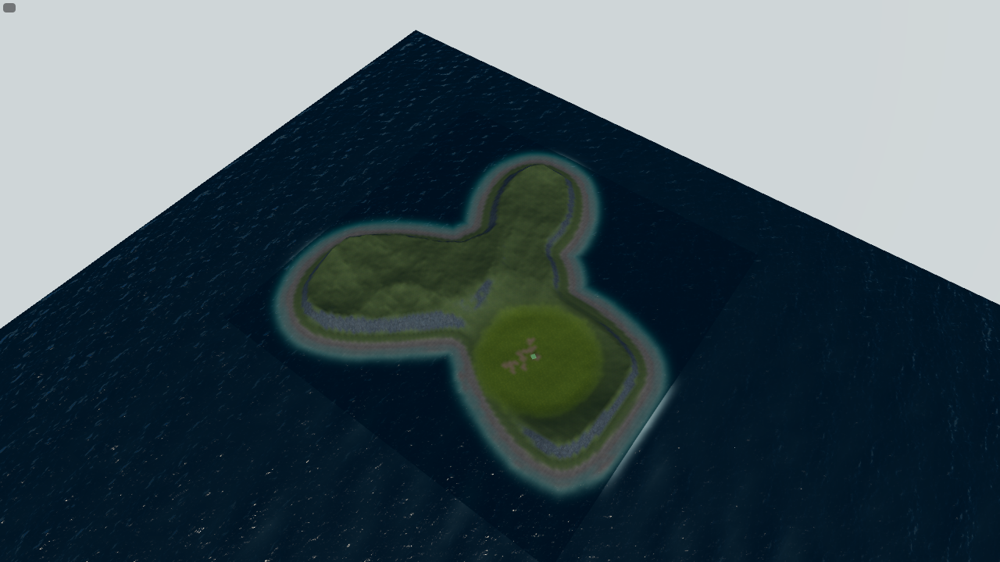

Gerçek World Builder önizlemeleri:

| Seed | Small | Medium |
| ---: | --- | --- |
| 4 | 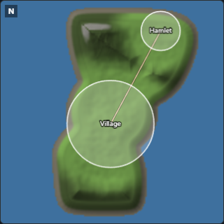 | 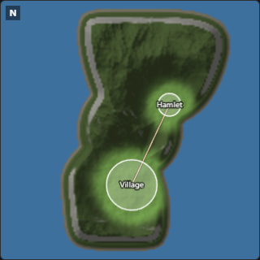 |
| 11 | 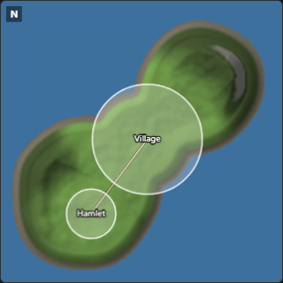 | 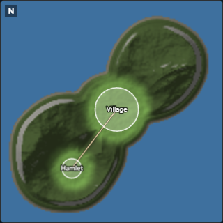 |
| 12 | 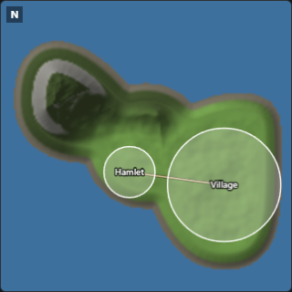 | 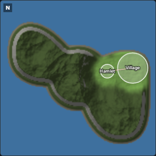 |
| 29 | 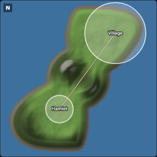 | 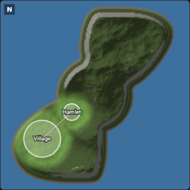 |
| 48213 | 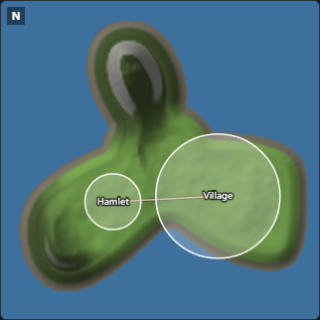 | 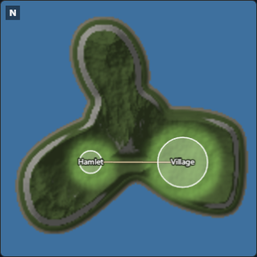 |
| 4294967295 | 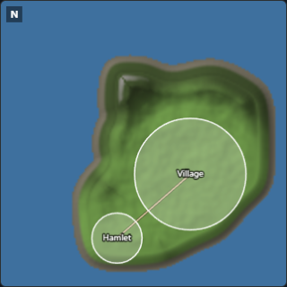 | 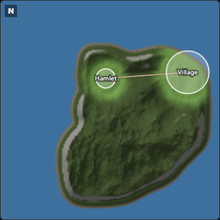 |

Kara/deniz tarafı, ana koylar/uzantılar ve genel/yerel görüntüler ayrı incelendi.
Uygulama/shader hatası kaydedilmedi. Dalga fazı, ışık ve foliage residency anı
eşit değildir; görüntüler piksel benchmark'ı veya foliage performans kabulü
değildir. Uzaktan görülen sonlu Ocean mesh sınırı/horizon önceki kapsam sınırıdır.

## Teknik doğrulama ve birleşik kapı sınırı

| Kontrol | Sonuç |
| --- | --- |
| TypeScript + smoke + ölçüm aracı strict türleri | Başarılı |
| Odaklı Island/A2/Medium/önizleme grubu | 12 kontrol başarılı; tam suite yerine sayılmaz |
| İlk browser grubu | 3 senaryo başarılı, 1,7 dakika |
| Geniş kadraj tekrarları | Yalnız ilgili görsel akışlar: iki boyut, sonra Medium far-clip düzeltmesi; final görüntüler incelendi |
| Tam engine slow grubu | **2610 kontrol başarılı**, 172,5 s; native Island Lake/Ocean dahil |
| Kalan build kapıları | Project-build, TypeScript/Vite build, strict dist, world-data başarılı; exit 0 |
| Tam `build:verify` | **Tamamlanmış/yeşil sayılmadı:** ilgisiz project-roots test dosyası kapanışında takıldı |

[Odaklı engine logu](evidence/island-a3/focused.log),
[browser logu](evidence/island-a3/browser.log), [browser sonucu](evidence/island-a3/browser-result.json),
[geniş kadraj logu](evidence/island-a3/views.log),
[son Medium logu](evidence/island-a3/medium.log), [Medium sonucu](evidence/island-a3/medium-result.json).

İlk birleşik kapı, import/fixture/content/UI/tool kontrollerini geçti.
`verify:project-roots` içindeki **10 alt kontrolün tamamı başarılı raporlandı**,
ancak Node test child'ı çıktı vermeyi ve kapanmayı bıraktı. Yaklaşık 426 s sonra
yalnız bu koşuya ait olduğu PID/ebeveyn zinciriyle doğrulanan child sonlandırıldı;
dosya koşucusu doğal olarak failure/exit 1 kaydetti. Kullanıcı sunucusuna veya
bu kapsam dışı test harness'ine müdahale edilmedi. Başarılı kontroller tekrarlanmadı;
henüz çalışmamış `verify:project-build`, `build`, `test:engine:slow`,
`verify:dist -- --strict` ve `verify:world-data` sırayla **exit 0** ile tamamlandı.
World-data 12 level / 5 world-data taradı; issue yok.

[İlk birleşik log](evidence/island-a3/build-verify.log),
[ilk exit](evidence/island-a3/build-exit.txt),
[kalan kapılar](evidence/island-a3/remaining-gates.log), [exit 0](evidence/island-a3/remaining-exit.txt).
Bu ayrım tam birleşik kapının geçtiği iddiasını önler.

## Yeniden üretme ve korunmuş kapsam

```powershell
node tools/world/run-island-shape-measurement.mjs before.json --legacy
node tools/world/run-island-shape-measurement.mjs after.json
node tools/world/compare-island-shapes.mjs before.json after.json comparison.svg
$env:FORGE_SMOKE_PORT='5289'
npx.cmd playwright test tests/smoke/world-builder-random.spec.ts --grep 'World Builder island' --headed
```

Kullanıcının A2 değişiklikleri başlangıçta commit edilmemişti; korundu ve yalnız
A3'ün ortak kıyı/ölçüm tüketicileri uyarlandı. İş sırasında ayrıca değişen
`public/project.3dgame.json`, manifest, silinen `Levels/L02.level.json` ve yeni
`Levels/L03.level.json` dosyalarına dokunulmadı/geri alınmadı. S1*, WebGPU master planı ve diğer kullanıcı verileri
korundu. Commit/push yapılmadı. Large, Ada'da nehir, kıyıya vuran dalgalar ve tam
Ocean GPU/ürün kabulü bu A3 teslimine eklenmedi. Yeni saklanan kıyı verisi için
Codex Security diff incelemesi önerildi; tarama başlatılmadı.
