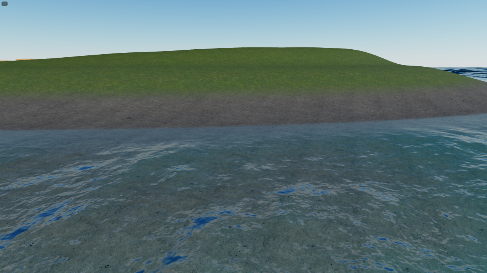
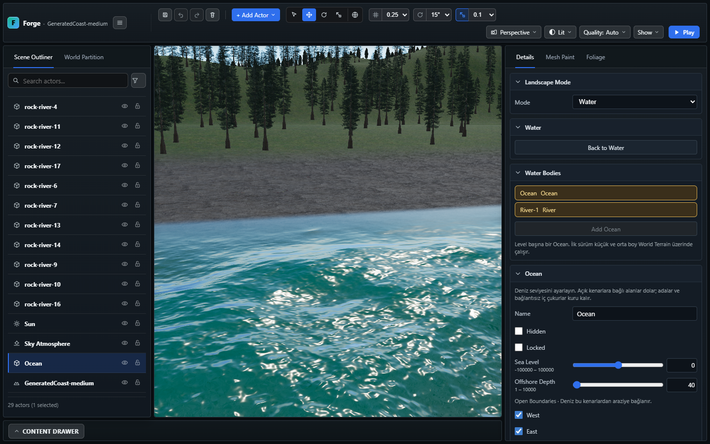

# World Builder — A2 Island/Coast sığ kıyı profili

10 Kasım 2026. [Kıyı planı A2](../planned/WORLD_BUILDER_SHORELINE_PLAN.md).
Yalnız su altı taban profili; bu kayıt A3 öncesidir.
Sonraki [A3 biçim teslimi](WORLD_BUILDER_ISLAND_A3.md) ayrı raporlanır. [A1 ölçümleri](WORLD_BUILDER_COAST_A1.md)
kendi tarihsel kapsamıyla korunur.

## Uygulama

Yeni World Builder Island ve Coast brief'lerinde şu değerler açıkça yazılır:

```json
"shoreProfile": { "shallowDistance": 35, "shallowDepth": 2, "deepDistance": 150 }
```

Alan `ocean` altındadır. Su altı mesafesi 0–35 m'de 0–2 m, 35–150 m'de
2–40 m derinliğe ilerler; ardından mevcut 40 m derin taban devam eder.
İki parça smoothstep eğrisidir: su çizgisinde, 35 m'de ve 150 m'de yükseklik
ve eğim süreklidir (C1). Kuru kıyı rampası, boya ve relief hesabı değişmedi.
Mesafe, mevcut ortak kıyı fonksiyonunun mesafesidir; sahada normal yönünde
ölçülen metreler aşağıda ayrıca verilir.

Profil opt-in'dir: alanı olmayan eski brief, `shoreWidth` ile belirlenen
üstel su altı eğrisini korur. Mevcut kullanıcı terrain'i yeniden üretilmez.
Normalizer yalnız bilinen alanları kabul eder; sonlu değerler 0,01–10000,
`deepDistance > shallowDistance`, `shallowDepth < offshoreDepth` koşullarıyla
doğrulanır. Layout/environment veya skeleton alanı eklenmediği için
`saveValidator.ts` allowlist değişikliği gerekmez. Profil terrain'e bake edilir;
Ocean controller veya renderer'a yeni kayıt alanı taşınmaz.

Kıyı merkezleri/biçimleri, A1 kuru kumsalı ve güvenlik mesafeleri, nehir ağızları,
canlı Width Scale/inlet sahipliği ve Medium atlas yolu değiştirilmedi.
Kullanıcı sahnesine, manifest'e, `public/project.3dgame.json`, S1* veya WebGPU
master planına yazılmadı. Başlangıç Git ağacı temizdi. Commit/push yapılmadı.

## Ölçüm yöntemi ve sonuçlar

[Ham sonuçlar](evidence/shore-a2/profile.json),
[ölçüm logu](evidence/shore-a2/measurement.log).

- Kaynak matrisi: Small/Medium × (Island + Coast dört yön) × seed 4/11/29 =
  **30 senaryo**. Nehir/göl/yerleşim kapalıdır; iç sular kıyı alanını değiştiren
  bir ölçüm sınıfı olarak bu matrise karıştırılmaz.
- Her senaryoda 128 kıyı kesiti. Coast along ekseninde 200 m kenar payı;
  Island çevresinde eşit açılar. Mesafeler kaynak kıyı normalinde denize doğru
  fiziksel metrelerdir. Kaynak kıyı fonksiyonu tam Öklid SDF olmadığından
  özellikle burunlarda değerler tek bir ideal düz kesitten biraz farklıdır.
- Alanlar 8 m hücre merkezlerinde, yalnız harita karesi içinde sayılır. Eski
  karşılaştırma aynı brief'ten yalnız `shoreProfile` çıkarılarak yapılır; A1
  kumsalı ve kaydırılmış Coast merkezi korunur.
- Small/Medium Island ve West Coast, seed 11 için **dört native önce/sonra çifti**
  ayrıca gerçek builder ile yalnız bellekte üretildi. Native 2 m üçgen yükseklik,
  denize bağlı coverage ve mevcut harita dışı 64 m Ocean geçişi sorgulandı.
  Bunlar kullanıcının sahnesinde oluşturulmadı.

Kaynak matrisinin tamamında örneklenen kuru zemin yüksekliği ve kıyı mesafesi
önce/sonra farkı **0**. Coast iç kara %69,9936–70,0317 olarak korundu. Native
örneklerde deniz alanı da önce/sonra aynı kaldı:

| Native örnek, seed 11 | Önce/sonra deniz % | Önce 35 m derinlik m | Yeni 35 m derinlik m | Yeni 150 m derinlik m |
| --- | ---: | ---: | ---: | ---: |
| Small Island | 56,8909 | 17,68–18,55 | 2,00–2,05 | 36,54–40,00 |
| Medium Island | 56,8512 | 17,67–18,60 | 2,00–2,06 | 39,99–40,00 |
| Small Coast | 23,8953 | 17,68–18,28 | 2,00–2,04 | 40,00 civarı |
| Medium Coast | 26,9455 | 17,68–18,28 | 2,00–2,04 | 40,00 civarı |

Yeni kaynak profilinde, tüm 30 senaryonun 128 kesitindeki aralıklar:

| Kıyıdan normal mesafe | Yeni derinlik |
| --- | ---: |
| 10 m | 0,397–0,454 m |
| 30 m | 1,889–1,967 m |
| 35 m | 2,000–2,063 m |
| 40 m | 2,209–2,536 m |
| 120 m | 33,59–36,46 m |
| 150 / 180 m | 40 m |

**Small Island sınırı:** kıyıyı/ada alanını koruyunca bazı yönlerde 150 m'lik
kesit terrain karesinin dışına çıkar. Seed 11 örneğinde 128 kesitin 38'i
150 m'de dışarıdadır; mevcut connected-boundary offshore devamıyla derinlik
36,54–40 m (ortalama 39,48 m) olur. 180 m'de 39,67–40 m'dir. Native alanı
büyütmek, ada küçültmek veya renderer'ın offshore politikasını değiştirmek
bu teslimde yapılmadı. Kaynak eğri 150 m'de 40 m olsa da bu dış kesitler için
native/renderer sonucunun birebir 40 m olduğu iddia edilmez.

## Mevcut renderer tepkisi

Yeni wave/foam sistemi eklenmedi. Mevcut Ocean, 0–5 m derinlikte vertex
deplasmanını, 0–4 m'de normal eğimini yumuşatır. Yeni taban, bu tepkiyi daha
geniş yatay banda yayar. Yakın editör ve gerçek Play görüntülerinde su altı
tabanı görünen geniş sığ bant ile kıyıya doğru sakinleşme incelendi.

GPU probe, üretim `OceanSurface` vertex kaynağındaki coverage ve dalga
fonksiyonlarını doğrudan derler; bu GLSL'yi ikinci kez elle yazmaz. Aynı seed ve
aynı 0,25 saniyelik FFT adımlarıyla iki profili karşılaştırır: her profilde 24
an × 7 mesafe = toplam **336 örnek**. 10 m açıkta yeni düşey tepkinin RMS/raw
oranı %3'ün altında ve eski tepkinin onda birinden azdır. Her örnekte hesaplanan
dalgalı yüzey tabanın üzerinde ve derinlik pozitiftir; GL hatası 0. Bu, tüm
rüzgâr ayarları/sonsuz süre/LOD sınırları için eksiksiz görsel kabul değildir.
Normal shader'ının derinlik bandı değişmedi; probe düşey deplasman ve coverage'ı
ölçer, normaller için ayrı sayısal kabul iddia edilmez.

## Kontroller

| Kontrol | Sonuç |
| --- | --- |
| Profil, legacy ve A1 regresyonları | 11 odaklı kontrol geçti; kaynak eğri monoton, C1, sonlu ve 0–40 m arasında; kara değişmedi |
| Gerçek native üretim | Dört önce/sonra çift; 35 m / yaklaşık 2 m ve Ocean bağlantısı doğrulandı |
| `npx.cmd tsc --noEmit` | Geçti |
| Smoke ve ölçüm araçlarının strict tür kontrolü | Geçti |
| `build:verify` | Exit 0; import/fixture/content/UI/tool/project kontrolleri, TypeScript/Vite, strict dist ve world-data geçti |
| Tam engine | **2608 kontrol**, 141,6 s; River/Ocean sahipliği ve Medium kurulumları dahil |
| Headed editör/Play | **Dört akış geçti:** Small/Medium Island/Coast; Create, Save, Reload, Play; Coast width 0,5/1,5, undo/redo, dar/geniş gerçek Play |
| Üretim GLSL sığlık probe'u | İzole tekrar **1/1 geçti**, exit 0, 16,4 s; 336 örnek, GL hata 0 |

[Build logu](evidence/shore-a2/build-verify.log), [exit 0](evidence/shore-a2/build-exit.txt),
[odaklı engine](evidence/shore-a2/focused.log),
[browser akışları](evidence/shore-a2/browser.log),
[son GPU logu](evidence/shore-a2/gpu.log), [GPU sonucu](evidence/shore-a2/gpu-result.json).

İlk birleşik browser koşusu dört authoring akışını geçti, GPU probe'unun
desteklenmeyen 3 saniyelik FFT adımında durdu. Probe düzeltildi; sonraki denemede
eski profilin de mevcut destination/bed kıskaçlarından etkilendiği görüldü.
Eski tepkiyi 1 varsayan test, aynı FFT anlarındaki gerçek eski/yeni RMS tepkisini
karşılaştıracak şekilde düzeltildi. Son probe başarılıdır; ürün renderer'ı bu
test varsayımları için değiştirilmedi. Başarılı dört authoring akışı ve tam
engine paketi tekrarlanmadı. Dört authoring akışında uygulama/shader hatası yok;
bilinen opsiyonel sidecar/favicon 404 sınıflandırması korunur.

## Görüntüler ve kabul sınırları

| Örnek | Genel Play | Yakın editör | Yakın Play |
| --- | --- | --- | --- |
| Small Island | [görsel](images/shore-a2/small-island-runtime.png) | [görsel](images/shore-a2/small-island-shallow-editor.png) | [görsel](images/shore-a2/small-island-shallow-runtime.png) |
| Medium Island | [görsel](images/shore-a2/medium-island-runtime.png) | [görsel](images/shore-a2/medium-island-shallow-editor.png) | [görsel](images/shore-a2/medium-island-shallow-runtime.png) |
| Small Coast | [görsel](images/shore-a2/small-coast-runtime.png) | [görsel](images/shore-a2/small-coast-shallow-editor.png) | [görsel](images/shore-a2/small-coast-shallow-runtime.png) |
| Medium Coast | [görsel](images/shore-a2/medium-coast-runtime.png) | [görsel](images/shore-a2/medium-coast-shallow-editor.png) | [görsel](images/shore-a2/medium-coast-shallow-runtime.png) |

Coast ağızları: [Small dar](images/shore-a2/small-coast-mouth-narrow-runtime.png),
[Small geniş](images/shore-a2/small-coast-mouth-runtime.png),
[Medium dar](images/shore-a2/medium-coast-mouth-narrow-runtime.png),
[Medium geniş](images/shore-a2/medium-coast-mouth-runtime.png).





Görüntülerde sığ bandın tabanı ve su örtüsü, kuru kıyı bağlantısı ve dar/geniş
ağızlar ayrı incelendi; örneklenen sığ bantta kuru taban açılması veya yeni
bağlantı deliği görülmedi. Dalga fazı/ışık/streaming anı eşit değildir; Play
foliage residency'si bu görüntülerle eşzamanlı kabul edilmiş sayılmaz. Bunlar
piksel veya performans benchmark'ı değildir. Ocean/River optik sınırı hâlâ
seçilebilir; kıyıya vurup kırılan dalga ve tam köpük teslimi değildir.

```powershell
node tools/world/run-shore-profile-measurement.mjs docs/reports/evidence/shore-a2/profile.json
$env:FORGE_SMOKE_PORT='5287'
npx.cmd playwright test tests/smoke/world-builder-random.spec.ts --grep 'World Builder (island|coast)' --headed
$env:FORGE_SMOKE_PORT='5288'
npx.cmd playwright test tests/smoke/ocean-shallow-profile.spec.ts --headed
```

Browser projeleri `.playwright-smoke/run-*` altında izoledir. Large, Ada'da nehir,
A3 ada biçim çeşitliliği, kıyıya vuran dalgalar ve tam Ocean GPU/ürün görsel
kabulü açık kalır. Yeni WorldBrief/generation diff'i için Codex Security diff
incelemesi uygundur; kullanıcı isteği/onayı olmadan tarama başlatılmadı.
