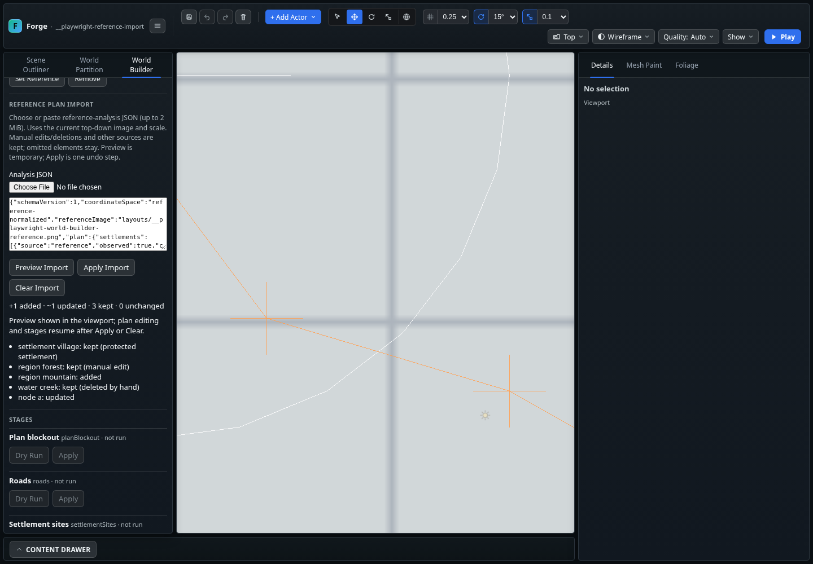

# World Builder — T35 içe aktarma/birleştirme kontrol noktası

Tarih: 2026-11-02. Kapsam: dışarıda üretilen referans analizinin editöre güvenli
önizleme ve açık uygulama adımıyla alınması. F1b tamamlanmış sayılmaz.

## Teslim edilen davranış

- World Builder → **Reference Plan Import** JSON dosyası seçimi veya metin girişi.
  Normalize görsel noktaları mevcut referansın sol üstü ve metre boyutuyla dünya
  koordinatlarına çevrilir. Kaynak görsel eşleşmesi zorunludur.
- Önizleme viewport'ta çizilir; eklenen, güncellenen, değişmeyen ve korunan
  kimlikler gerekçeleriyle listelenir. Recipe, dirty durumu ve history değişmez.
  Önizlemede plan düzenleme ve üretim aşamaları kapalıdır.
- **Apply Import** tek undo/redo adımıdır; sahne üretimi ve Save Layout ayrıdır.
  Geçersiz JSON atomik reddedilir. Aynı JSON ikinci kez değişiklik üretmez.
- Kararlı `(kind,id)` ile eklemeli birleştirme: manuel öğeler, başka kaynaktan
  gelenler ve korunan yerleşimler korunur; JSON'da bulunmayan öğeler silinmez.
- Elle silinen kimlikler ve düğüm silinmesiyle düşen kenarlar
  `ownership.deletedPlanElements` içinde kaydedilir. Yeniden yükleme ve analiz
  bunları geri getirmez. Eksik bağımlılığa sahip öğe uygulanmaz.
- Recipe normalizer/save doğrulaması yeni alanı korur; maximal recipe drift
  kontrolü bu alanı içerir. Yeni manuel kimlikler silinen kimlikleri kullanmaz.

[JSON sözleşmesi, örnek ve üretici yönergesi](../world-builder/REFERENCE_PLAN_IMPORT.md).

## Doğrulama

- `npm run build:verify`: başarılı; TypeScript, katman sınırları, yardımcı araç
  kontrolleri, üretim paketi, **2210 engine kontrolü** (slow dahil), strict dist
  ve dünya verisi doğrulaması geçti.
- Chromium/Playwright: yeni T35 import akışı ve önceki referans, plan düzeltme,
  su/bölge düzenleme senaryoları geçti (4 ayrı senaryo). T35 ekran görüntüsünü
  üstten görünüşe alan son koşu da başarılı. Tarayıcı konsol/pageerror listesi boş.
- T35 engine kontrolleri: geometri dönüşümleri, tekrar aktarım, manuel/başka
  kaynak/korunan öğe çakışması, silme/eksik bağımlılık, kısmi yol bağlantısı,
  hatalı/çok büyük belge ve save/reload/undo/redo. Recipe maksimal round-trip
  testi silme kayıtlarını kapsar. Referans değişimi eski önizlemeyi düşürür.
- `npm run check:assets`: başarılı; mevcut tek manifest uyarısı
  `assets/starter-content/UI/SaveLoadMenu.ui.json` kayıtsız dosyasıdır.
- `git diff --check`: temiz.

Bu ekran sentetik smoke altlığıyla arayüz/aktarım kanıtıdır; gerçek görselden
analiz doğruluğu veya gerçek GPU performans kabulü değildir.

## Sınırlar ve sıradaki çalışma

Editör kendi başına görsel yorumlamaz ve bir AI servisine bağlanmaz. Bu dilim,
T35'in dış analiz çıktısı ile mevcut plan arasında eksik olan aktarım yüzeyidir.
Silme kayıtlarını temizlemek için ayrı bir arayüz eklenmedi; silme anında Undo
kullanılır. Yeniden analizde farklı ID kullanılması yeni öğe sayılır; üretici
kararlı kimlikleri korumalıdır.

Sıradaki uygun adım: üç gerçek üstten görünüşlü referans için dışarıda plan
üretmek; her birini 2–3 kontrol noktasıyla altlık üzerinde değerlendirmek,
elle düzeltip yeniden analiz ederek WB-13 kabulünü kaydetmek. Açık ölçek/görünüm
kararı 16 bu kabulde ele alınmalı. Bu kontrol noktasında main'e push sonrası
çalışma durur; WES'in yerel gerçek GPU kabulü ayrı bekleyen iştir.
